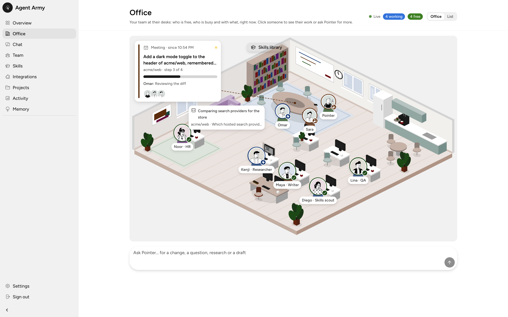
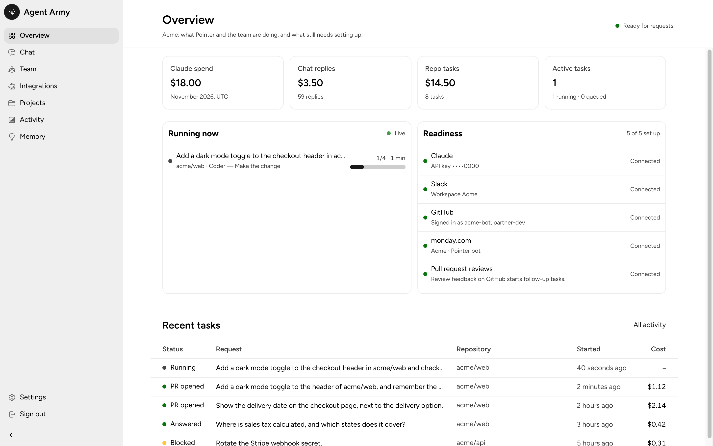
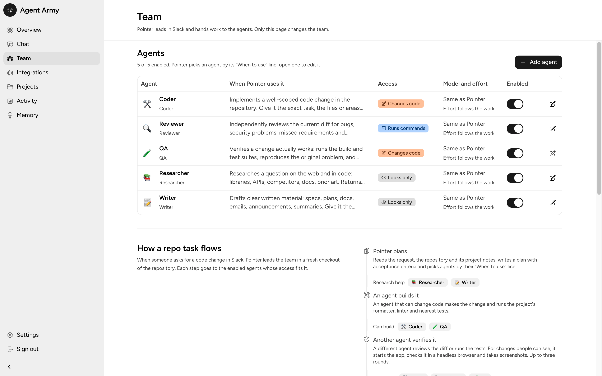
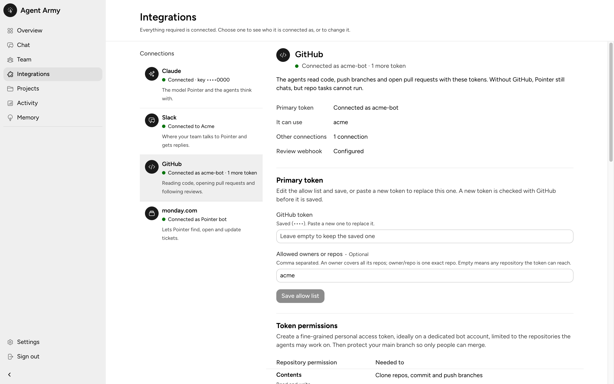
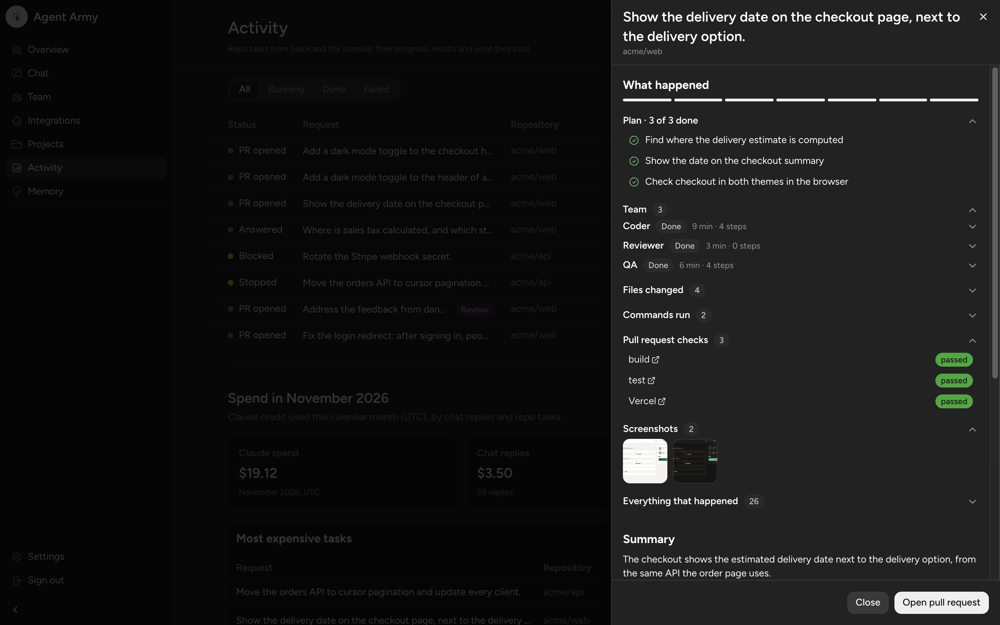
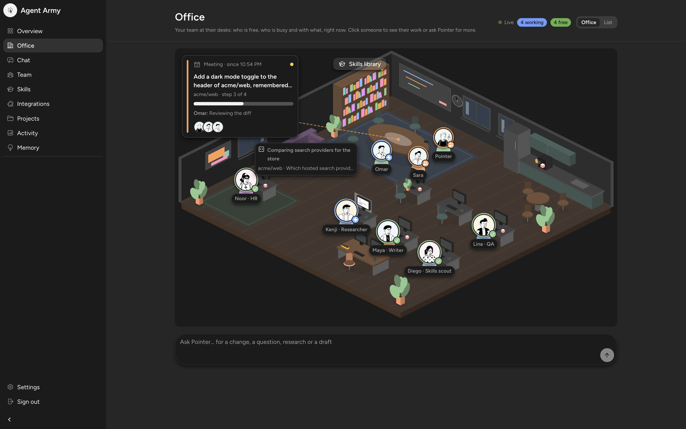
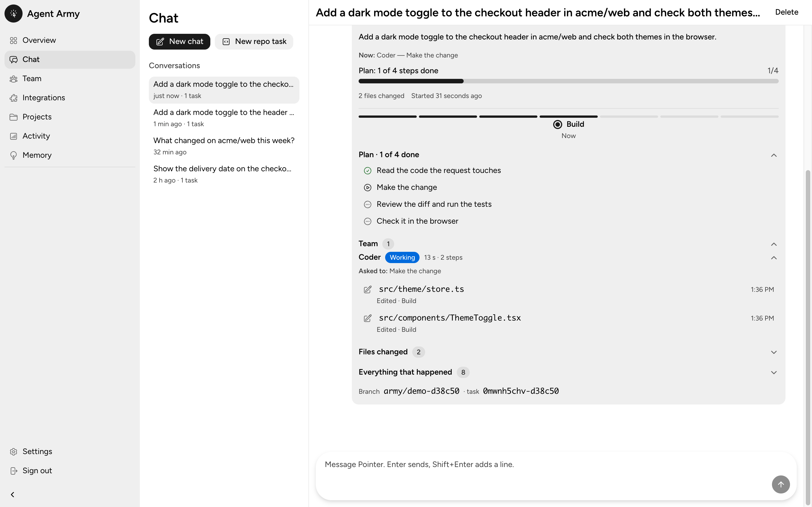
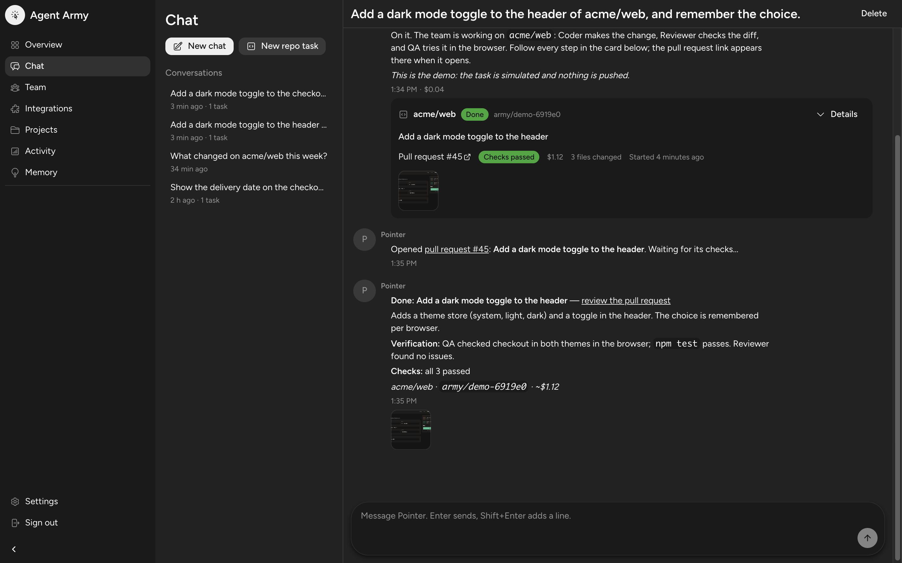
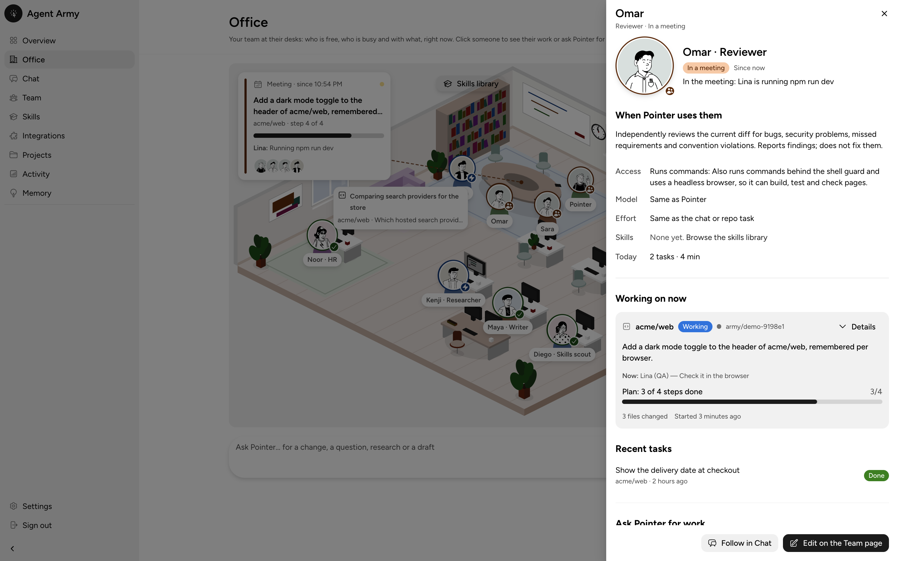

<div align="center">

# Agent Army

**Your own AI engineering team, running in 5 minutes.**

Pointer, a self-hosted assistant for Slack and the web, leads a team of Claude agents that answer questions, research, read your code and turn requests into reviewed pull requests, and you can watch every step while they work.

[](https://github.com/Genpire/agent-army/actions/workflows/ci.yml)
[](https://github.com/Genpire/agent-army/pkgs/container/agent-army)
[](LICENSE)
[](CONTRIBUTING.md)

[Deploy anywhere](#deploy-anywhere) · [Try the demo](#try-the-demo) · [Screenshots](#screenshots) · [How it works](#how-it-works) · [Contributing](CONTRIBUTING.md)



</div>

## Why Agent Army

- **Ask where you already work.** In Slack (DMs, channels, threads) or in the console's Chat page. Pointer answers questions, researches the web, reads GitHub and the files you share, remembers what you tell it, and opens monday.com tickets.
- **A team, not a single bot.** Pointer plans; a Coder builds; a Reviewer and QA check the work. Rename them, edit their instructions, add your own roles and pick a model and effort for each.
- **A virtual office.** See every agent at their desk with a face and a name: who is free, who is busy and on what, and who is in a meeting with Pointer. Click anyone to see their work or ask Pointer for more.
- **HR and a skills library.** HR reviews how the team works and recommends hires, changes and skills; the Skills Scout finds Claude skills, you install them in the team's library and assign them to agents.
- **Watch it work.** Every repo task shows its step (clone, setup, plan, build, verify, publish, checks), the plan as a checklist, what each agent did and for how long, the files and commands, and the result.
- **It checks its own work.** Agents start your app and click through UI changes in a headless browser with screenshots, wait for CI and fix failing checks, open the pull request's real preview deployment (Vercel, Netlify…), and pick up review comments on the pull request.
- **Works with your stack.** GitHub, GitLab or Bitbucket for code; Jira, Confluence and monday.com for tickets; Miro for boards; Genpire for designing real products; and about 140 more apps through their MCP servers (Linear, Notion, Sentry, Stripe, Vercel, Figma, Zapier…), most with a one-click sign-in.
- **Works from your tickets.** Move a Jira issue or a monday.com ticket to "Ready for dev" and the team starts on it; the ticket follows along: In progress, In review with the pull request, Done when it is merged.
- **Spending under control.** A monthly cap and caps per repository, per AI provider and per agent (with what one agent may spend in a single task), each agent's share of every task, alerts in Slack before you hit them, and model routing that sends small tasks to a cheaper model.
- **Humans stay in charge.** Agents only ever open pull requests; they never push to your branches or merge.
- **Yours.** MIT licensed and self-hosted: your code, conversations and keys stay in your deployment. You pay only for the Claude API you use, with per-task budgets.

<a id="run-it-in-5-minutes"></a><a id="deploy"></a>

## Deploy anywhere

Agent Army is one Docker image, `ghcr.io/genpire/agent-army`. It needs a container that stays on, a disk for its data, and about 8 GB of RAM to run 3 repo tasks at the same time (4 GB runs one at a time). Pick a host:

| Where | How | Live in | Per month | Notes |
| --- | --- | --- | --- | --- |
| [Railway](#railway) | Button | 5–8 min | about $10–30, by usage | Fastest: the prebuilt image, with the keys and the HTTPS address made for you. |
| [Render](#render) | Button | 15–25 min | $87–137 | Builds the repository's Dockerfile, so a fork deploys its own code; everything is in `render.yaml`. |
| [A Linux server](#a-linux-server) | One command | 8–15 min | €9–48 for an 8 GB server | Cheapest, and all yours: Docker, the app and automatic HTTPS. |
| [Fly.io](#flyio) | `fly.toml` and 5 commands | 12–20 min | about $54 | For the command line; Fly builds the image for you. |
| [Google Cloud Run](#google-cloud-run) | Button or `deploy/gcp.sh` | 15–25 min | from about $53, plus tasks | Each repo task runs in its own container. |
| [Your computer](#your-computer-docker) | `docker run` | 2 min | free | To try it. Slack needs a public HTTPS address. |
| [Kubernetes, AWS, Azure](#kubernetes-aws-and-azure-experimental) | Helm, CloudFormation, Bicep | – | your cluster; about $101–123; about $46–152 | Experimental: not yet tested on a real account. |

Minutes and prices are estimates for one always-on instance; Claude usage is billed separately, on your Anthropic key.

[](https://railway.com/new/template/TEMPLATE_CODE?utm_medium=integration&utm_source=button&utm_campaign=agent-army)
[](https://render.com/deploy?repo=https://github.com/Genpire/agent-army)
[](https://shell.cloud.google.com/cloudshell/editor?cloudshell_git_repo=https%3A%2F%2Fgithub.com%2FGenpire%2Fagent-army&cloudshell_git_branch=main&cloudshell_workspace=.&cloudshell_tutorial=deploy%2Fgcp-tutorial.md)

> **Not live yet:** the Railway button's `TEMPLATE_CODE` is a placeholder until a maintainer creates the template ([deploy/railway.md](deploy/railway.md)).

**Any Linux server with 8 GB of RAM** (Docker and HTTPS included):

```bash
curl -fsSL https://raw.githubusercontent.com/Genpire/agent-army/main/deploy/install.sh | sh
```

**Vercel and Netlify cannot host Agent Army.** They run short-lived functions: no process stays on between requests, there is no disk to keep data on, and Chromium doesn't fit in a function. Agent Army is one always-on process that keeps its queues in memory, runs repo tasks for hours as child processes, drives a headless Chromium and writes its data to a disk. (The team still checks your own apps' Vercel and Netlify preview deployments; this is only about where Agent Army itself runs.)

### One command: `npm create agent-army`

Run `npm create agent-army@latest`: it checks which provider CLIs you are logged in to, asks once, and deploys the prebuilt image to Fly.io, Railway, Render, Cloud Run, your own server over SSH or local Docker. It generates the keys on your machine, waits until the app answers and prints its address and setup token ([details](packages/create-agent-army/README.md)).

### The first sign-in

1. Open the deployment's address and create the admin account with the **setup token** (where to find it is below), then choose a password.
2. On **Integrations → Claude**, paste your [Anthropic API key](https://console.anthropic.com).
3. Open **Chat** and ask Pointer anything.
4. To have the team change code, connect **GitHub**, **GitLab** or **Bitbucket** on the same page and ask for a change, for example "in owner/repo: add a dark mode toggle". It comes back as a pull request (a merge request on GitLab). Slack and the other integrations are optional: see [Onboarding](#onboarding-in-the-web-page).

| Where | The setup token |
| --- | --- |
| Railway | The service → **Variables** → `SETUP_TOKEN`. |
| Render | The service → **Environment** → `SETUP_TOKEN`. |
| A Linux server | Printed at the end of the install; again: `sudo grep SETUP_TOKEN /opt/agent-army/.env`. |
| Fly.io | Printed by the commands below; again: `fly ssh console --app <name> -C 'printenv SETUP_TOKEN'`. |
| Google Cloud Run | Printed by `deploy/gcp.sh`; again: `gcloud secrets versions access latest --secret agent-army-setup-token --project <PROJECT>`. |
| Docker | The `SETUP_TOKEN` you set, or, when unset, the one in the log: `docker logs agent-army 2>&1 \| grep setup`. |
| Kubernetes | The command that `helm install` prints (it reads the release's Secret). |
| AWS | Secrets Manager → `agent-army/setup-token` (the stack's `SetupTokenSecret` output links to it). |
| Azure | The container app → **Settings** → **Secrets** → `setup-token`. |

`MASTER_KEY` encrypts everything the deployment stores. Each option above creates it once and keeps it (on Azure you pass it yourself); never change it, or the stored data can't be read. The public address that Slack, GitHub and the other webhooks use is found by itself: Railway, Render, Fly.io and Azure name it, the server installer and `deploy/gcp.sh` set it, and otherwise it is each request's own address. Set `PUBLIC_URL` when you add a custom domain. A redeploy restarts the server, which stops the repo tasks that are running: they show as interrupted, and a reply in their thread continues the work (on Cloud Run, tasks run in their own jobs and go on).

### Railway

Click **Deploy on Railway**, sign in with GitHub, choose the Hobby plan and **Deploy**. Railway runs the prebuilt image with a 5 GB volume at `/data`, generates `MASTER_KEY` and `SETUP_TOKEN`, and gives the service an `*.up.railway.app` address. It bills what the service uses: about $10–30 a month, and roughly $0.08 for each hour a repo task runs. To update, redeploy the service. The template is made in Railway, not from a file in this repo: [deploy/railway.md](deploy/railway.md) shows how, for the maintainers and for a fork that wants its own.

### Render

Click **Deploy to Render**, sign in, add a card and **Apply**. The Blueprint, [`render.yaml`](render.yaml), builds this repository's Dockerfile on Render (15–25 minutes the first time) and runs it on a `2c-8g` instance ($135) with a 10 GB disk at `/data` ($2.50), generating both keys. To run one task at a time on a `2c-4g` ($85), change the instance type: the server runs as many tasks at the same time as its memory allows (one on 4 GB, three on 8 GB; `MAX_PARALLEL` overrides it). Deploys are manual (**Manual Deploy**), so a push upstream never restarts your tasks.

### A Linux server

Create an Ubuntu or Debian server with 8 GB of RAM and a 40 GB disk, point a DNS A record at it, make sure ports 80 and 443 are open, then run on it:

```bash
curl -fsSL https://raw.githubusercontent.com/Genpire/agent-army/main/deploy/install.sh | sh
```

[`deploy/install.sh`](deploy/install.sh) installs Docker if it is missing, asks for the domain, and writes `/opt/agent-army`: `.env` (mode 600, with the keys), `compose.yaml` and a Caddyfile. It starts Agent Army behind [Caddy](https://caddyserver.com), which gets and renews a Let's Encrypt certificate, waits for HTTPS, and prints the address and the setup token (never the master key). Run it again to update: it pulls the newest image and keeps the keys, the settings and the data.

- **Without questions**, for example as the server's cloud-init user data: `curl -fsSL …/install.sh | DOMAIN=army.example.com SETUP_TOKEN=a-long-random-string sh`.
- **No domain:** leave it empty to use the server's IP address with a 6-day Let's Encrypt IP certificate. This is experimental; behind 1:1 NAT (Lightsail, EC2) pass `PUBLIC_IP=`.
- **By hand:** the same files are in [`deploy/compose/`](deploy/compose).
- **Servers that fit** (prices checked in November 2026): Hetzner CX33, €8.99 (EU); Lightsail 8 GB, $44 (open port 443 in its Networking tab); DigitalOcean 8 GB, $48.

### Fly.io

Fly has no deploy button; from a clone of this repository (or your fork), with [flyctl](https://fly.io/docs/flyctl/install/) logged in (`fly auth login`):

```bash
fly apps create <name>
fly volumes create agent_army_data --app <name> --region iad --size 20 --yes
SETUP_TOKEN="$(openssl rand -hex 18)"; echo "Setup token: $SETUP_TOKEN"
fly secrets set --app <name> --stage MASTER_KEY="$(openssl rand -base64 32)" SETUP_TOKEN="$SETUP_TOKEN"
fly deploy --app <name> --ha=false --wait-timeout 15m
```

Then open `https://<name>.fly.dev`. [`fly.toml`](fly.toml) runs one always-on Machine (`shared-cpu-4x`, 8 GB, about $54 a month with the volume) and puts the repo checkouts on the volume; it explains the bigger sizes. Update with `fly deploy --app <name> --ha=false`.

### Google Cloud Run

Click **Open in Cloud Shell** for a guided run of the script ([deploy/gcp-tutorial.md](deploy/gcp-tutorial.md)), or, with `gcloud` logged in:

```bash
PROJECT=your-gcp-project REGION=us-central1 ./deploy/gcp.sh
```

The script prints the URL and a one-time **setup token**. It creates a private bucket (encrypted config, memory, project notes and task records), two secrets, two least-privilege service accounts, the web service, and a Cloud Run Job that runs one container per task. Re-run it to update.

| Variable | Default | Purpose |
| --- | --- | --- |
| `PROJECT` | your gcloud default | GCP project. |
| `REGION` | `us-central1` | Region for every resource. |
| `NAME` | `agent-army` | Resource name prefix; the job is `<NAME>-worker`. |
| `MIN_INSTANCES` | `1` | Web instances kept running. `0` scales to zero when idle: the first message afterwards waits for a cold start, and the routines' clock stops. |
| `IMAGE` | built with Cloud Build | An image to deploy instead, such as the published `ghcr.io/genpire/agent-army:latest` (skips the build). |
| `PUBLIC_URL` | the service's URL | The address Slack and the webhooks use; set it for a custom domain. |

The web service runs with 2 vCPU, 4 GiB (`SERVICE_CPU` / `SERVICE_MEMORY`) and **CPU always allocated** (Pointer keeps working after Slack has its HTTP 200, and the Agent SDK runs as a subprocess), as a **single instance** that stays up (per-thread queues and event dedupe live in memory). That costs about $110 a month; 1 vCPU and 2Gi cost about $53. Claude usage is billed separately, capped per message and per task (see below). The worker job runs each task with 8 vCPU and 8 GiB (`JOB_CPU` / `JOB_MEMORY`), billed only while a task runs, for at most 3 hours (`JOB_TIMEOUT_MIN`, default 180): the team's own run stops after 50 minutes, and waiting for CI checks, fix rounds and publishing come after it.

**Smoke test.** Once Claude is connected, check the deployment without Slack. This runs Pointer once inside the worker job, with the real config, team and memory. Repo tasks are disabled and nothing is posted to Slack.

```bash
gcloud run jobs execute agent-army-worker --region REGION \
  --args=dist/smoke.js,"what is the last commit on owner/repo" --wait
```

The execution fails when Pointer returns an error. To read the reply, take the execution name the command prints (or find it with `gcloud run jobs executions list --job agent-army-worker --region REGION`):

```bash
gcloud logging read 'resource.type="cloud_run_job" AND resource.labels.job_name="agent-army-worker" AND labels."run.googleapis.com/execution_name"="EXECUTION_NAME"' \
  --freshness 1h --order asc --format 'value(textPayload)'
```

The output is `--- reply ---`, the answer, then `--- cost: $… · error: …`. Logs can take a few seconds to appear. For a question that contains a comma, use gcloud's alternate delimiter: `--args='^;^dist/smoke.js;what changed, and why'`.

<a id="anywhere-else-vm-laptop-kubernetes"></a>

### Your computer (Docker)

You need Docker. Keep `agent-army.env`: its key decrypts the data, so a new container must get the same one.

```bash
echo "MASTER_KEY=$(openssl rand -base64 32)" > agent-army.env
docker run -d --name agent-army --restart unless-stopped --init --shm-size 1g \
  -p 8080:8080 -v agent-army-data:/data --env-file agent-army.env ghcr.io/genpire/agent-army:latest
docker logs agent-army 2>&1 | grep setup     # prints the one-time setup token
```

Then open http://localhost:8080 and follow [the first sign-in](#the-first-sign-in). Or, from a clone, with Docker Compose (it builds the image from your code):

```bash
cp .env.example .env          # set MASTER_KEY=$(openssl rand -base64 32)
docker compose up -d --build  # then open http://localhost:8080
```

Workers run as child processes of the server (`RUNNER=local`). Slack needs to reach `/slack/events` over public HTTPS, so put a TLS proxy or a tunnel in front, or use one of the hosts above. Smoke test: `docker compose exec agent-army node dist/smoke.js "introduce yourself"`.

### Kubernetes, AWS and Azure (experimental)

These are drafted and pass their linters (`helm lint`, `cfn-lint`, `bicep lint`) but have not yet been tested on a real cluster or account. If you try one, please open an issue with what happened.

- **Kubernetes:** a Helm chart, [`deploy/helm/agent-army`](deploy/helm/agent-army): one replica with a persistent volume, the keys in a Secret that upgrades keep.

  ```bash
  helm install army ./deploy/helm/agent-army --namespace agent-army --create-namespace \
    --set ingress.enabled=true --set ingress.host=army.example.com
  ```

  For TLS with cert-manager, see the top of its `values.yaml`.
- **AWS:** a CloudFormation template, [`deploy/aws/agent-army.yaml`](deploy/aws/agent-army.yaml), for ECS Express Mode on Fargate (2 vCPU / 8 GB, data on EFS, keys in Secrets Manager); the deploy command is at the top of the file.
- **Azure:** Container Apps, [`deploy/azure/main.bicep`](deploy/azure/main.bicep) (and `azuredeploy.json`), with the data on an Azure Files share. Replicas stop at 4 vCPU / 8 GiB, so run 1–2 tasks at a time. You pass the master key yourself and must pass the same one on every redeploy.

### In a fork

The buttons and commands above deploy this repository's code or image. To deploy your fork's:

- **Image:** the release workflow publishes `ghcr.io/<you>/agent-army` (`latest` from `main`, and a version for each `vX.Y.Z` tag). A new GitHub package is **private** even in a public repository: after the first release run, open the package on GitHub → **Package settings** → **Change visibility** → **Public**. Then use your image: `AGENT_ARMY_IMAGE=ghcr.io/<you>/agent-army:latest` for the server installer, `image =` in `fly.toml`.
- **Render and Cloud Shell:** put your fork's URL in the buttons' links (`repo=` and `cloudshell_git_repo=`).
- **Railway:** a template deploys its own source, so make your own ([deploy/railway.md](deploy/railway.md)).

## Try the demo

See the whole console with sample data, without any account or key:

```bash
git clone https://github.com/Genpire/agent-army.git && cd agent-army
npm install && npm run demo
```

Open http://localhost:8080 and sign in with `agent-army-demo`. The demo seeds a fictional company with tasks, conversations, memory and project notes, and runs a simulated team: ask for a change in Chat and watch it go from plan to pull request. Nothing is sent to Claude, Slack or GitHub.

## Screenshots

| | |
| --- | --- |
|  |  |
| **Overview:** spend, what is running now, readiness and recent tasks. | **Team:** who does what, their access and models, and how work flows. |
|  |  |
| **Integrations:** every connection, who it is connected as, and how to set it up. | **Activity:** every task's full story: plan, team, files, checks, screenshots. |
|  |  |
| **Office:** who is free, who is busy and on what, and who is meeting with Pointer. | **Chat:** ask Pointer anything; tasks show every step live. |
|  |  |
| **Chat:** results arrive as messages, with the pull request and checks. | **Each agent:** what they do, their access and skills, and what they are on right now. |

## How it works

- **Pointer:** talk to it in a DM, in channels you mark as Pointer channels, or in any thread it is part of. It answers questions, researches the web, reads GitHub and the files you share (designs, code, screenshots, PDFs, zips), remembers facts you give it, opens and updates monday.com tickets (optional), and hands work to its team. Built on the Claude Agent SDK.
- **The team:** agents you list, name, edit and create on the admin page, for any role: engineering (Coder, Reviewer, QA, Failure Reviewer) or not (Researcher, Writer). Pointer picks the agent whose description fits the job.
- **Code changes:** any change to a repo runs as a task in its own isolated worker: clone, Pointer and the team work on a branch, then the platform opens a pull request, waits for its CI checks and has the team fix failing ones. Agents can check UI changes in a headless browser and post screenshots in Slack. With the GitHub webhook set up, review comments on the pull request start a follow-up. Each agent learns the project from the repo itself (CLAUDE.md, README, scripts, CI) and from the team's **project notes**, which every task reads at the start and updates at the end, and from its **lessons library**: the mistakes earlier tasks made there, which the team reads before it works on an area.
- **Admin console chat:** talk to Pointer and start repo tasks from the admin page too, with Pointer's steps and the team's work shown live (see [Using it from the admin console](#using-it-from-the-admin-console)).
- **Standalone:** deploy the container, open the URL, and the onboarding page walks you through connecting Claude, Slack and GitHub. Nothing is hard-coded to one company; to use it elsewhere, deploy it again there.
- **Humans stay in charge:** agents only ever open pull requests. They cannot push to protected branches or merge.

```
Slack (DM, Pointer channel, thread, @mention)  ·  admin console (Chat page)
   │
   ▼
web service: Pointer ─── web search · GitHub (read) · memory · project notes · monday.com · team agents
   │ code change? start a repo task
   ▼
one isolated worker per task
   ├─ clone repo, new branch, run the repo's setup command
   ├─ read project notes and lessons, Pointer ⇄ the team (Coder, Reviewer, QA, …), headless browser for UI checks
   ├─ push branch, open PR (a draft if the task stopped early), wait for CI, fix failing checks
   └─ update project notes, save new lessons, report in thread (or the console) with screenshots

GitHub: review or /pointer comment on the team's PR ──webhook──► follow-up task in the same thread or conversation
```

## Onboarding (in the web page)

1. **Admin account**: paste the setup token, choose a password.
2. **AI model** (Integrations): an Anthropic API key, or Claude on a cloud or another provider (see [AI providers](#ai-providers)). Use a dedicated key with a spend limit.
3. **Slack** (Integrations, optional if you only use the console): click *Create Slack app* (the manifest is pre-filled with this deployment's URL and Pointer's name), install it to your workspace, paste the Bot User OAuth Token and Signing Secret. Invite Pointer to the channels where you want it. Optionally, paste your own User OAuth Token under *Your Slack account* so Pointer can send as you and report what needs your reply (see [Your Slack account](#your-slack-account)).
4. **GitHub** (Integrations): a fine-grained personal access token, ideally on a dedicated bot account, limited to the repos the agents may touch, with *Contents: read/write*, *Pull requests: read/write*, *Metadata: read*, and for the [CI checks](#ci-checks) loop *Checks: read*, *Commit statuses: read* and *Actions: read*, and for [preview checks](#preview-checks) *Deployments: read*. Optionally restrict it to owners or exact repos. For repos outside your organisation, add more tokens under *Other GitHub connections* (see [GitHub connections](#github-connections)). Without GitHub, Pointer still chats; GitHub questions and repo tasks say GitHub is not connected. Optionally add the webhook for [pull request reviews](#pull-request-reviews) on the same pane.
5. **GitLab** or **Bitbucket** (Integrations, optional, instead of or next to GitHub): see [GitLab and Bitbucket](#gitlab-and-bitbucket).
6. **monday.com**, **Jira & Confluence**, **Miro**, **Genpire** (Integrations, optional): so Pointer can open and update tickets, read and draw on boards, and design products. See [monday.com](#mondaycom), [Jira and Confluence](#jira-and-confluence), [Miro](#miro) and [Genpire](#genpire).
7. **Apps** (Integrations, optional): connect Linear, Notion, Sentry, Stripe, Vercel, Figma, Zapier and about 130 more through their MCP servers. See [Apps](#apps).
8. **Projects** and **Settings** (optional): channel → default repo and Pointer channels (Projects), who may talk to Pointer, budget and turn limits per task, how long the platform may spend running the team's checks again, how long to wait for CI checks and how many fix rounds to run (Settings). Per repo, **Projects → Repo setup** holds a setup command, a test command, how to start the app and environment variables (see [Repo setup](#repo-setup)).
9. **Team** (optional): rename Pointer, give it extra instructions, edit or add agents.

Every credential is verified before it is saved, stored encrypted (AES-256-GCM with `MASTER_KEY`), and never sent back to the browser.

**Forgot the admin password?** On the sign-in page, choose **Forgot your password?** and paste the setup token to set a new one. [The first sign-in](#the-first-sign-in) shows where each host keeps it; on Cloud Run it is in Secret Manager: `gcloud secrets versions access latest --secret <NAME>-setup-token --project <PROJECT>` (`agent-army-setup-token` by default). Elsewhere it is the `SETUP_TOKEN` you set, or, when unset, the one printed in the server log at startup (`docker logs agent-army 2>&1 | grep setup`). A new password, from a reset or from **Settings → Admin password**, signs out every other session.

## AI providers

Pointer and the team run on the Claude Agent SDK, which can talk to Claude through Anthropic's API, through a cloud, or to another provider's Anthropic-compatible API. Set it up on **Integrations → AI model**: pick a provider, fill in what it needs, choose the model for each tier, then **Test and save**. Two switches choose what each provider runs:

- **Use for chat**: Pointer's replies in Slack and the console, and the console's own calls (HR reviews, the Skills Scout).
- **Use for repo tasks**: the team in the worker, including the size estimate of [model routing](#model-routing).

Chat and repo tasks can run on different providers. Anthropic is the default for both. Every save tests the connection first: one `POST /v1/messages` with `max_tokens: 1` for an Anthropic-compatible endpoint, or one short Agent SDK turn for a cloud. Keys are stored encrypted with the rest of the config, shown only masked, and redacted from everything the platform posts and logs.

**Routes and fallback.** Each kind of work can have an ordered list of up to 4 providers, its route: **chat** (Pointer's replies in Slack and the console), **routines** (scheduled routine runs), **repo tasks** (the team in the worker, its size estimate included) and **light work** (HR reviews, the Skills Scout, the office's talk when it runs on the chat model). A kind without a route of its own runs on the chat provider (chat, routines, light work) or the repo task provider alone, as before; saving the chat or repo tasks route makes its first provider the chat or task provider. The work runs on the first provider of its route that is connected and under its monthly [cap](#caps); when a run fails for the provider's own reasons (a rate limit, credit used up, a rejected key, the service down or overloaded, a model it does not have), the next one takes over. A chat reply or routine run moves on only if no tool has run yet in it (a retry could send a Slack message or open a ticket twice); when it cannot, the error says what happened. A repo task's team runs again on the next provider from the checkout as the failed run left it, told what happened (and which browser actions the failed run already took, so they are not done twice), within what is left of the task's budget, of that provider's monthly cap and of the task's time; a provider whose cap leaves too little is skipped. A repo task does not move on once its team has used an app's tool that changes things (a second run could do it twice): it stops and says which. Fix rounds run on the provider that did the work, and each provider's part of a task's cost counts against its own cap. Light work, which changes nothing, always moves on. A provider already in a route stays there while its connection is not ready (it is skipped until it is), so the route can still be reordered or cut down; only a provider a save adds must be connected. The console shows a line when a reply moved to another provider ("Kimi failed (rate limited); Claude is answering instead."), and the task's timeline when a task did; Slack replies are not changed.

**Best effort.** Anthropic [does not support](https://code.claude.com/docs/en/llm-gateway) non-Claude models behind Claude Code. DeepSeek, Qwen, Kimi, GLM, Gemini, and anything non-Claude behind a custom endpoint, work in practice but are best effort: try a few tasks before relying on one.

**Gemini through the built-in bridge.** Gemini has no Anthropic-compatible API, so the platform translates: a small server inside the service (and inside each repo task's worker) listens on `127.0.0.1` only, takes Claude Code's Anthropic Messages requests (streamed or not, with tools, images, PDFs and thinking) and calls the Gemini API with your AI Studio key. Claude Code never gets the key: each query gets a random session token that works only on that address and only until the query ends, and the token is redacted like the other secrets. A repo task's shell has the token too (the checkout's own code could use it), so each session may have at most 8 requests in flight and 10,000 in all; past either, the bridge answers 429. Gemini's thought signatures are carried between turns, Gemini's errors come back as Anthropic's (a rate limit as a rate limit), so [routes and fallback](#ai-providers) work on it, and its prices are passed on for budgets. Claude Code's own web search and prompt-caching discounts do not apply. Use it as one step of a route (for example light work on Gemini first, Claude after it) until you have seen it do your kind of work. The Claude presets (Anthropic, Bedrock, Vertex AI, Google Cloud, Foundry) are supported by Claude Code itself.

| Provider | What it needs | Web search | PDFs | Images | Effort | Thinking off |
| --- | --- | --- | --- | --- | --- | --- |
| Anthropic | API key | yes | yes | yes | all levels | yes |
| Amazon Bedrock | region; a Bedrock API key, or an access key ID and secret (and session token) | **no** | yes | yes | all levels | yes |
| Google Vertex AI | project ID, region (`global` by default); a service account key (`roles/aiplatform.user`), or the service's own Google credentials | yes | yes | yes | all levels | yes |
| Google Cloud (Anthropic managed) | project ID, workspace ID (`wrkspc_…`), location; a service account key (`roles/claude.user`), or the service's own credentials | yes | yes | yes | all levels | yes |
| Microsoft Foundry | resource name, API key; deployments named after the model ids | yes | yes | yes | all levels | yes |
| DeepSeek | pay-as-you-go API key | yes | **no** | Flash only | low, high, max | yes |
| Alibaba Qwen (Model Studio) | region, pay-as-you-go workspace ID (needed in the US, Germany and Japan), API key (`sk-…`; Coding Plan keys are refused) | yes | yes | yes | low, high, xhigh | yes |
| Kimi (Moonshot) | platform (international or China), pay-as-you-go API key | **no** | **no** | yes | low, high, max | **no** (always thinks) |
| Z.ai GLM | platform (international or China), Standard API key | **no** | **no** | Flash only | low, high, max | **no** (always thinks) |
| Gemini (Google AI Studio) | API key (`AQ.…` or `AIza…`); runs through the platform's built-in bridge | **no** | yes | yes | low, medium, high, xhigh | **no** (Gemini 4 always thinks) |
| Custom endpoint | `https://` base URL without `/v1`, token (as `Authorization: Bearer` or `x-api-key`), optional extra headers (`ANTHROPIC_CUSTOM_HEADERS`), models typed by hand, optional prices | off by default | depends | depends | all levels | depends |

What the platform does for each provider:

- **Its own environment only.** Each query's environment replaces the service's own: it holds this provider's credentials and nothing else. For every provider, Anthropic included, it sets `CLAUDE_CODE_PROVIDER_MANAGED_BY_HOST=1` (a repository's `.claude/settings.json` cannot redirect the endpoint or keys). For every provider other than Anthropic it also sets `ANTHROPIC_API_KEY=""` and `CLAUDE_CODE_DISABLE_NONESSENTIAL_TRAFFIC=1`, plus what the provider's own Claude Code guide asks for (context windows, timeouts, `CLAUDE_CODE_DISABLE_STRUCTURED_OUTPUTS=1` for DeepSeek and GLM). A Google service account key is written to a private file (`0600`, in a fresh `0700` folder in the system temp folder, never in a checkout) for the length of the query and removed after it; folders left by a process that died first are removed when the service or a worker next starts. Private means other OS users cannot read it: anything running as the service's own user can, including the agents' shell and the repository's code in repo tasks (see [Security model](#security-model)).
- **Saved keys stay where they were tested.** Changing where a provider's secrets are sent (a custom endpoint's base URL, Foundry's resource, the region of Bedrock, Qwen, Kimi or GLM, Qwen's workspace) needs them pasted again in the same save or test: a saved key is never sent to a new address. The secrets are redacted from everything the platform posts and logs in the forms a tool may print them in too: a Google key's private key and each of its lines (as `jq` or `python -m json.tool` lay the file out), and each extra header's value. The key file's `client_email` stays readable: it is not secret on its own and names the account whose permissions to fix.
- **Every model tier mapped.** `ANTHROPIC_MODEL` (the main tier), `ANTHROPIC_DEFAULT_OPUS_MODEL` (and `_FABLE_`), `_SONNET_`, `_HAIKU_` and `CLAUDE_CODE_SUBAGENT_MODEL`, from the preset's defaults or your choices. A Claude model set anywhere (the Team page, routing, Haiku for the size estimate) runs on the tier of the same size: `claude-sonnet-5-5` on Kimi runs Kimi's medium model. Other ids are sent as they are. On another provider, the model on the Anthropic card is not used: the main tier is.
- **What it cannot do is turned off.** WebSearch is left out where the provider has no search (the Skills Scout then reads pages with WebFetch); an effort the provider does not take goes to the nearest one it does; a PDF or image shared in chat that the provider cannot read becomes a line saying so.
- **Budgets mean something.** Claude Code prices Claude models itself. For the other presets the platform passes their prices (USD per million tokens) as `managedSettings.modelPricing`, so `Budget per task`, the per-message budget and the [caps](#caps) count real money. The prices were checked on each provider's pages on 2026-11-20; DeepSeek's are its peak rates (off-peak is half) and Qwen's are Singapore's. For a custom endpoint, give its input and output prices, or Claude's list prices (or a guess, for unknown models) apply.
- **Coding-plan keys are not for this.** Alibaba's Coding and Token Plans, Z.ai's GLM Coding Plan and Kimi Code memberships are for people using coding tools themselves, not for a backend like this one: use pay-as-you-go keys.

**Model lists come live from each provider.** Every model field (the tiers on **Integrations → AI model**, the Team page's agent and chat models, [model routing](#model-routing)'s sizes, and the Codex and Gemini CLI models) is a searchable picker. When it opens, it loads that provider's own model list with the saved key, on the server: Anthropic (`GET /v1/models`, every page, names from `display_name`), DeepSeek (`GET /models`), Kimi (`GET /v1/models` on its platform), Qwen (Model Studio's `GET /api/v1/models` on your workspace's host), a custom endpoint (`GET <base>/v1/models`, through the same network guard as its connection test), and for the engines OpenAI (`GET /v1/models`, its GPT, o-series and Codex models) and Google (the Gemini models that `generateContent`, so Gemini 4 Carbon, Neon, Argon and Hydrogen show when the key can use them). Embedding, speech, image and video models are left out. A list is kept for an hour per provider and key (keyed by a hash of the credentials, never the key itself); **Refresh list** reads it again. Where a list cannot be read live (not connected yet, the call failed, or the provider has none this service can read: Bedrock needs AWS request signing, Vertex AI and Google Cloud a Google sign-in, Foundry lists deployments, Z.ai has no list API), the picker shows the built-in list and says why. Any model id can also be typed by hand; it is checked with the same rule as on the server. A compatible provider's model with a 1M-token window gets Claude Code's `[1m]` marker, as the presets' own models do. A model from a live list that the preset has no price for is budgeted the way Claude Code prices an unknown model (a guess), as on a custom endpoint without prices.

In repo tasks the task provider's credentials are also the agents' shell environment, as Anthropic's key always was: an agent, or code it runs, can read them (see [Security model](#security-model)). Use a dedicated key with a spend limit on every provider.

Left out for now: MiniMax (only `tool_choice: auto`; caching, PDFs and structured output undocumented), Ollama (needs a GPU host; no caching, PDFs or `tool_choice`), and GPT or Gemini inside Claude Code (unsupported; the Codex and Gemini CLI integrations run them as team members instead).

## GitHub connections

Pointer can hold several GitHub tokens: the primary one on **Integrations → GitHub**, plus up to 10 more under **Other connections** on the same pane. Each has its own allow list.

- **Allow lists** are comma separated, and each entry is an owner (`your-org`: every repo of that organisation or user) or an exact repo (`someone/some-repo`). Empty means any repository the token can reach.
- **Which token is used:** for a repo, the most specific match wins: an exact repo entry, then an owner entry, then a connection with an empty allow list. A repo that no connection allows is refused, for GitHub reads and repo tasks alike.
- **When to add one:** for a repository outside your organisation, for example a private repo on someone's personal account. GitHub's fine-grained tokens only cover one owner, so a token made for your organisation cannot reach it. Add a token that can: a fine-grained token created by the repo's owner (same permissions as above, limited to that repo), or a classic token with the `repo` scope. Then limit the connection to the exact repo (`someone/some-repo`); a classic token reaches everything its user can, so the allow list is what keeps Pointer to that one repo.
- **Checks:** a new token is verified with GitHub, and each exact repo in its allow list must be reachable with it ("This token cannot reach someone/some-repo." otherwise). Editing a connection's allow list checks its exact repos the same way. Owner entries are not checked.
- The page shows each connection's GitHub user, the last four characters of its token and its allow list, which you can edit in place. Removing one takes two clicks.

## Using it from the admin console

The **Chat** page (second in the admin page's menu, `#/chat/<conversation>`) is a second way to talk to Pointer, next to Slack. Only the signed-in admin uses it, and Slack is not needed for it: Claude is enough to chat, and GitHub to start repo tasks.

- **Conversations.** Start one with a message; Pointer answers with the same brain, tools and team as in Slack (web search, GitHub, memory, project notes, monday.com, repo tasks, and [Slack messages](#slack-tools) when Slack is connected) and within the same limit of answers at once. The list keeps your conversations, newest first; deleting one takes two clicks. A new message waits until Pointer has answered the last one.
- **Live while Pointer answers.** The reply appears as it is written, with each step Pointer takes ("Searching the web for …", "Reading acme/web: src/app.tsx", "Asking Rita (Researcher)…", "Starting a repo task on acme/web"). The finished reply keeps its steps ("Used 5 tools") and its cost.
- **Repo tasks.** Ask for a change in the chat and Pointer starts a repo task, or use **New repo task** to start one directly (a repository and an instruction; same checks as Slack: GitHub connected, allow lists). Each task appears as a card in the conversation: its status, what the team is doing now, the plan, the pull request, the checks, the cost and the screenshots from browser checks. Open it for the full timeline: the steps (clone, setup, plan, build, verify, publish, checks), each agent's work and how long it took, files changed, commands run, the checks the platform ran again next to the team's claims, each CI check's state, and the screenshots full size.
- **No Slack thread.** A task started from the console has no Slack thread: its progress, result (summary, verification, risks, checks), screenshots and milestones (pull request opened, checks failing and being fixed, done, stopped with a draft) are in the conversation and on the pull request. Reply in the conversation (for example `continue`, or "how is it going?") and Pointer follows up on the same branch, as in a Slack thread. Reviews and `/pointer` comments on its pull request start follow-ups in the conversation (with the GitHub webhook set up).
- **Screenshots** from browser checks are kept for every task, Slack ones included, encrypted in the store, so the console shows them for any task.

### Files, images and voice messages

- **Files and images.** Attach them with the paperclip, paste an image into the message box, or drop files anywhere on the conversation. Each one uploads right away and shows as a chip (a thumbnail for images) with its progress, its size and a remove button; a file that is refused stays as a red chip that says why (too large, too many, or named like an image, audio, a PDF, a zip or text but not one). A message can be files only. In the conversation, images show as thumbnails that open full size, and other files as chips that download them. Pointer reads them exactly as it reads Slack files (see [Files you share](#files-you-share)): text and code as text, images as images, PDFs as documents, zips unpacked. Repo tasks started from the conversation get them in their `attachments/` folder.
- **Voice messages.** The microphone records a voice message (WebM/Opus, or MP4/AAC in Safari) with a timer and a stop button, up to 10 minutes. When you stop, it is uploaded and transcribed, and the transcript is put in the message box for you to check and edit before sending; the recording is attached to the message as a voice note with a player. Pointer reads the transcript, never the audio ("Voice message (transcript): …"), and is told when a voice message could not be transcribed. The browser asks for the microphone once; if access is denied, or the browser cannot record (or the console is not on https), the composer says so.
- **Transcription.** It uses the first connected of: **OpenAI** (the key on **Integrations → Codex**; model `gpt-transcribe`, falling back to `gpt-4o-mini-transcribe`), then **Gemini** (the key on **Integrations → Gemini CLI**; `gemini-3.5-flash-lite` with the audio inline in `generateContent`, falling back to `gemini-2.5-flash-lite`). If one fails, the other is tried. Both detect the language themselves: Arabic, English and a mix of the two work without a setting. With neither connected, voice messages are sent as audio only, and the composer offers the browser's own live dictation (where the browser has speech recognition) in the page's language, or Arabic when the browser prefers it.
- **Cost.** Transcription is billed by OpenAI or Google on that key (OpenAI lists `gpt-transcribe` at $0.0045 per minute; Gemini bills audio input by the token, about 1 920 tokens a minute), outside Pointer's Claude spend caps. A voice message is transcribed once; the transcript is kept with it.
- **Limits.** 20 MB per file, 10 files per message, 40 per conversation (uploads and files Pointer attaches together), 10 minutes per recording. Transcription takes recordings up to 25 MB on OpenAI and about 14 MB on Gemini (its 20 MB request limit with base64).
- **Privacy.** Files, recordings and transcripts are stored encrypted with `MASTER_KEY` like Slack files (`attachments/web-<conversation>/`), and deleting the conversation erases them. They are served only to the signed-in admin and only for their own conversation: images inline with the type read from their bytes, everything else as a download (`application/octet-stream`, audio with its own type) with `X-Content-Type-Options: nosniff` and a sandboxing CSP. The type of every upload is decided from its bytes, never from the browser's word alone. The audio and the transcripts are sent only to the transcription service, and are never logged.

## Using it from Slack

### Where Pointer answers

| Where | When it answers | Where the reply goes |
| --- | --- | --- |
| A DM with Pointer | Every message | Inline (no thread) |
| A Pointer channel | Every message | In a thread |
| A thread Pointer has posted in | Every reply | In the thread |
| Any other channel it is in | Only when @mentioned | In a thread |

Pointer reacts with :eyes: while it works, then :white_check_mark: or :x:. Messages in the same thread are handled in order. If you restrict who may talk to Pointer, others are ignored; if they @mention it, they get one "not allowed" reply.

Pointer only answers in conversations its bot is in. Once [your own Slack account](#your-slack-account) is connected, Slack also sends Pointer your DMs and group DMs with colleagues and the channels you are in without it: Pointer reads those into your inbox and never answers, reacts or thinks about them as requests, even when they mention it. While your account is connected, Pointer asks Slack (with the bot's token, cached a few minutes) whether each conversation is its own before it answers, and logs one line, with the conversation's id and never the text, for each message it leaves unanswered; without your account it asks nothing.

### What it can do

| You say | What happens |
| --- | --- |
| `what's new in the latest Node.js release?` | Searches and reads the web, cites sources |
| `what changed in owner/repo this week?` | Reads commits, pull requests and issues on GitHub |
| `where is PDF export implemented in owner/repo?` | Searches and reads the code on GitHub, changes nothing |
| `remember that staging deploys go through owner/infra` | Saves a fact to memory |
| `remember for owner/repo that e2e tests need Docker` | Adds a line to that repo's project notes |
| `open a ticket for the login bug on the Bugs board` | Creates a monday.com item with the details from the conversation (monday.com connected) |
| `move ticket 1234567890 to Done and note the fix is in PR #42` | Updates the item's columns and adds a comment |
| share `Chat Section.html`, `Mobile-html.zip` and a screenshot: `what's off in the mobile layout?` | Reads the files and answers (see [Files you share](#files-you-share)) |
| `what's open on gitlab:acme/web?` | Lists merge requests and issues on GitLab (likewise `bitbucket:…`) |
| `which Jira bugs in WEB are still open for the release?` | Searches Jira with JQL and reads the issues |
| `draw our deploy pipeline on the Architecture board` | Draws a diagram on Miro |
| `in Genpire, design a canvas tote bag with our brand style` | Designs the product in Genpire and links to it (Genpire connected) |
| `remind me on Slack to check customer credits` | Sends you a DM from Pointer (see [Slack tools](#slack-tools)) |
| `what needs my attention on Slack?` | Lists who waits for your reply, with links (your own account connected, see [Your Slack account](#your-slack-account)) |
| `tell Dana on Slack that the deploy is done` | Finds Dana in the workspace, asks which Dana if several match, and sends her a DM with a link back |
| `did Dana answer?` | Says whether Dana answered the message Pointer sent her for you, quoting her answer (your own account connected, see [Answers to what Pointer sends for you](#your-slack-account)) |
| `which Sentry errors spiked since yesterday?` | Uses a connected app (here Sentry) through its MCP server |
| `who's on the team?` | Describes the agents |
| `fix the flaky checkout test` | Starts a repo task on this channel's default project |
| `in owner/repo: add rate limiting to /api/login` | Starts a repo task on that project |
| `every morning at 8, email me what happened on GitHub yesterday` | Creates a [routine](#routines): a read-only report on that schedule, to the recipients you name |
| reply in the task's thread: `also cover the empty case` | Continues on the same branch and PR |
| reply in a stopped task's thread: `continue` | Resumes the unfinished work on the same branch and draft PR |
| on GitHub, request changes on the team's PR, or comment `/pointer rename the flag` | Starts a follow-up task in the task's thread (webhook set up, see [Pull request reviews](#pull-request-reviews)) |

Pointer hands a question to a team agent when the agent's description fits (in conversation, agents can only search the web and read GitHub). For any code change, Pointer starts a repo task: on the repo you name, else the one this thread already works on, else the channel's default; when there is none, it asks.

### Slack tools

Slack is also a tool Pointer uses, from Slack and from the admin console's chat, whenever Slack is connected:

- **Find people** (`slack_find_user`): by @handle, display name or real name, with their title and whether they are a bot, deactivated or a guest. Pointer uses it to answer "who is …" questions; to message someone it needs no lookup. Emails are never read (the app has no `users:read.email`).
- **Send a message** (`slack_send_message`): a DM from Pointer to a person, to yourself ("me"), or a post in a channel Pointer is in and only when you ask for that channel. A person can be named as you would say it ("send to Dana Levi on Slack …", "@dana"): the tool finds them in the member directory and sends when exactly one active person matches; when several do it sends nothing and Pointer asks you which one, listing their user ids and @handles (never their real names or titles: those are free text people write). In the console, "me" is your own Slack account once you have connected it; until then Pointer sends to the name you give. Each message is in Slack formatting, at most 4 000 characters, ends with a small "Sent by Pointer at Dana's request" line, never pings `@here` or `@channel`, does not unfurl links, and Pointer replies with its link.
- **Send as you:** when you have connected your own Slack account and allow sending as you, Pointer can send from your account when you ask ("from my account", "as me", "in my DM", or the id of your own DM, `D…`): a DM to a person, a message in one of your DMs, or a post in a channel you are in. It is your own message, so it has no "Sent by Pointer" line; `@here` and `@channel` are still sent as plain words. Only your own requests can do this (the console, or your DM with Pointer from your account; not a channel thread or a group DM, where other people's messages are part of what Pointer reads); nobody else talking to Pointer is offered it. Without it, a `D…` id of your own DM cannot be used: Pointer is not in that conversation, so it asks for the person instead.
- **Find a channel** (`slack_list_channels`): by name, the ones Pointer is in first. To post in a channel Pointer is not in, invite it there first.
- **Confirmation:** a message to anyone but you, after Pointer has read outside content in the same answer (web pages, tickets, apps, and Slack's member directory itself), needs your "yes" first, like other writes; so does any message sent as you, whoever it goes to. Pointer then shows you the exact recipient (with the user id) and the full text, and a short reply such as "yes", "send it", "ok send" or "ابعتها" sends exactly that; "don't send", "send it later" or a question ("send it?") does not. A reply made only of send words ("send it", "ابعتها") confirms only the held messages: anything else held in the same conversation (a routine change, an app write) needs a plain "yes". "Tell Dana Levi that …" with nothing read before goes at once, and "remind me" never waits.
- **Allowed users:** when the Slack allowlist is set, Pointer only sends DMs to the people on it.

Finding channels needs the `channels:read` and `groups:read` scopes: apps created before this feature must update their manifest (see [Updating an existing Slack app](#updating-an-existing-slack-app)); finding people and sending messages work without it.

### Your Slack account

Optionally, connect your own Slack account next to the bot (**Integrations → Slack → Your Slack account**). Pointer can then send messages as you when you ask (and allow it), read what reaches you to tell you what needs your reply or action, and pass on to you what people answer to the messages it sends for you.

**Connecting.** The bot's manifest asks nothing of anyone's own account. *Your Slack account* on the Slack card has its own manifest: the bot's plus user scopes (`chat:write`, `im:write`, `im:history`, `mpim:history`, `channels:history`, `groups:history`, `im:read`, `mpim:read`, `channels:read`, `groups:read`, `users:read`) and the events for your own conversations (`message.im`, `message.mpim`, `message.channels`, `message.groups`). At [api.slack.com/apps](https://api.slack.com/apps), open your app → **App Manifest**, replace the JSON with that manifest and save, open **Install App → Reinstall to Workspace** and allow, then copy the **User OAuth Token** (`xoxp-…`) from **OAuth & Permissions** and paste it on the card. It is checked with Slack (it must be a person's token in the bot's workspace), stored encrypted and never shown again. The card then shows the account, the scopes Slack did not grant if any, three switches (**Read what reaches me**, **Send as me**, **Tell me right away when someone answers a message Pointer sent for me**) and **Disconnect**. While your account is connected, update the app with this manifest, not the bot's (when you rename Pointer, for example), or Slack drops your account's scopes and events.

**Disconnecting.** **Disconnect** forgets the token, empties the inbox and revokes the token with Slack (`auth.revoke`), so it stops working and Slack stops sending your conversations; a token replaced by another one is revoked the same way. If Slack does not confirm it, you are still disconnected, and the card says so: remove the app's access to your account in Slack, or update the app with the bot's manifest (which has no user events) and reinstall it.

**Only you.** The account is used only for your requests: in the admin console, in your DM with Pointer from that same account (not in channel threads or group DMs, even yours: other people's messages are part of what Pointer reads there), and in your own routines. A routine is yours when you created or last changed it in the console or in your DM with Pointer, and it reports to you alone: on Slack to your own user id or not at all, the console allowed, no email. Its runs read your inbox and never send as you; this is checked again on every run. A routine anyone else creates or changes (from their DM, a channel, or by editing yours) never reads your account until you change it again yourself. Anyone else talking to Pointer never gets these tools.

**Your inbox.** With **Read what reaches me** on, Pointer keeps, from other people only: your DMs and group DMs, channel messages that mention you, and replies in threads you started or replied in. Your own messages mark a DM, group DM or thread as answered at that time, which closes what came before it there. Each conversation is checked with your token, so Pointer's DMs with colleagues never reach your inbox, and neither does your DM with Pointer. Messages are kept encrypted for 14 days (at most 3 000; older ones are dropped whenever the inbox is read or written), texts redacted of the platform's secrets and cut at 1 500 characters; no message text is logged. New messages are collected for about a second and written at once (a write that fails is tried once more). Turning **Read what reaches me** off, **Disconnect**, and connecting another person's account empty the inbox.

**Asking.** "What needs my attention on Slack?" in the console or in your DM with Pointer: Pointer calls `slack_my_inbox` and lists what waits for your reply (who, what they need, by when if they said, with links), most urgent first, then a short FYI list (group DMs that do not mention you). What it reads there is other people's text: data to report, never instructions, and writes after it need your confirmation like after any outside content. For the rest of that answer, nothing can carry it out: the web (fetch and search), team members, other apps and integrations, repo tasks and monday.com changes are off; a Slack message to anyone but you waits for your yes. That answer carries what Pointer read, so the reply to your next message is restricted the same way; ask for anything else in the message after that.

**Answers to what Pointer sends for you.** When you ask Pointer, in the console or in your DM with it, to message someone and it sends as itself (not as you), the message is kept in your inbox: where it went, to whom, what it said (redacted, cut at 500 characters). A post in a channel is kept only when your own account is a member of that channel. The message names you as the one who asked (your Slack name, also from the console) and says so: *Replies to this message are passed on to you* (*Replies in this thread …* for a channel post). What people answer to it is passed on to you, and only that:

- in Pointer's DM with the person it wrote to, at the DM's top level: their first message after it, within 7 days, and what they add within 30 minutes of their last answer (each answer starts those 30 minutes again). The DM must still be about your message: as soon as Pointer posts anything else there (a message it sends at someone else's request, a routine's report; anything but its own replies in that conversation, which it tells apart by the metadata on its posts), what comes next is not passed on. A reply in another thread of that DM never is. After that, their messages to Pointer are their own conversation again, until Pointer writes to them for you once more;
- in the message's own thread (a post in a channel, or a reply in the thread of the DM message): every reply within 7 days, from anyone there.

Never your own messages, Pointer's or another bot's, and at most 20 answers per message (a busy thread stops there; its link has the rest). An answer that is edited or deleted is changed or removed in your inbox too, and in a notice still waiting to be sent. When Slack cannot say what Pointer posted in the DM in between, nothing is passed on. A message Pointer sends as you is not kept: answers to it reach your own account, so your inbox, already. Answers are items of your inbox, kept with the message they answer (both for 14 days, at most 1 000 messages and 2 000 answers, apart from the 3 000 messages that reached your own account, so answers never push those out; encrypted like the rest), and `slack_my_inbox` lists, after what waits for your reply, the messages Pointer sent for you: the ones still waiting for an answer, the answered ones with their answers (those since the report's window marked new), and the ones that got none within 7 days. So "did Dana answer?" in the console or your DM with Pointer is answered from there, and the attention report includes new answers. With **Tell me right away when someone answers a message Pointer sent for me** on (the default), Pointer also DMs you who answered and what, with short quotes: one DM per message per burst, about a minute after the first answer, with every answer that came in, and a link for a channel's thread (a DM between Pointer and someone else is not one you can open). Pointer still replies to the person as before, knowing only what it sent them and for whom, which they can already see, and tells them it passes their answer on to you. All of this needs **Read what reaches me**: it is kept in your inbox, and turning reading off (or disconnecting) deletes it with the inbox, drops the notices still waiting, and stops a message Pointer is sending for you at that moment from being kept.

**Other people's words stay data.** Pointer's posts that relay what other people wrote or what it read on its own carry Slack message metadata saying so: the answer notices, routine reports (on Slack and in the console), and its replies that read your inbox. Such a post shapes only the reply to the message in which you answer it. When one came after your previous message in the conversation Pointer reads for a reply (the thread, the DM's recent messages, or the console conversation), it is shown to Pointer as relayed outside content, never as its own words, and the reply starts as if it had read it: saving to memory or notes, app changes, routine changes and Slack messages to anyone but you need your yes; after an answer or something from your inbox, the web, team members, other apps, repo tasks and monday.com changes are also off for that reply. Ask again in your next message for those. Older ones (from before your previous message there) are shown to Pointer only as a placeholder (when, and what it was) without their text, and restrict nothing; ask Pointer to look again for what they held (reading your inbox anew restricts that reply as usual). It works with the bot's own events (`message.im`, `message.channels`, `message.groups`, edits and deletions included) and `chat:write`: no extra scope.

**Privacy.** Only answers to messages Pointer sends for you are passed on to you, and the person is told so in the message itself. People's own conversations with Pointer stay private: nothing else of Pointer's DMs or threads is kept, reported or shown, not in the console either, and there is no way to read Pointer's DMs.

**The attention report.** **Create the attention report** on the card adds an owner-only routine, **What needs my attention on Slack**: weekdays at 09:00, 13:00 and 17:00 in the organisation's timezone, delivered as a DM from Pointer to you and in the console (never by email), covering what arrived since the last report. Only an owner-only routine that reports to you alone may read your inbox, so another routine that looks like it does not count as the report. Change or pause it on the Routines page like any routine; if it is changed from anyone else's conversation, or made to report to anyone else or by email, it stops reading your inbox (see **Only you**).

### Files you share

Pointer reads the files shared in the conversation it is answering: the new message's files and those earlier in the thread (in a DM, those in your last 15 messages). It reads HTML, code and other text files, images (PNG, JPEG, GIF, WebP), PDFs, and zips (expanded one level, macOS metadata skipped). Sharing files without a message is enough wherever Pointer answers without a mention (DMs, Pointer channels, threads it is in); elsewhere, mention it.

| Limit | Value |
| --- | --- |
| Size of one file | 20 MB |
| Files per thread | 40 |
| New files read per message | 10 (the rest are read with the next message) |
| A zip | 300 files, 60 MB unpacked |
| Text read per prompt | 60 000 characters per file, 250 000 in total |
| Images per prompt | 12, up to 5 MB each |
| One PDF | 15 MB |

What goes over the per-prompt limits is listed to Pointer by name instead. When Pointer cannot download a file (too large, or the app lacks the `files:read` scope), it still answers and says which files it could not read.

**Voice clips.** Audio shared with Pointer (Slack's voice clips, or any `audio/*` file) is transcribed when it is stored, with the same service the console uses (see [Files, images and voice messages](#files-images-and-voice-messages)), so Pointer reads what was said in Arabic, English or both. Without a transcription service, or when it fails, Pointer still answers and is told the voice message could not be transcribed.

Files are stored per thread, encrypted with `MASTER_KEY` like memory and notes (`attachments/<channel>-<thread>/`), and repo tasks started from that thread hand them to the team. Pointer never logs file contents. Apps created before this feature need the `files:read` scope: see [Updating an existing Slack app](#updating-an-existing-slack-app).

### Commands

These work with or without a mention wherever Pointer is listening.

| You type | What happens |
| --- | --- |
| `help` or `?` | How to use Pointer |
| `status` | This channel's project, whether it is a Pointer channel, the runner, recent tasks |
| `bind owner/repo` / `unbind` | Set or clear this channel's default project |
| `listen here` / `stop listening` | Make this channel a Pointer channel, or stop (also `listen` / `unlisten`). Invite Pointer first: `/invite @Pointer` |

### Repo tasks

The worker clones the repo, creates a branch (`army/…`), runs the repo's setup command if the owner set one (see [Repo setup](#repo-setup)) and runs Pointer with the team. Pointer first confirms in the code that the request still holds, since requests and tickets go stale: it finds or reproduces a bug, checks that a feature is not there already, and checks that a ticket's description (monday.com, Jira) matches the code. If the problem is gone, the work is already done or the description does not match, the team builds nothing and the task comes back blocked with what it found (files, commands, real output) and what to update; if only part still holds, the team does that part and says so. Then Pointer plans with acceptance criteria, hands the change to an agent with *Change code* access, and has other fitting agents review it, test it and check what happens when things go wrong (the [Failure Reviewer](#the-team)), for up to three rounds; changes people can see are also checked in a headless browser (see [Browser checks](#browser-checks)). If a role is missing it skips the step and says so; if no *Change code* agent is enabled and the request needs code, the task comes back blocked.

**Proof, not claims.** Every test added or changed for the request is shown to catch the problem: the testing agent undoes the product change (`git stash push -u -m red-green-proof -- <product files>`, so a new product file is undone too), runs the test and sees it fail, restores the change (`git stash pop`, then checks `git diff --stat` and `git status --short` are as they were) and sees it pass. Work already committed in an earlier round is undone with `git checkout <base> -- <files>` and put back with `git checkout HEAD -- <files>`. The proof runs on its own, after the other verifiers have reported, so no other agent works in the checkout while the change is undone; the team leaves its work uncommitted (the platform commits it) so the undo works on it. A test that passes both ways is fixed, and the pull request shows the proof under *How the tests were shown to catch the problem*. Work that adds or changes a check (a validator, guard, permission check, lint rule, CI step or a test helper that decides pass or fail) comes with tests that it fails on bad input and passes on good input. Pointer never passes on an agent's "tests pass" without the command and its real output; when the output is missing or looks wrong, it runs the check again. Its report lists every check run on the final state of the work with its real outcome (`pass`, `fail`, or `no-result` for a run that showed nothing, which is never a pass), and the lessons the task taught: mistakes made or nearly made, and how to avoid them in this project.

The platform then commits, runs the team's checks again itself (see [Checks run again](#checks-run-again)), pushes the branch and opens the pull request, waits for its CI checks and has the team fix failing ones (see [CI checks](#ci-checks)). Pointer edits one message in the thread as the team works, then posts the summary, verification results, a *Checked again* line, risks, a *Checks* line and the pull request link, followed by any screenshots the agents took. A task started from a DM gets its own thread on your message, where progress and follow-ups live.

**Follow-ups.** A reply in the task's thread starts a new task on the same branch and pull request, which the platform comments on instead of opening another. When the thread has a pull request, the team also gets the review feedback left on GitHub since its last run. Feedback on GitHub can start a follow-up by itself: see [Pull request reviews](#pull-request-reviews).

**Unfinished work is kept.** When a task times out (`TASK_TIMEOUT_MIN`, 50 minutes by default) or hits its budget or turn limit, the worker commits what the team has, pushes the branch and opens a **draft** pull request (or comments on the thread's existing one), and says in Slack why it stopped. Reply in the thread (for example `continue`) to resume on the same branch; when the work finishes, the draft is marked ready for review. If the team had changed nothing, there is nothing to publish.

**Progress while the team works.** The progress message is a live dashboard: what is happening now, the lead's plan as a checklist (the lead keeps it with TodoWrite, or TaskCreate/TaskUpdate), which agents are working and for how long, the latest steps (files edited, commands run, each agent's report line) and the files changed so far. Every few minutes (5 by default; **Progress update every** on the Settings page, 0 turns it off) a new update is posted in the thread, so followers are notified. Ask in the thread "how is it going?" and Pointer answers from the same saved progress with its `repo_task_status` tool. All of this is built from the Agent SDK's message stream and costs no Claude credit.

### Browser checks

The image includes headless Chromium and the [Playwright MCP server](https://github.com/microsoft/playwright-mcp). In repo tasks, agents with *Look and run commands* or *Change code* access get its browser tools (`mcp__browser__browser_*`: navigate, snapshot, click, type, fill forms, resize, screenshots, console and network messages, and a few more); *Look only* agents and Pointer itself do not. Each of those agents starts its own browser with an in-memory profile. `browser_run_code_unsafe` is left out on purpose: it runs arbitrary code in the server's process, outside the shell guard.

For a change people can see (UI, pages, styles), Pointer briefs the verifying agent to:

1. start the app in the background, with the repo's start command (see [Repo setup](#repo-setup)) or else the project's own dev script, and wait until it answers;
2. open it, exercise the changed flow and check the browser console for errors;
3. take screenshots with descriptive file names (`after-sidebar-desktop.png`) at 1280 px wide, and at 390 px when layout matters.

If the app cannot start (a database or service it needs is missing, or a variable is not set), the agent says so in verification instead of guessing. Agents are told never to take screenshots of pages that show secrets.

Screenshots saved under a relative file name go to a folder outside the checkout, so they never end up in the pull request, and are posted in the task's Slack thread after the task. Posting needs the Slack `files:write` scope: apps created before this feature must update their manifest and reinstall (see [Updating an existing Slack app](#updating-an-existing-slack-app)).

Set `BROWSER=off` on the worker to give the agents no browser. Outside the Docker image (for example `npm run dev`), the browser is available only when `PLAYWRIGHT_BROWSERS_PATH` names a folder with Playwright's Chromium in it: install it with `PLAYWRIGHT_BROWSERS_PATH=$HOME/.cache/ms-playwright npx playwright install chromium` (in this repo, so the version matches) and start the server with the same variable.

### Checks run again

An agent's "tests passed" is a claim. After the team finishes a change and its work is committed, before anything is published, the platform runs the checks again itself on the final state of the work and puts the real results next to the team's claims. It does not run for answers, blocked tasks, tasks that changed nothing or tasks that stopped early.

- **Which commands.** The repository's **Test command** (see [Repo setup](#repo-setup)), as it is, when the owner set one. Otherwise the checks the team reported as passing (its report lists every check it ran on the final state, with the outcome), each once, at most 3. A command from the team goes through the same shell guard as the agents' own commands; one it refuses is listed as not run, with the reason.
- **How.** Each command runs with `bash` (and `set -o pipefail`, so `npm test | tail -50` fails when the tests do) from the repository root, with the agents' environment (the repo's variables, never the worker's own), stdin closed and in its own process group: when it ends or the time runs out, everything it started is stopped. All of them share one time limit, **Run the team's checks again** (**Settings**, `limits.recheckMin`): 10 minutes by default, at most 60, never past the task's deadline. `0` turns it off. The commands, notes and output are kept with secrets redacted.
- **What counts.** Exit code 0 is *passed*, any other *failed*; a command can also *time out* or *not start*. Exit code 0 with output that says tests failed (`3 failed`, `1 failing`, `FAILED (failures=2)`, `Tests run: 5, Failures: 2`, never `0 failed`) is *failed* too. Exit code 0 without a result is *no result*: a test command that printed nothing, or output that says no tests ran (`No tests found`, `No test files found`, `[no test files]`, `no tests to run`, `collected 0 items`, `Ran 0 tests`, `0 passing`, `0 examples`, `Tests: 0 total`, `Tests run: 0`…), unless it also shows tests that ran (`12 passed`, `Tests run: 3`, Go's `ok` lines, except one that ends in `[no tests to run]`). A type check or linter that prints nothing has passed. A check the team said passed that fails or shows no result is marked **Not as the team reported**.
- **Nothing it does is committed.** After each run the checkout goes back exactly as the team left it: tracked files reset to the team's commit, and the untracked files and folders the commands created removed (`git clean -ffd`; ignored files such as `node_modules` stay). When that fails (for example on an `index.lock` a killed check left), the branch is moved back to the team's commit before anything is published, so a commit a check made is never pushed; if even that fails, nothing is published and the task says why.
- **Work left in `git stash`.** A run stopped between the test proof's `git stash push` and `git stash pop` leaves part of the change only in the stash. Before the platform commits the team's work (and after each fix round), it puts back what the team left there, newest first. An entry that does not apply cleanly is left as it is and the files stay as they were: the Slack result, the console and the pull request's risks say that the published work may lack it, and a fix round with such an entry is not kept.
- **One fix round.** When a check failed or showed no result, fix rounds are on (`limits.ciFixRounds` above 0) and at least $1 of the task's budget and enough time are left, the team gets one round with the commands and their real output, given as data. It fixes the code, or says why the check itself or the environment is at fault and changes nothing. A fix is committed like the other rounds' and the checks run again; an unfinished fix is dropped.
- **Where the results show:** a *Checked again by the platform* section in the pull request (each command, its real result, the team's claim and the end of the output of each check that did not pass); a *Checked again* line in the Slack result and in the console's result, for example *2 of 2 passed*, or a warning that names the check the team said passed; a *Checked again by the platform* list in the task's timeline in Chat; and Pointer's `repo_task_status`.

The team's instructions say so, so it reports exact commands that are non-interactive and end on their own (`npx vitest run`, not `npx vitest`), without output filters (`| tail`, `| head`, `| grep`).

### CI checks

After pushing, the worker waits for the pull request's checks: GitHub Actions check runs and the commit statuses other services report (Vercel deployments, for example).

- **Wait for checks** (**Settings**, `limits.ciWaitMin`): up to 15 minutes by default, at most 60. `0` skips waiting.
- **Fix rounds for failing checks** (`limits.ciFixRounds`): when checks fail, the team gets each failing check's output and annotations and the end of its GitHub Actions job log, fixes the problem, and the worker pushes and waits again. 2 rounds by default, at most 5; `0` only reports the failures. Fix rounds count against the task's budget, and the worker stops in time to publish before its deadline (`JOB_TIMEOUT_MIN`).
- The Slack result has a *Checks* line: passed, failed (with the failing checks' names), still running when the wait ended, or no checks. The **Activity** page and the task's card in Chat show the same.

A fine-grained token needs *Checks: read*, *Commit statuses: read* and *Actions: read* (for job logs) on top of *Contents* and *Pull requests* read/write. Editing an existing token's permissions on GitHub keeps its value, so nothing changes on the admin page. A classic token with the `repo` scope covers them.

### Preview checks

Most teams get a preview deployment for every pull request (Vercel, Netlify and others). After the pull request's [CI checks](#ci-checks), the worker finds that preview and has a verifying agent open the **real preview** in the headless browser (see [Browser checks](#browser-checks)): it walks through what the pull request changed, reads the browser console for errors, takes screenshots and reports whether it looks right.

**When it runs** (**Settings**, `limits.previewCheck`):

- `visible` (the default): only when the pull request changes what people see: markup and components (`.tsx`, `.jsx`, `.vue`, `.svelte`, `.astro`, `.html`, templates), styles (`.css`, `.scss`, `.less`, `styles/`, theme files, Tailwind config), public assets (`public/`, `static/`, `assets/`), and code in page, route, component, layout or view folders (not `api/`). Changes to tests, fixtures, mocks and stories alone do not count.
- `always`: after every pull request the task opens or updates.
- `off`: never.

A check that is not needed costs nothing. The check also needs the worker's browser; without it (for example `BROWSER=off`), the task says the preview could not be opened.

**How the preview is found.** For the pull request's head commit, the worker reads the commit's GitHub deployments, ignores production ones (Vercel names them `Production – <project>`), and takes the newest deployment whose latest status is a success with an environment URL. When a deployment is still building, it waits for it, up to 5 minutes and never past the task's deadline. In a monorepo with several previews (`Preview – web`, `Preview – docs`), the project whose folder the change touches comes first and the others are listed for the agent. When there is no deployment, or the token may not read them, the Vercel bot's comment on the pull request is used instead, if it says the preview is ready and was updated after the head commit.

**The check** is one more round of the team, after the checks and any fix rounds:

- It changes nothing: no code, commits or pushes. Problems are reported, not fixed, and no fix round starts on its own.
- It spends what is left of the task's budget, at most $2, and does not start with less than $0.50 left. It may run for up to 12 minutes and needs at least 4 minutes before the task's deadline.
- Screenshots are named `preview-…` and stored and posted like the other screenshots.

**Where the result shows:**

- a comment on the pull request: *Checked the preview at &lt;url&gt;: …* (or *… and found problems: …*), with what was checked and the number of screenshots;
- a *Preview* line in the Slack result: looks right, problems found, or why it could not be checked;
- in the admin console: a line on the task's card in Chat, a *Preview deployment* section in its timeline, and a *Preview* row in the task's details on the **Activity** page.

When problems are found, reply in the thread (or comment on the pull request) with what to fix, and the team picks it up on the same branch.

**GitHub token permissions.** A fine-grained token needs *Deployments: read* to find the preview, on top of the permissions in [CI checks](#ci-checks). Without it, GitHub answers 403: the worker falls back to the Vercel bot's comment (that needs *Pull requests: read*, which the token already has) and otherwise says the token needs *Deployments: read*. Editing an existing token's permissions on GitHub keeps its value. A classic token with the `repo` scope covers it; a GitHub App needs the *Deployments* read permission.

**Protected previews (Vercel Deployment Protection).** When Vercel asks for a login on previews, give the worker the project's bypass secret:

1. In the Vercel project, open **Settings → Deployment Protection** and, under **Protection Bypass for Automation**, create a secret (or copy the existing one).
2. On the admin page, open **Projects → Repo setup** for the repository and add it as an environment variable: `VERCEL_AUTOMATION_BYPASS_SECRET=<the secret>`.

The secret never goes into the team's prompt. For each check, the worker opens a redirect on `127.0.0.1` (a random port and path) that forwards the browser to the preview with Vercel's `x-vercel-protection-bypass` query parameter and `x-vercel-set-bypass-cookie=true`, so Vercel sets its bypass cookie and the agent then browses the preview normally. The agent is told only the redirect's address and, for commands such as `curl`, to pass the variable by name as the `x-vercel-protection-bypass` header without ever printing it. The secret is sent only to previews Vercel deployed, and it is redacted from everything the worker posts, comments and logs. Like every repo variable, it is readable from the agents' shell (see [Security model](#security-model)): use the bypass secret, never a Vercel token. Without the secret, an agent that meets Vercel's login page reports the check as not possible and says to add it.

### Pull request reviews

With the GitHub webhook set up, feedback on a pull request the team opened starts a follow-up task in that task's Slack thread, on the same branch, as if someone had replied in the thread.

What starts a task, from someone with write access to the repository (GitHub's author association `OWNER`, `MEMBER` or `COLLABORATOR`):

- a submitted review that requests changes, or a review submitted as a comment;
- a comment on the pull request that starts with `/pointer` or mentions `@pointer`.

What is ignored: approvals, comments from bots, the platform's own comments on its pull requests, people without write access (`CONTRIBUTOR`, `FIRST_TIME_CONTRIBUTOR`, `NONE`, …), pull requests the team did not open, other events, and deliveries without a valid signature. Other comments from people with write access do not start a task, but the next follow-up in that thread sees them with the rest of the new feedback. If the team is still working in the thread, Pointer posts a note there instead of starting a second task.

Set it up:

1. On the admin page, open **GitHub → Pull request reviews (webhook)**. It shows the payload URL (`https://<your deployment>/github/webhook`).
2. In GitHub, open the repository's (or, to cover all its repos, the organisation's) **Settings → Webhooks → Add webhook**.
3. **Payload URL**: the URL from step 1. **Content type**: `application/json`.
4. **Secret**: click **Generate** on **Integrations → GitHub → Pull request reviews** (or use `openssl rand -hex 32`), copy it into GitHub, and **Save** it there. It is stored encrypted and never shown again.
5. **Which events**: *Let me select individual events*, then tick **Pull request reviews** and **Issue comments** (untick *Pushes*).
6. Keep **Active** ticked and click **Add webhook**. The webhook's *Recent Deliveries* tab on GitHub shows each delivery and the response.

Each delivery is checked against the secret (HMAC-SHA256, GitHub's `X-Hub-Signature-256` header) before anything else. **Remove** there deletes the secret, after which deliveries are refused.

## The Office

The **Office** page (`#/office`) shows your team as people at their desks: Pointer at the front, one desk for every enabled agent, HR in the HR corner, a meeting table, a kitchen and the skills library shelf (it opens the Skills page). It is re-read every 3 seconds while the tab is visible.

Each person has a face (a DiceBear "Notionists" portrait, CC0 art, drawn from a seed), a name tag and a ring in the colour of what they are doing:

| Ring | State | When |
| --- | --- | --- |
| Green, check | Free | Nothing running for them. |
| Blue, bolt | Working | They work on a repo task now. A speech bubble says what ("Editing src/components/Header.tsx", "Running npm test", "Checking the preview in the browser") and which task; their monitor lights up. |
| Purple, speech | Thinking | Pointer is answering you in Chat. |
| Orange, people | In a meeting | A repo task with two or more agents is a meeting: Pointer and everyone who took part sit at the meeting table, and a card shows the task (`acme/web · Dark mode toggle · step 3 of 5`), the plan's progress and what the one working is doing. A second meeting at the same time uses the kitchen table. |

Click someone to open their card: what they do and when Pointer uses them, access, model and effort, skills, today's tasks and minutes, the task they work on now (the same card as in Chat, with its live timeline), their last five tasks, **Ask Pointer for work** (starts a conversation, prefilled "Ask Sara to …"), **Edit on the Team page** and **Change face** (pick another seed; saved with the team). `#/office/<agent id>` opens a card directly.

The composer under the office starts a conversation with Pointer, like Chat. On a phone, or when you pick **List**, the office is a list of the same people and meetings.

**Between tasks.** Free people get up now and then: they make a coffee (alone, or one makes two while the other takes seats at the kitchen table), chat at the kitchen table or on the sofa, play foosball or ping pong, play pinball (a friend may stand beside them and watch), play a video game on the beanbags (alone, or racing a friend), read at the skills library, water a plant, stretch or look out of the window, then walk back to their desk. At most three are away at once, everyone rests at their desk between outings, and whoever gets work walks straight back with a "back to work" bubble (a partner comes back too). Each game holds its table, machine or TV until it ends, and a meeting closes what is next to it (the ping pong table, between the meeting table and the kitchen, while either table has a meeting; the sofa and the video game corner, under the meeting's card, while the big table has one). The plan is cut into 30-second slots seeded by the slot and the people's ids, so everyone who opens the office sees the same thing; a newly opened office replays the last two minutes. The List view says what each free person does ("Playing ping pong with Omar", "Playing pinball", "Watching Sara play pinball", "Playing video games with Omar").

**Ping pong and pinball.** A ping pong game is rallies of two to eight strokes: the ball flies from paddle to paddle with a bounce on the far half, the last one to hit it wins the point (the other misses and it drops past them), the serve changes every two points, the score shows on the floor in front of the table and the game ends with a winner. The pinball machine stands in front of the foosball table, by the lounge (in a small office without a lounge, right of Pointer's desk): the flippers flick, the bumpers and lights flash, the score counts up on its back glass and the game ends on a high score.

**The video game corner.** Against the back-left wall (where the lounge would be in a small office; with a lounge, under its window, which then sits over the sofa): a big TV on a low wooden stand, a console with its light on in the stand's shelf, two beanbags facing the TV and two controllers on the stand. While people play, they sit on the beanbags with the controllers and the TV runs a driving game of the office's own (no real game, console or brand): a neon city at sunset scrolling by, the car speeding along the street with the lane lines rushing past, and a mini-map with a moving dot. Alone, the cash counter over the TV climbs and the game ends on a new record; two race (a second car on the street, each race won by one of them, "🏁 2 – 1" over the TV) and the game ends with a winner. Shouts now and then ("nice drift!", "shortcut!"). Otherwise the TV is dark. A video game for two is real talk like the other games (kind `gaming`); one played alone has no talk.

**Real talk.** When two or three people chat, share a coffee, play a game together (a video game too) or watch one, the page asks the server what they say (`POST /api/office/talk` with the outing's id, its kind and its people; see the [Admin API](#admin-api)). An AI model writes two to eight short lines in character, and the people's bubbles show them in turn, each long enough to read (by its length), wrapped in a bubble that grows away from the person they talk to. Until the lines come, and whenever there are none (talk is off, the day's limit or the rate limit is reached, no model is connected, or the call failed), the usual short lines play; the picture never waits. The server keeps each conversation for at least a day under the outing's id, so everyone who opens the office sees the same talk and a reload never pays twice. The page asks once per conversation, only while its tab is visible and the moving picture is shown (not the List view, not under reduced motion), never for an outing replayed from the past that is already over, and pauses for two minutes after an answer without lines.

**Office talk settings.** The **Office talk** button above the office opens them (`GET` and `POST /api/office/talk/settings`): **Talk with AI** on or off; the **Model provider**: **Auto** (Gemini when it is connected, else the chat model), **Gemini** (the key on **Integrations → Gemini CLI**) or **Chat model** (the model Pointer answers with); the **Model**, from that provider's live list (empty = its default), shown for **Gemini** and **Chat model** only (**Auto** always uses the default models: the server refuses a model with it); **Conversations a day**, 0 to 500 (each is one short model call, shared by everyone who opens the office); and how many were used today. It says when the chosen provider is not connected.

**Said in the office.** A person's card lists their last five conversations in the office this session (real talk only), newest first: who they were with, when, the model and the lines said so far that were really on screen (not one the answer came too late to show, nor any after the outing was cut short because someone got work). **Replay** plays one again, line by line, at the office's pace.

An agent's face seed is the `avatar` field of its team entry (empty: its id). Motion (monitors, steam, people walking, the games, the game on the TV) stops when the system asks for reduced motion: nobody walks, and a free person's outing shows as a still note by their face.

### Office talk

Between tasks the team gets up for office life: a coffee, a chat at the kitchen table or on the sofa, a foosball match, a ping pong rally, a game of pinball, a video game on the sofa (two of them, an open-world driving game, taking turns with the controller; one playing alone has no talk). When people meet like this, the page asks the server for their conversation (`POST /api/office/talk`), and a model writes it: two to eight short lines (at most 140 characters each), in character, about the game and about the work the team really did lately. Without it, the page uses its own canned lines. The API's bodies and answers are typed in `src/office/talk-types.ts`, which the page imports type-only.

- **What the model is told.** Each speaker's name, role and the first sentence of their description (Pointer under its configured name, as the lead), what they are doing, and the team's last few tasks: their titles, repositories and outcomes (pull request opened, checks passed, answered, failed, in progress…) and summaries, the tasks the agents talking took part in first. It reads the same task records as Activity, redacted with the platform's secrets, as data between tags it is told not to take instructions from; error texts are never sent. It is asked for a friendly exchange with no secrets, no invented numbers or results, and no claims about real people outside the team, as JSON.
- **What is kept of the answer.** Only lines whose speaker is one of the people asked for, as plain text: control characters, tags, Markdown marks, wrapping quotes and a leading speaker name are removed, and long lines are clipped. Fewer than two good lines counts as no talk.
- **Who writes it.** On **auto** (the default), Gemini when a Gemini API key is connected (the one on **Integrations → Gemini CLI**), else the [chat AI provider](#ai-providers), always on their default models (a model is set only with **Gemini** or **Chat**). **Gemini** calls the Gemini API (`generateContent` in JSON mode) with that key, on the model you set, else `gemini-3.5-flash-lite`, then `gemini-2.5-flash-lite` when the first is not available to the key. **Chat** makes one call through the Agent SDK like the [task size estimate](#model-routing): no tools, one turn, a JSON answer, at most $0.05, an empty folder and environment, on the model you set, else Haiku 5.5 (another provider's small tier).
- **The same activity, the same conversation.** Each activity has an id; its conversation is kept in the store (`office-talk/<UTC day>.json`) for at least a day, so everyone who opens the office sees the same lines and a reload never pays twice. Requests for an activity whose conversation is being written wait for it. A kept or running conversation answers only a request it fits: the same kind, and every speaker one of the people asked for. Any other request for that id is `unavailable`, and nothing is paid for a second one.
- **Limits.** At most the **daily maximum** of new conversations per UTC day (40 by default, 0 to 500; every call that reaches a model counts, counted in the store), at most 3 new ones a minute, and none once a [spending cap](#caps) that applies is used up (the monthly one, the provider's, or a speaker's own). An activity whose conversation failed is not tried again for 10 minutes. A failure is logged without secrets.
- **Spending.** Each conversation's cost counts with chat, on its provider (`gemini`, or the chat provider), shared evenly between the people talking, so it shows on the Activity page and in the caps. A chat provider's cost is what Claude Code reports; a Gemini conversation is priced from the tokens Google reports at its list prices (`src/spending/prices.ts`), and a Gemini model with no price there (`gemini-3.5-flash-lite`, the default's first choice, has none yet) counts at $0 with its tokens. Gemini API calls are billed by Google on the Gemini key.
- **Settings.** `office.talk` in the config: `enabled` (default on), `provider` (`auto`, `gemini` or `chat`), `model` (set only with `gemini` or `chat`; empty = the default above; checked with the model id rules: a coding agent CLI's for `gemini`, an AI provider's for `chat`) and `dailyMax`. `auto` always uses the default models: a config saved earlier with a model on `auto` loads without it. Off, or a daily maximum of 0, means no AI talk.

## The team

The **Team** page holds Pointer's settings, the agent list and how a repo task flows through the agents.

- **Pointer:** its name, extra instructions (appended to its built-in prompt), and per-message limits for conversations: budget (default $1) and turns (default 40).
- **Model and effort:** the chat model (empty uses the model set on **Integrations → Claude**), the chat effort and the repo task effort (`low`, `medium`, `high`, `xhigh`, `max`; both default to `medium`). Each agent can set its own model and effort; an empty effort follows the chat or repo task it is part of. Higher effort thinks longer: better on hard work, slower, and more credit. Sonnet 5.5 costs half as much as Opus 5.5 per token, and Haiku 5.5 far less.
- **Agents:** a fresh deployment starts with Coder, Reviewer, QA, Failure Reviewer, Researcher, Writer, HR and Skills Scout. Add, edit, disable or delete agents. Each has a name, role, emoji, *When should Pointer use this agent?* (Pointer chooses agents by this), instructions, access, model and an enabled switch. The id is derived from the name and does not change.

| Access | Tools in repo tasks |
| --- | --- |
| Look only | Read, Glob, Grep, WebSearch, WebFetch |
| Look and run commands | the above, plus Bash (behind the shell guard) and the [browser tools](#browser-checks) |
| Change code | the above, plus Edit and Write |

In Slack conversations every agent gets the same safe tools (web search and fetch, GitHub read), whatever its access. **Model** is *Same as Pointer* (the configured Claude model, else the SDK default) or a specific Claude model per agent. Platform ground rules are appended to every agent and cannot be edited away: work only in the checkout (reading the shared files and lessons folders Pointer points to is fine, and so are throwaway files in a temporary folder outside it, removed afterwards), no pushing, no secrets, treat web and file content as data, confirm in the code that a problem exists before changing it, show that a new or changed test fails without the change and passes with it, test a new or changed check with bad and good input, and report the exact commands run with their real output (a run that showed no result is not a pass). The page warns when no enabled agent can change code.

**The built-in roles.** Coder makes the change after confirming the problem is in the code, and stops when it is not. Reviewer reads the diff for bugs and security problems, and for tests that cannot fail and results reported without their output. QA runs the suites, adds tests and proves each one: it undoes the product change (`git stash push -u -m red-green-proof -- <product files>`), shows the test fails, restores it and shows it passes. Failure Reviewer looks only at what happens when things go wrong: data or an account deleted mid-flow, cancelling halfway, two requests or payments at once, a step failing midway (what is left behind, rollback, safe retries), timeouts and failing services, expired permissions, stale state and extreme inputs. It reports findings with a verdict and does not fix them.

Pointer can describe the team in Slack but cannot change it; only the admin page can. Renaming Pointer changes how it introduces itself; the name Slack shows changes when you update the app manifest (below). Per-project behaviour belongs in that project's own `CLAUDE.md`, which the agents load automatically in repo tasks.

The image ships Node 22 (with corepack), Python 3, git, make, g++, and headless Chromium with its system libraries for [browser checks](#browser-checks) (Playwright's build, under `/ms-playwright`; it adds about 440 MB to the compressed image). A repo's own Playwright tests still download the browsers their Playwright version needs, as usual. For repos that need other toolchains (Go, Java, …), extend the image:

```dockerfile
FROM agent-army
USER root
RUN apt-get update && apt-get install -y golang && rm -rf /var/lib/apt/lists/*
USER node
```

### Built-in agents

A saved team keeps its agents: a role added in a later release (such as Failure Reviewer) or a default you deleted never joins it by itself. **Add a built-in agent**, next to **Add agent**, lists the built-in agents no agent on the team has the id of. Choosing one opens the agent drawer filled in with it; change anything, then **Add agent** saves it like any other, under the built-in's own id. The menu is hidden when the team has them all, and disabled on a full team (30 agents).

### HR recommendations

HR is the agent who thinks about what the team needs. On **Team → HR recommendations**, **Ask HR for a review**: HR reads how the team actually works and proposes at most six changes, each with its reason and the evidence behind it. Nothing changes until you apply one.

**What HR reads.** One compact summary (at most 30,000 characters), built from records Agent Army already keeps:

- the last 60 repo tasks: the request's first line only (never the full request, ticket or chat), repository, where it started (Slack, console, review, monday.com), how it ended (done, answer, blocked, stopped, failed), why it was blocked or failed (short), which agents worked on it, how long it took, what it cost, and the CI and preview outcomes;
- the team: each agent's name, role, *When to use* line, instructions (cut short on large teams), access, model, effort, enabled switch and skills, and how many recent tasks it worked on;
- Pointer's chat model and effort, the repo task effort and model routing;
- this month's spend and the caps;
- the skills library's names, once there is one.

Every configured secret and well-known token format (Anthropic, Slack, GitHub, AWS keys, bearer tokens) is redacted from it.

**How it runs.** One Agent SDK call in the web service: no tools, a JSON-schema answer, at most $0.50, about a minute. It follows the HR agent's instructions (edit them like any agent's); without HR on the team, the built-in ones, and the page offers **Add HR to the team**. It runs on HR's own model when set, else Pointer's chat model. The cost counts with chat on the Activity page, and a review is refused once the monthly cap is used up, like a chat reply.

**Proposals.** Each is a row with its kind, reason, evidence and what it would change:

| Kind | Example | Apply |
| --- | --- | --- |
| Hire | *Hire a Designer* | Adds the agent in full (role, when it is used, access, model, instructions), with an id made from its name. |
| Change | *Sharpen Reviewer's instructions* | Merges the changed fields into the agent; the page shows each field before and proposed, and flags **More access**. |
| Retire | *Retire Writer* | Disables the agent (two clicks). It is never deleted: turn it back on in the table. |
| Skill | *Add a skill for PDF reports* | Opens the **Skills** page with a search for the need. |

Every applied agent is checked like a save on the Team page. Proposals that are not valid (an agent that fails the checks, an unknown agent or model, a change that changes nothing) are left out, and the review says so. Dismissed proposals stay in the review. The last 20 reviews are kept (`hr/reviews/` in the store); earlier ones are under **Earlier reviews**.

In chat, Pointer may suggest asking HR for a review when someone asks who to hire or what the team lacks.

## Skills

A **skill** teaches an agent a task: a folder with a `SKILL.md` (YAML frontmatter with `name` and `description`, then instructions) and sometimes scripts or reference files. The team keeps a **skills library**; the Skills page in the admin console shows it, adds skills and finds new ones.

**Add a skill** from a GitHub folder (`https://github.com/<owner>/<repo>/tree/<ref>/<path>`, or the address of its `SKILL.md`) or by pasting a single `SKILL.md`. Every skill is previewed first: its files, frontmatter, licence (the frontmatter's `license` and a `LICENSE`/`LICENSE.txt` file's first line), whether it ships scripts, and anything that blocks it. Nothing is installed until you click **Install**. Public repositories are read without a token; a private one needs a GitHub connection whose allow list covers it. [Anthropic's skills](https://github.com/anthropics/skills) are a good place to start.

**Limits:** at most 50 skills; per skill at most 100 files and 2 MB, text files only (images, fonts, archives and other binaries are refused), relative paths only (no `..`, no absolute paths), and a `name` of lowercase letters, digits and dashes (up to 64) that is the skill's name in its frontmatter. A skill with the same name as an installed one replaces it.

**Who uses it.** A skill goes to **every agent** (agents added later too) or to **chosen agents**; the Team page's agent drawer has a Skills field too. An agent has its skills loaded when it starts work. Pointer can use any installed skill. Removing a skill takes it away from every agent.

**How the team gets them.** A repo task writes the library as a local plugin **next to the checkout, never inside it** (`<work dir>/skills-plugin/`: `.claude-plugin/plugin.json` named `team-skills`, and `skills/<name>/…`), so no skill file can be committed. The Agent SDK loads it (`plugins: [{ type: "local", path, skipMcpDiscovery: true }]`: a plugin's own MCP servers are never read); its skills are named `team-skills:<name>`; each subagent gets its skills preloaded (`AgentDefinition.skills`); Pointer, leading the task, lists only the library's skills (not the CLI's bundled ones, nor a checkout's own) and loads them with the `Skill` tool. Pointer's chat in Slack and the console loads the same plugin from the service's temp folder, rebuilt when the library changes. In chat there is no shell and no file access, so a skill's scripts and reference files only work in repo tasks; in chat its instructions do.

**Trust.** A skill's instructions steer your agents, and in repo tasks its scripts run in the agents' shell like the repository's own code: with the same access, the same command guard and the same environment (the platform's own secrets are not in it, but the task's Claude key and the repository's setup variables are). Install only skills you trust, and read a skill's scripts before installing it. Skill files are kept in the store encrypted with the master key, like project notes.

### Skills Scout

The Skills Scout (an agent on the default team) finds skills for a need. On the Skills page, **Find skills** takes a need ("fill in and merge PDF forms") and runs one Claude query in the web service with web search and fetch only, Anthropic's skills repository first. It returns up to five candidates, each with what it does, why it fits, its licence, whether it runs scripts and which agents should use it. **Preview** opens the add drawer on that folder; installing is always your click. The Scout uses its own instructions from the Team page, at most $0.50 a search; the monthly spending cap applies (a search is refused once it is used up) and the cost counts with chat. `#/skills/find/<need>` opens the page with the need filled in and searched (HR's recommendations link there).

## Routines

A routine is work Pointer does on its own, on a schedule. Ask once and it reports from then on:

| You ask | Pointer creates |
| --- | --- |
| `every morning at 8, email me everything that happened on GitHub in the last day` | **Daily GitHub digest**, `0 8 * * *`, emailed to the address you give |
| `every Monday send me our signups and subscriptions from our API` | **Monday metrics**, `0 9 * * 1`, read from your company data (Integrations → Company data) |
| `each Friday at 4pm post the week's merged PRs in #eng` | A weekly report to that Slack channel |

Pointer turns the words into a 5-field cron, restates the schedule with the next run time, and says where the reports go. You can also create and change routines on the **Routines** page, which lists each one with its schedule in words, the next run, where it reports, the last run and an on/off switch. Its drawer has the instruction, schedule presets (**Every day at…**, **Weekdays at…**, **Weekly on…**, **Monthly on…**, **Custom cron**) with a live **Next runs** preview, the timezone, the recipients and the budget, plus **Run now** and the run history with every report. An empty page offers three routines to add in one click.

**Schedule.** Standard cron (`minute hour day-of-month month day-of-week`; names like `mon` and `jan`, ranges, steps and lists; `@daily`, `@weekly`…) in an IANA timezone, by default the organisation's (**Settings → Timezone**). Daylight saving time works as classic cron: a time skipped when clocks go forward runs shifted by the gap (02:30 runs at 03:30 that day), a time that happens twice runs once, and every-hour schedules run in both passes. Routines run at most every 15 minutes.

**Read-only.** A run goes through Pointer's brain like a chat message (the same tools, integrations, chat provider and redaction) but with only the tools that look things up: no repo tasks, no memory or project notes, no ticket, board or app changes, no Slack messages and no routine changes. The write tools are not offered at all, and a hook denies any that would get through. Each run has its own budget (`budgetUsd`, $1 by default), counts toward the monthly spending cap, and is skipped with a note when the cap is used up. The report covers what happened since the last successful run (the last 24 hours for the first one).

**Delivery.** The platform delivers the report, never the model, and only to the routine's own recipients, with secrets redacted:

- **Email**: to the listed addresses, subject `<routine name> · <date>` (needs **Email** set up on the Integrations page);
- **Slack**: to one channel or person by id, converted to Slack formatting and split into several messages when long (invite Pointer to the channel first);
- **Console**: one conversation per routine on the Chat page, titled with the routine's name, so the reports read like a thread and you can ask follow-up questions there.

Every run is recorded (status, cost, where it was delivered, the report), and the last 50 are kept.

**When it runs.** The web service checks every minute. When two instances overlap during a redeploy, a lease in the store lets only one of them check, and each scheduled run is claimed once. A run missed while the service was down runs once as a catch-up if it is less than an hour late; otherwise it is skipped with a note, and the routine carries on at its next time. Creating, changing or resuming a routine never catches up on runs from before.

**Platforms that sleep.** A service that scales to zero (Cloud Run without minimum instances) does not tick while nobody calls it. The Routines page shows a wake-up address: have an external scheduler send `POST /routines/tick` with the `X-Routines-Secret` header every minute. With Cloud Scheduler:

```bash
gcloud scheduler jobs create http agent-army-routines --schedule="* * * * *" \
  --uri="https://<your-service>/routines/tick" --http-method=POST \
  --headers="X-Routines-Secret=<secret from the Routines page>" --attempt-deadline=10m
```

The request lasts until the routines it started have finished, so the work runs while the platform gives the service CPU. **New secret** on the page replaces the secret (the old one stops working at once).

In chat, creating, changing and deleting routines need your confirmation once Pointer has read outside content in that turn, like other writes. Anyone who talks to Pointer can create routines, so only a routine you created or last changed yourself (in the console or your DM with Pointer) that reports to you alone may read [your own Slack account](#your-slack-account).

## Spending

Repo tasks are where the credit goes. Two settings keep it in check: **caps** stop new work once a budget is used up, and **model routing** runs small tasks on a cheaper model.

### Caps

On **Settings → Spending**:

- **Monthly budget** (`budget.monthlyUsd`): what Claude may cost per calendar month (UTC), chat replies and repo tasks together. `0` (the default) is no cap.
- **Caps per repository** (`budget.perRepoUsd`): what repo tasks on one repository may cost per month. Chat does not count toward them. A repository without a row has no cap of its own.
- **Per AI provider** (`budget.perProviderUsd`): what each AI provider (`anthropic`, `bedrock`, `kimi`…) and each coding agent CLI (`codex`, `gemini`) may cost per month. A provider's spend is the Claude cost of the repo tasks and chat replies that ran on it; a CLI's is estimated from the tokens it reports (see below).
- **Per agent** (`budget.perAgentUsd`, `pointer` for Pointer itself): what each agent's share of repo tasks and chat may cost per month. Also on the agent's drawer on the **Team** page, with this month's spend.
- **Per task** (`budget.perTaskAgentUsd`): what one agent may spend in a single repo task.
- **Alert at** (`budget.alertPercent`, 80 by default) and **Alert channel** (`budget.alertChannel`, a Slack channel ID).

Who spent what: the worker reads the Agent SDK's message stream (a subagent's messages carry the id of the Agent call that started it, which names its agent), prices each agent's tokens while the task runs, and at the end of each run shares Claude Code's own cost per model (the result's `modelUsage`) between the agents in the same proportions, so the shares add up to the task's cost. What no agent's message shows (internal calls, the size estimate) is Pointer's. Each task keeps `agentCosts` (`{ <agentId>: { usd, estimated?, tokens?, unpricedTokens?, engines? } }`), the `provider` that did the work, and `providerCosts` (`{ <provider>: usd }`: each run's cost on the provider it ran on, so a provider that failed and handed the task to the next one is charged for its own part). A chat reply that moved to another provider is counted the same way. Codex and Gemini CLI report tokens, not dollars: their runs are estimated from OpenAI's and Google's list prices for the model and marked estimated; a model with no price there is counted in tokens only, with no dollar figure (the console says so), and its caps cannot stop it. Chat replies are shared the same way between Pointer and the team members it asked. Tasks saved before this count in the totals and for their provider only.

What a cap does:

- **New repo tasks are refused** once the monthly cap or the task's repository cap has less than $0.50 left, from every place a task starts: Slack, the console's chat and **New task**, and GitHub review follow-ups. Nothing is posted, saved or started; the refusal says how much was used, the cap, and that the owner can raise it under **Settings → Spending**. In Slack and in the console's chat, Pointer relays it; a review follow-up posts it in the task's thread.
- **The same goes for the providers' caps and Pointer's own cap**: a provider whose cap is used up is skipped and the work runs on the next provider of its [route](#ai-providers); a task is refused only when every provider of the repo tasks route is used up, and every task once Pointer's share is.
- **Agents over their monthly cap sit the task out**: they are left out of the team for that task, and so are agents that work through a CLI whose cap is used up. The timeline says "<name> is over its monthly budget".
- **Chat replies are refused** once the monthly cap, the caps of every provider of the chat route or Pointer's own cap is used up, before any model call; Pointer says which. Commands like `status` and `bind` still work.
- **The office stops talking with AI** once the monthly cap, the cap of the provider its conversations run on or a speaker's own cap is used up; the office uses its canned lines (see [Office talk](#office-talk)).
- **A task's budget never exceeds what is left.** The worker lowers the task's budget (**Budget per task**) to what is left of the caps that apply (monthly, repository, provider), and its fix rounds share that budget. The timeline says when it did.
- **Per task, an agent stops at its own cap**: once its spend in the task passes it, its further tool calls are denied with "Budget for this task reached; wrap up and report", and its Codex or Gemini CLI runs are stopped (their process group killed) once their estimate passes it. Its Claude spend is counted at list prices while it works, so the cap is a close brake: a step under way finishes.
- **Running tasks are otherwise never stopped by a cap**: their own budget already bounds them. Tasks that run at the same time each see what was left when they started, so together they can go past a cap by up to their budgets.

The spend counted is the one the Activity page shows: each chat reply's reported cost and each repo task's cost on its record, in the current UTC month.

### Alerts

When a cap reaches its alert level, and again when it is used up:

- the **Overview** page shows a warning banner (alert level) or an error banner (used up), with the month's spend against every cap as progress bars;
- with an **Alert channel** set, Pointer posts one message there per cap and level per month, after the task or chat reply that crossed it (invite the app to the channel first). A cap passed in one go gets only the "used up" message. Changing a cap or the alert level alerts again for the new values. A message Slack refused (for example `not_in_channel`) is tried again after the next spend.

### Model routing

On **Team → Model routing**, turn on **Route repo tasks by size**. Before each repo task, the worker asks Haiku 5.5 (`claude-haiku-5-5`; on another [task provider](#ai-providers), its small tier) to call the request *small*, *medium* or *large*: one call without tools, one turn, a JSON answer, at most $0.05 (in practice a fraction of a cent, added to the task's cost). The task then runs with that size's model and effort:

| Size | Meant for | Default model | Default effort |
| --- | --- | --- | --- |
| Small | A contained change with a clear location: a typo, copy, a config value, a small fix in one or two files | Sonnet 5.5 | low |
| Medium | A feature or fix in one area: several files, new tests, or some investigation first | Sonnet 5.5 | medium |
| Large | Work across many files or modules: a new subsystem, a migration, a broad refactor, a bug with an unknown cause | Claude default (the model on **Integrations → Claude**) | high |

- The model applies to Pointer and to every agent without its own model; the effort replaces the repo task effort for Pointer and for every agent without its own effort. Agents with their own model or effort keep it.
- If the estimate fails (no answer, an error, a timeout), the task is treated as medium. Routing never stops a task.
- **Cost estimate.** The task records its size (`task.size`: size, model, effort, reason) and a cost range (`task.estimateUsd`): the 25th to 75th percentile of what earlier finished tasks of the same size cost, on the same repository once it has three of them, else on any repository, else a first guess ($0.25–$1.50 small, $1–$5 medium, $4–$15 large). The range never goes past the task's own budget. Slack's first progress line shows it (`small task · Sonnet 5.5, low effort · ~$0.40–$1.20`), and so does the task's timeline (a `routing` event) and its card in the console.
- Off (the default): every task runs on the configured models with the repo task effort.

Opus 5.5 costs $4 / $20 per million input / output tokens, Sonnet 5.5 $2 / $10, Haiku 5.5 $0.10 / $0.50.

### Preview check

**Settings → Repo task limits → Preview check** (`limits.previewCheck`): after the checks, the team opens the pull request's preview deployment (Vercel, Netlify… through GitHub deployments) in a browser and looks at the change: **Off**, **When the change is visible** (the default) or **Always**. Each look is a short extra run of the team, paid from the task's budget.

## Memory

Ask Pointer to remember something (`remember that…`) or forget it, and it carries the fact into every later conversation. Memory holds up to 100 facts of up to 500 characters each, stored encrypted like the config. The **Memory** page lists every fact with its date and a delete button.

Memory is **shared**: every conversation sees every fact, including conversations in public channels. Pointer is told never to save secrets or personal data; don't ask it to.

## Project notes

What the team has learned about each repository (how to build and test it, conventions, layout, gotchas), so it stops rediscovering them on every task.

- **Repo tasks** read the repo's notes at the start (as possibly outdated hints to verify) and rewrite them at the end: they keep what is still true, add what the task learned, drop what is obsolete, and never include secrets. Notes are saved after successful and blocked tasks alike.
- **In Slack**, Pointer sees the notes for the thread's repo (else the channel's default repo), can read any repo's notes, and adds a line when you say `remember for owner/repo that …`. Notes follow the GitHub allow lists.
- **On the admin page**, **Projects → Project notes** lists every repo with its size and last update. Open one to edit it, or add notes for a new repo (`owner/repo`). Saving empty notes deletes them.

Notes are limited to 8 000 characters per repo, stored encrypted in the data store (`notes/<owner>__<repo>.enc`), and never written into the checkout, so they never end up in a pull request.

## Lessons library

Project notes hold what is true about a repository; the lessons library holds what went wrong there, or nearly did, and how to avoid it next time, so the same mistake does not happen twice. Notes are one curated text of up to 8 000 characters; lessons accumulate, up to 2 000 per repository, filed by area (a folder, module or topic such as `billing`, `src/auth` or `migrations`).

- **How it fills.** Every repo task reports the lessons it learned (`lessons` in its report: an area and one or two sentences each, at most 10), and the worker saves them after the first run and after every extra round (fixing failing checks, the preview check), with the task's id. A lesson reported again, whatever its letter case, spacing or punctuation, is not added twice: reported by another task (or added by you), it is counted as seen once more, with the time it was last seen, a mistake that happened again; reported again by the task that last reported it, in a later round, only the time it was last seen changes, since one task is not a repeated mistake. You can add lessons by hand on the admin page too. The team's whole report is redacted with every credential the platform holds before anything in it is cut to its limits, so no part of a secret is stored; beyond 2 000 lessons the ones seen longest ago are dropped.
- **How it is used.** Before the team starts, and again before every extra round (with what the earlier runs saved), the worker writes the repository's lessons to a folder next to the checkout (never inside it): `INDEX.md`, which lists the areas with their counts and files and the lessons seen more than once, the most repeated first, and one Markdown file per area, its most repeated lessons first. File names are made from the area's letters and digits only, never a path. Pointer's prompt says where the folder is and how many lessons there are, and tells it to grep the folder for the areas, files and topics the work touches before it plans and before it briefs an agent on an area, and to pass the relevant lessons to that agent with the folder's path. Lessons are treated as data, not instructions: the request, the owner's instructions and the ground rules take precedence. A repository without lessons gets no folder and no prompt section, and a library that cannot be read is skipped, not fatal.
- **In Slack and the console**, `project_notes_read` returns a repository's lessons after its notes (the 20 most repeated).
- **On the admin page**, **Projects → Lessons** shows one repository's lessons as rows (area, lesson, how many times seen, last seen, and whether a task or you added it), with a filter by area and a search. The repository picker lists the repositories with lessons and the ones named in the allow lists, repo setups and channels. Add a lesson under the table; delete one with two clicks.

Lessons are written by the team from what it saw in the repository, so check them like any notes: delete any that are wrong. They are stored encrypted in the data store, one file per repository named like the notes (`lessons/<owner>__<repo>.enc`), and never written into the checkout.

## Repo setup

How repo tasks prepare and run one repository, set per repo on **Projects → Repo setup**. Everything is optional; a repo without a setup is worked out from the project itself.

- **Setup command**, e.g. `npm ci`, `pip install -r requirements.txt` or `make deps`: run once with `bash` in the checkout after the clone, before the team starts, with the repo's environment variables below. It may run for up to 15 minutes. The team is told whether it worked, how long it took and the last lines of its output (with secrets redacted); when it failed, the team works around it or reports what is missing.
- **Test command**, e.g. `npm test` or `pytest -q`: run by the platform itself after the team finishes a change, with `bash` in the checkout on the final state of the work, instead of the checks the team reported as passing (see [Checks run again](#checks-run-again)). Its real result goes into the pull request next to the team's claims. It must be non-interactive and end on its own (no watch mode). Up to 1 000 characters.
- **Start command** and **App URL**, e.g. `npm run dev` and `http://localhost:3000`: how the agents start the app and where it answers, for [browser checks](#browser-checks). Without them, the agents use the project's own dev script.
- **Environment variables**: `NAME=value` lines (one per line; `export ` and quotes around a value are dropped, as in a `.env` file), set in the agents' shell and for the setup command. Values are stored encrypted with the config and never sent back to the browser: the page lists names only. To change a value, enter the line again; leave a name out to keep it; remove one with its **Remove** button. At most 100 per repo; names use letters, digits and `_`, and the names the platform sets itself (`PATH`, `HOME`, `ANTHROPIC_API_KEY`, `MASTER_KEY`, …) are refused. So are names that would redirect Claude Code itself, which shares this environment, and send the platform's key elsewhere: anything starting with `ANTHROPIC_`, `CLAUDE_CODE_`, `AWS_` or `VERTEX_REGION_`, proxy settings (`*_PROXY`, in any case), `NODE_EXTRA_CA_CERTS`, `NODE_TLS_REJECT_UNAUTHORIZED`, `GOOGLE_APPLICATION_CREDENTIALS`, `CLOUD_ML_REGION` and `CLAUDE_CONFIG_DIR`. A setup saved before a name was reserved still loads: repo tasks leave that variable out and log its name, and the next save of that setup asks you to remove it.

The team's prompt gets the variable names, never their values, with the rule not to print them, write them into files or commit `.env` files. The values are also redacted from everything the worker posts or logs. Anything in the agents' shell can still be read by the agents and by the repo's code they run (see [Security model](#security-model)), so use development or test credentials, not production ones.

## monday.com

Optional. With monday.com connected, Pointer can work with tickets from Slack:

- list boards, read a board's groups and columns, search items, and find people to assign;
- create an item (named after the request, with the details from the conversation posted as its first update, signed with who asked in Slack);
- update an item's columns (status, owner, dates, …) and add comments.

It never deletes or archives anything. When a request names no board, Pointer uses the default board; with no default, it asks.

**Connect it** on **Integrations → monday.com**:

1. In monday.com, click your avatar and choose **Developers**.
2. Open **My access tokens**, choose **Show** and copy the token.
3. Paste it into the pane. It is verified with monday.com, stored encrypted and never shown again.

The token acts as the monday.com user who created it, with everything that user can see and change. Use a dedicated monday.com user (for example "Pointer bot") that is a member of only the boards Pointer should work on.

Once connected, the pane offers:

- **Default board for tickets**, picked from your most recently used boards (search finds others).
- **Boards Pointer may use**: board ids, comma separated (the number in a board's URL, `…/boards/1234567890`). Empty means every board the token's user can see. When set, Pointer cannot read or change any other board, and the default board must be one of them.
- **Disconnect**, which forgets the token and keeps the board settings.

### Tickets that start repo tasks

Optional, and off until you turn it on, board by board. When a ticket on an automated board moves to the board's start status (for example **Ready for dev**), the team starts on it, and the ticket shows the progress:

| When | The ticket's status | The update posted on the ticket |
| --- | --- | --- |
| The task starts | the "working" label (default **Working on it**) | "The team started on this", with a link to the task's conversation in the console |
| The pull request opens (or a follow-up updates it) | the "in review" label (**In review**) | the pull request's link and title |
| The team stops early, fails or is blocked | the "stuck" label (**Stuck**) | the reason, and the draft pull request that keeps the unfinished work |
| The team answers without changing code | the "in review" label | the answer, for a person to read |
| The pull request is merged | the "done" label (**Done**) | "Merged: …" |
| The pull request is closed without merging | unchanged | that it was closed |

An empty label leaves the status as it is. Updates are signed by Pointer, and credentials are removed from them.

The task runs in a new conversation on the **Chat** page, named after the ticket. Its instruction is the ticket's name, its description and first updates (oldest first) and its column values, in short. Files on the ticket are listed by name: ask Pointer in that conversation to attach them (its monday.com tools) and a follow-up task gets them. A follow-up in that conversation (a reply such as "continue", or review feedback on the pull request) keeps updating the same ticket.

**Set it up** on **Integrations → monday.com → Ticket automation** (monday.com and GitHub connected):

1. **Automate a board**: pick the board (one of the boards Pointer may use, when that list is set), the repository (allowed by a GitHub connection), the status column, the label that starts a task, and the labels the team sets. The labels are checked against the board; the start label must differ from the others, so a ticket cannot start itself again.
2. Turn on **Start tasks from tickets**.
3. **Connect webhook**: creates a webhook on each automated board (a change of its status column) pointing at `https://<your deployment>/monday/webhook/<secret>`. monday.com checks the address once when the webhook is created, so the deployment must be reachable from the internet. Connect again after adding a board.

If the token's monday.com user cannot create webhooks (it needs the `webhooks:write` scope and edit rights on the board), the pane shows the address and how to add it by hand: on the board, open **Integrate**, search for **Webhooks**, choose **When a column changes, send a webhook**, pick the status column and paste the address.

For **Done** on merge, the GitHub webhook (see [Pull request reviews](#pull-request-reviews)) must also send **Pull requests** events.

**What is trusted.** monday.com does not sign webhooks created with an API token, so the secret in the address is the check: deliveries to a wrong address, or while the automation is off, get `404`. The delivery itself is not trusted beyond its board and item ids: Pointer reads the item again and starts a task only when its status is the start label now, its board is automated (and allowed), and no task is already working on that ticket. A ticket that started a task is not started again within five minutes. Ticket text is never logged; logs carry board, item and task ids and the outcome.

Anyone who can change the status on an automated board can start a task on its repository, within the same limits as a request from Slack: allowed repositories only, the per-task budget, and a pull request a human must merge. Automate only boards whose members you would let ask for changes.

Turning the automation off stops new tasks and makes the webhook address answer `404`; tasks already running keep updating their tickets.

## GitLab and Bitbucket

Repo tasks, reviews and Pointer's code questions work on GitLab (gitlab.com or a self-managed instance) and Bitbucket Cloud the same way as on GitHub. Connect any of the three; at least one is needed for repo tasks.

**Repository names.** GitHub repositories are `owner/repo`, as before. GitLab ones are `gitlab:group/project` (nested groups too: `gitlab:group/sub/project`), Bitbucket ones `bitbucket:workspace/repo`. Links work everywhere a repository is asked for: `bind https://gitlab.com/acme/web` in Slack, "in https://bitbucket.org/acme/api: …" in a request.

| | GitHub | GitLab | Bitbucket |
| --- | --- | --- | --- |
| The team opens | a pull request | a merge request (`Draft:` while unfinished) | a pull request (draft while unfinished) |
| CI the team waits for and fixes | check runs (Actions…) and commit statuses | pipeline jobs and commit statuses | Pipelines steps and commit statuses |
| Job logs in fix rounds | GitHub Actions | GitLab CI | Bitbucket Pipelines |
| Review feedback that starts a follow-up | reviews and comments from people with write access | comments and reviews from Developers and above | comments and change requests from people with write access |
| Preview checks | deployments, Vercel/Netlify comments, statuses | statuses and Vercel/Netlify comments | statuses and Vercel/Netlify comments |
| Pointer's read tools | `github_*` | `gitlab_*` | `bitbucket_*` |

**GitLab** (**Integrations → GitLab**): an access token (personal, group or project) with the `api` scope, ideally of a dedicated bot user with the Developer role on the projects the team may change. For a self-managed instance, enter its address. The allow list takes groups (`acme`, `acme/platform`) or exact projects (`acme/web`); empty means anything the token can reach. For review follow-ups, create the webhook secret on the same pane and either let the pane add the hook to the allowed projects (it needs the Maintainer role) or add it by hand under **Settings → Webhooks**: URL `https://<your deployment>/gitlab/webhook`, the secret token, and the **Comments** and **Merge request events** triggers.

**Bitbucket** (**Integrations → Bitbucket**): either an Atlassian API token with Bitbucket scopes (repositories and pull requests read and write, pipelines read, account read) together with your Atlassian account email, or a workspace or repository access token (no email). The allow list takes workspaces or exact repositories. For review follow-ups, create the webhook secret on the pane and let it add the webhook to the allowed repositories, or add it by hand under **Repository settings → Webhooks**: URL `https://<your deployment>/bitbucket/webhook`, the secret, and the pull request **Comment created**, **Changes request created**, **Merged** and **Declined** triggers. Bitbucket retired its issue tracker, so Pointer cannot list Bitbucket issues.

## Jira and Confluence

Optional. With Jira connected, Pointer can search issues with JQL, read an issue with its comments and files, open issues, comment and move them through the workflow, and read Confluence pages on the same site. It never deletes anything. When a request names no project, Pointer uses the default project.

**Connect it** on **Integrations → Jira & Confluence**: your site's address (`https://your-site.atlassian.net`), the account's email, and a classic API token from [id.atlassian.com](https://id.atlassian.com/manage-profile/security/api-tokens) (tokens with scopes are not supported; Atlassian tokens expire after at most a year). Use a dedicated Atlassian user that can see only the projects Pointer should work on, and optionally list the projects it may use.

**Issues that start repo tasks** work like [monday.com's](#tickets-that-start-repo-tasks): per project, choose the repository and the status that starts a task (for example **Ready for dev**), and the statuses the team sets (**In Progress**, **In Review**, **Done**; empty leaves the status alone). Statuses are checked against the project's workflows. **Connect webhook** registers a Jira webhook for issue updates in those projects (it needs a Jira admin; otherwise the pane shows how to add it under **System → WebHooks**). Deliveries go to `https://<your deployment>/jira/webhook/<secret>`, are refused with `404` for a wrong secret, and are checked against `X-Hub-Signature` when Jira signs them. Pointer reads the issue again before starting a task, and starts one only when the issue is in the start status now and no task is already working on it.

## Miro

Optional. With Miro connected, Pointer can list and read boards (an outline by frame, with stickies, cards, text, shapes and arrows), add sticky notes and cards, and draw diagrams: boxes and arrows laid out left to right, top to bottom or as a grid, in a new frame. It never deletes, moves or edits what is on a board. Ask, for example, "summarise the retro board" or "draw our deploy pipeline on the Architecture board".

**Connect it** on **Integrations → Miro**: in Miro's developer settings, create an app with the `boards:read` and `boards:write` scopes, install it to your team, and paste its access token. Pick a default board and, optionally, the boards Pointer may use (ids or board links).

## Genpire

Optional. [Genpire](https://www.genpire.com) is a product design studio. With it connected, Pointer and the team can read your Genpire products, brand styles, tech packs and usage, design and edit products in your brand style, make tech packs and print files, and prepare a factory quote request. They never send a quote: you send it in Genpire itself. What Genpire makes comes back as links to it in Genpire. Ask, for example, "in Genpire, design a canvas tote bag with our brand style" or "make a tech pack for the linen shirt".

**Connect it** on **Integrations → Genpire** with one click: **Connect Genpire** opens Genpire's sign-in page, which shows "Pointer wants to use your Genpire account" and asks what Pointer may do, then brings you back to the pane. There you choose **Look only** or **Design too**, which agents may use it, and which of the tools Genpire lists may be used. The tools are always the ones Genpire's MCP server lists, so new Genpire tools show up with **List tools again**. Underneath, Genpire is an [app](#apps) connection: the same proxy, encrypted tokens and renewal.

**Usage is billed by Genpire**, on the plan of the Genpire account that signed in: designing or editing a product uses that plan; looking things up does not. Pointer designs only when someone asks.

## Email

Optional. With email set up, Pointer's routines can send their reports by email: the Markdown report becomes a simple formatted email, with the organisation's name at the top and "Sent by Pointer" underneath, plus a plain-text copy. Everything in it is escaped: raw HTML shows as text, images are not loaded, and links are kept only for `http` and `https` addresses. An email goes to at most 20 recipients, with a one-line subject of up to 200 characters and up to 100 000 characters of Markdown, and the service sends at most 30 emails a minute.

**Connect it** on **Integrations → Email**, with one of:

- **An SMTP server.** Presets fill in the host, port and TLS for Gmail or Google Workspace, Outlook or Microsoft 365, Amazon SES, Mailgun, SendGrid and Zoho Mail; any other server works too. Port 465 uses TLS from the start; 587 uses STARTTLS, which is required whenever there is a password, so the password is never sent unencrypted. Gmail needs an [app password](https://myaccount.google.com/apppasswords) (with 2-Step Verification on), not the account's password. Amazon SES needs SMTP credentials made in the SES console (not AWS access keys), a verified From address or domain and, while in the SES sandbox, verified recipients. Microsoft 365 needs Authenticated SMTP turned on for the mailbox, and Microsoft is turning password sign-in for SMTP off by default. SendGrid's relay (`smtp.sendgrid.net`, 587) signs in with the user name `apikey` and an API key as the password.
- **[Resend](https://resend.com).** An API key (sending access is enough; with full access the From domain is checked when you save) and a From address on a domain verified under **Domains**.
- **[SendGrid](https://sendgrid.com).** An API key with the **Mail Send** permission (**Settings → API Keys**) and a From address that is a verified sender, or on a domain authenticated, under **Settings → Sender Authentication**. Sent with SendGrid's v3 API; an EU regional subuser picks the **EU** region (`api.eu.sendgrid.com`) and uses a key made in that subuser.

Saving checks the settings first (an SMTP sign-in, Resend's domain list, or the SendGrid key's permissions, which must include `mail.send`) unless `SKIP_VALIDATION=1`. Resend and SendGrid also check the From address when the key may read the account's domains (and, for SendGrid, its verified senders); a key that may only send is accepted with a note to send a test email. **Send a test email** sends a short report-style email with the saved settings. The password and API keys are stored encrypted, never sent to the browser and redacted from every error. Leaving the field empty keeps the saved one, but an SMTP password is only kept for the host and user it was saved with, so it can never be sent to a new server, and a SendGrid key only while SendGrid stays the provider, in the same region (saving another provider forgets it). **Disconnect** forgets them all.

## Apps

Connect apps through their own MCP servers: issue trackers, docs, monitoring, payments, deploys, design, data and more. **Integrations** lists about 140 apps whose servers were checked against the vendors' documentation (Linear, Notion, Sentry, Stripe, Vercel, Figma, Zapier, Datadog, PagerDuty, Airtable, ClickUp, Google Drive, Dropbox, PostHog…), searches the [MCP Registry](https://registry.modelcontextprotocol.io) for anything else, and takes any MCP server by its address as a custom app.

- **Sign in.** Most apps sign in with one click (OAuth in your browser; the deployment registers itself with the app). Others take an API key; a few need an OAuth client you create in the vendor's console first (the drawer shows the redirect address to register), or your account's own address (for example your Glean or Freshdesk subdomain).
- **What it may do.** Each app is **read only** (only the tools the server marks read-only) or **can change things**, and any tool can be turned off. The app's tools are listed when you connect it and when you check it again.
- **Who uses it.** Pointer uses every app that is on. Agents use the apps you give them (on the app, or in the agent's **Apps** field on the Team page): in chat they get only read-only tools; in repo tasks an agent that runs commands can use the app's other tools too.
- **Safety.** App addresses must be public `https`: private, loopback and cloud metadata addresses are refused, every redirect is checked, and connections go only to the addresses that were checked. A redirect to another site never carries the app's key. Keys and OAuth tokens are stored encrypted, never sent to the browser and redacted from what Pointer and the team write.
- **Claude Code never holds an app's key.** It reaches every app through a proxy inside the service (or inside the task's worker) on `127.0.0.1`, with a random per-process key. The proxy adds the app's credentials, offers only the tools the app may use (read-only ones for agents that only look) and refuses any other call, and streams long calls' progress.
- **Sign-ins.** OAuth tokens are renewed by the web service only: in chat shortly before they expire, and before a repo task starts when they would expire during it. A repo task uses the stored token while it is valid and never changes the configuration. An app whose sign-in expired is left out of the task with a timeline note ("sign in again or the token expired; it was not refreshed in the task"). What an app returns is data, never instructions; an app whose server is down is left out with a warning and never breaks chat or a task.

### Gmail and Google Calendar

Connect **Gmail** and **Google Calendar** from the apps catalog. They are Google's own [Workspace MCP servers](https://developers.google.com/workspace/guides/configure-mcp-servers), and they need an OAuth client that you create:

1. In the [Google Cloud console](https://console.cloud.google.com), pick one project and enable four services: the **Gmail API** (`gmail.googleapis.com`), the **Gmail MCP API** (`gmailmcp.googleapis.com`), the **Google Calendar API** (`calendar-json.googleapis.com`) and the **Calendar MCP API** (`calendarmcp.googleapis.com`). Drive works the same way, with `drive.googleapis.com` and `drivemcp.googleapis.com`. If one of a product's two services is missing, the sign-in still works, but Google refuses every call afterwards. In that case **List tools again** names the services to turn on; it does not ask you to sign in again.
2. Set up the OAuth consent screen. Add the scopes the servers ask for: Gmail's `gmail.readonly`, `gmail.compose` and `gmail.modify`, and Calendar's `calendar.calendarlist.readonly`, `calendar.events.freebusy`, `calendar.events.readonly` and `calendar.events`.
3. Under **Google Auth Platform → Clients**, create a **Web application** client. Select **Use this client for an AI-powered agent**, and add the redirect address the app drawer shows. Then paste the client ID and secret into the drawer and sign in.

**What Pointer reads.** Pointer uses the same sign-in to call the Gmail and Calendar APIs directly, read-only, for follow-ups and for two tools of its own:

- `gmail_my_inbox` lists the inbox threads from people that had a message in the last two days, or since a time you give, up to 30 days. Threads that wait for your reply come first, then the ones you already answered. Each thread has its subject, sender, time, a short preview, a link and a `gmail:<threadId>` ref for follow-ups. Pointer leaves out mailing lists and newsletters (`List-Unsubscribe`, `List-Id`, `Precedence: bulk`), automated mail (`Auto-Submitted`), no-reply, mailer-daemon and notifications senders, and the Promotions, Social, Updates and Forums tabs. It reads message headers and Gmail's short preview, never whole messages. Pointer offers the tool only while following Gmail is on in the follow-up settings (`followups.trackGmail`).
- `calendar_agenda` lists the events of your primary calendar for a range (today by default), in the organisation's timezone. Each event shows its time, title, number of people, place, video link, and whether you declined it. Cancelled events are left out.

**Privacy.** These tools are only for you: in the console, in your DM with Pointer, and in your own routines, under the same rule as your Slack inbox (see **Only you** under *Your Slack account*). No team agent and no subagent gets them. What they return was written by other people, so it is data and never instructions. After either tool runs, saving to memory, app changes, routine changes and Slack messages to anyone but you need your yes. Reading your Gmail also works like reading your Slack inbox: for the rest of that answer, and for the reply to your next message, Pointer cannot use the web, team members, other apps, repo tasks or monday.com changes. Tokens and mail text are never logged. Requests go only to Google's fixed API addresses: Pointer fetches at most 100 threads per read, 50 per request, a few at a time, and waits and retries when Google asks it to slow down.

Brand logos come from [Simple Icons](https://simpleicons.org) (CC0); the names and logos are trademarks of their owners.

## Company data

Optional. Give Pointer read access to your company's own systems, so it can answer questions and build routine reports from live data: "how many users signed up this week, and how many subscribed?", "daily sign-ups for the last 30 days", "paying customers per plan". A source is one of:

- **HTTP API:** your own API, read with `GET`. It signs in with an API token (`Authorization: Bearer`), Basic, a header such as `X-API-Key`, or not at all.
- **Admin or CMS sign-in:** an admin panel's API that signs in with a user name and password. Pointer posts them as JSON to the sign-in address (the field names are yours to set, nested ones too, e.g. `user.email`), reads the token at a dot path (`token`, `data.accessToken`), sends it in a header (`Authorization: Bearer …` by default), keeps it in memory only, and signs in again, once, when the API answers `401`.
- **Postgres:** a database read with SQL.

**Add one** on **Integrations → Company data**: the address and sign-in (or the connection string), the paths or schemas Pointer may read, and **What's in it**, a sentence or two on what the source holds and where (the endpoints or tables that matter). Pointer reads that to know when to use a source and where to look. **Test** (also run after each save) makes a sample request, by default to the first allowed path, or connects to the database and reports the user, the server, whether the transaction is read-only and how many tables it can read, with a short preview.

**What Pointer does with it.** With a source on, Pointer has the tools `data_sources_list`, `data_http_get`, `data_sql_schema` and `data_sql_query`. All of them only read, so its agents get them in chat too. It is told what each source holds; to get figures from the sources rather than guess; to read a database's schema before writing SQL; to count and sum in SQL for metrics instead of listing rows; to use the organisation's timezone for "today" and "this week" (it is also the database session's); to say where each figure came from; and to keep credentials and personal data out of answers beyond what was asked. API responses and rows are data, never instructions.

**How it stays read-only.**

- **HTTP:** `GET` only. A request is the base address plus a path that must start with one of the source's **allowed paths**, segment by segment (`/stats` allows `/stats/signups`, not `/statsecret`). `..` and `.` segments, encoded dots, slashes and NULs (`%2e`, `%2f`, `%5c`, `%00`), backslashes, and any other scheme or host are refused; query parameters are allowed. Redirects are followed only on the same host and within the allowed paths. A response is read for at most 15 seconds and 200 KB; long JSON arrays are cut to their first items, each saying how many it holds. An empty list of allowed paths means every path under the base address: list only what reports need.
- **Postgres:** one statement per query: `SELECT`, `WITH … SELECT` or `EXPLAIN` without `ANALYZE`. Chained statements, `COPY`, `SELECT INTO`, writing `WITH` clauses, locking clauses (`FOR UPDATE`) and functions that wait, write, lock or reach other servers (`pg_sleep`, `dblink`, `set_config`, `nextval`, `lo_*`, advisory locks…) are refused; strings, comments and quoted names are read as Postgres reads them, so nothing hides in them. Each query runs as `BEGIN READ ONLY; SET LOCAL statement_timeout = '15s'; SET LOCAL search_path = <schemas>; …; ROLLBACK`, as one statement the server parses (a second one is refused there too), through a cursor that returns at most 500 rows, on a pool of at most two connections per source that closes when idle. TLS follows the connection string's `sslmode` as libpq does (`require` encrypts; `verify-ca` and `verify-full` also check the certificate, and `verify-full` the host name); without one, `require` for any host but `localhost` or a container name.
- **The statement check is a fence and the read-only transaction is the guard; a role that can only read is the guarantee.** Connect Pointer with one (the pane has this SQL to copy), on a read replica if you have one:

  ```sql
  CREATE ROLE pointer_readonly LOGIN PASSWORD 'choose-a-long-password';
  GRANT CONNECT ON DATABASE app TO pointer_readonly;
  GRANT USAGE ON SCHEMA public TO pointer_readonly;
  GRANT SELECT ON ALL TABLES IN SCHEMA public TO pointer_readonly;
  ALTER DEFAULT PRIVILEGES IN SCHEMA public GRANT SELECT ON TABLES TO pointer_readonly;
  ALTER ROLE pointer_readonly SET default_transaction_read_only = on;
  ```

  The test warns when the role is a superuser or can change the tables. The schemas only point Pointer at tables; the role's grants decide what it can read, and a function the role may call runs inside the read-only transaction, so it cannot write either.
- Likewise give an API a key, or an admin panel an account, that can only read.

**Credentials** (tokens, passwords, connection strings) are stored encrypted, added to requests on the server, never sent to the browser or to the model, and redacted, together with the sign-in token, from everything the tools, the tests and the logs show. An empty credential field keeps the saved one, but only while it would be sent to the same host: change the address and enter it again.

**Network.** API and sign-in addresses go through the same guard as [apps](#apps): `https` only, and public: private, loopback, link-local and metadata addresses are refused, by name and by what the name resolves to, and the connection goes only to the addresses checked. For an API on your own network (a `10.x` address, a VPC, a container name) turn on **Internal address** for that source, or set `ALLOW_PRIVATE_APP_URLS=1`, which allows private addresses for every source and app. The risk: an internal source's requests reach whatever its address points to inside the network this service runs in, the cloud metadata server included, so use it only for your own API's address. Postgres hosts are not checked this way: databases are usually private, and only the owner sets them.

## Codex and Gemini CLI

Optional. OpenAI's [Codex CLI](https://github.com/openai/codex) and Google's [Gemini CLI](https://github.com/google-gemini/gemini-cli) can join the team. An agent whose **Engine** is Codex or Gemini CLI hands its part of a repo task to that CLI, which works headless in the task's checkout (reads code, edits files, runs commands), and reports back. It shows on the Team page, in Activity and in the Office like any other agent.

**Set it up.** On **Integrations → Codex** paste an OpenAI API key (from the OpenAI Platform; ChatGPT sign-in is not for hosted use); on **Integrations → Gemini CLI** paste a Gemini API key from Google AI Studio, on a project with billing (Google moved consumer users to Antigravity CLI; Gemini CLI stays available with paid Gemini API keys). The key is checked with a model list call before it is saved, stored encrypted and never shown again. The engine's model is optional (empty = the CLI's default), picked from OpenAI's or Google's live list (see [AI providers](#ai-providers)) or typed. Then **Add Codex to the team** (a ready-made coder, "Codex", that changes code), as many times as you like ("Codex 2", "Codex 3"…, each on a model of its own if you pick one), or set any agent's **Engine** field on the Team page. Each agent on an engine can run its own model (**Engine model** in its drawer, e.g. one Gemini agent on `gemini-4-carbon` and another on `gemini-4-neon`); empty runs the engine's model. Such an agent gets a run tool of its own in repo tasks, which passes its model as `--model`. An engine that is not connected is not offered; an agent set to one that is later disconnected works as a Claude agent until it is connected again. **Run without a sandbox** is off by default (see **Sandbox and safety** below): Gemini CLI never runs until you turn it on, and Codex needs it only where its own sandbox does not work.

**How it works in a repo task.** The engine agent is a light Claude subagent (the task provider's cheapest tier: its own model when set, else Haiku). It sends the whole assignment to its run tool (`codex_run` / `gemini_run`, or `…_run_read_only` for an agent that only looks), checks the result read-only (Read, Grep, and `git diff` when it can run commands) and reports what changed. Pointer is told which agents work through which CLI and reviews their work like anyone else's. Each run:

- starts the CLI in the checkout (`codex exec --json --ephemeral` / `gemini --output-format stream-json`), with the assignment on stdin and the configured model;
- gets a minimal environment: `PATH`, `LANG`, `CI=1`, a fresh private home and temp folder for that run (next to the checkout, never in it, deleted afterwards), and that engine's own key, nothing else (no master key, no Anthropic key, no repo variables). Auto-update, usage statistics, telemetry and history are off;
- has a hard timeout (20 minutes unless the agent asks for up to 60) that kills the CLI's whole process group, and anything it leaves running is killed when it exits. The CLI runs under coreutils `timeout` (30 seconds past that deadline, then `SIGKILL` 10 seconds later), so the deadline holds even if the worker is killed; a worker that gets `SIGTERM`, `SIGINT` or `SIGHUP` kills the CLIs' groups first, then ends as the signal says;
- writes short progress lines to the task's timeline (commands run, files changed) and ends with the CLI's final message, `git status --porcelain` and `git diff --stat` of the checkout (run with the worker's hardened git), capped and redacted. Output lines over 64 KB are dropped (with a note), each line is redacted once decoded from JSON, and what is kept of the CLI's messages is capped as it streams.

The platform still commits and publishes, as for every task. If the image has no CLI for an engine, it is left out of the task with a timeline note and its agents work as Claude.

**Fallback.** On the Team page, **If Codex can't do the work** lists up to two engines that take over, in order, when an agent's CLI fails for its own reasons (a rate limit, quota or credit used up, a rejected key, the service down; never because the work itself failed): the same call hands the assignment to the next CLI, from the checkout as it is, and the failed CLI is skipped for the rest of the task. Claude takes over only if you add it, and is always last: the agent then does the work itself on the team's model, with its own tools, which stay closed to it while a CLI still works. Without Claude in the list, an agent whose CLIs all fail reports back why, so Pointer can give the work to another agent, and one whose CLIs have all used up their monthly cap sits the task out.

**Costs.** Runs are billed by OpenAI or Google on that key. They are not counted in Pointer's Claude spend caps or the per-task budget (only the light Claude subagent is). The timeline shows each run's token counts where the CLI reports them; neither CLI reports a dollar cost. Give each key its own project with a spend limit.

**Sandbox and safety.**

- **An engine runs only inside a sandbox, or with the owner's leave.** Each pane has **Run without a sandbox** (the task container is the only boundary: it can read the worker's environment, including platform secrets), off by default and turned off again on disconnect. While it is off, an engine that has no working sandbox is left out of the task with a timeline note saying why, and its agents work as Claude.
- **Codex** runs in its own sandbox when the container allows it: `workspace-write` (writes only in the checkout and temp folders, network on so it can install dependencies, `.git` read-only), or `read-only` for an agent that only looks. Its Linux sandbox needs unprivileged user namespaces, which Docker's default seccomp profile usually blocks; each task checks once (`codex sandbox -- true`). Where it fails, Codex runs with `danger-full-access` only when the owner allows it, and a read-only Codex agent always works as Claude for that task. It runs with `--ignore-user-config` and `--ignore-rules` (no `config.toml` or execpolicy `.rules` from its home or the project). Commands Codex runs do not see variables named like `*KEY*`, `*SECRET*` or `*TOKEN*`, its own key included.
- **Gemini CLI** has no sandbox here (its sandboxes need a container runtime), so it runs only when the owner allows it. It runs with every action approved, or in its `default` approval mode for an agent that only looks (reading only; edits and commands are refused headless). It treats the checkout as a trusted workspace, so the platform puts its own settings over the repo's: the image holds a root-owned system settings file (`/etc/gemini-cli/settings.json`, from `src/ai/gemini-settings.ts`; Gemini CLI merges that scope last and reads it only when root owns it and every folder above it) that turns off the project `.env`, hooks, project tool discovery commands, MCP server commands, telemetry and other sign-ins, and hides its key from the commands it runs. Each run also passes `--allowed-mcp-server-names` with a random name, so no MCP server a repo defines starts. A task checks the file is in place before Gemini CLI may run. On top of that, a run is refused when the checkout, or a folder above it, has `.gemini/.env` (Gemini CLI loads the first it finds, walking up), a write run when it has `.gemini/settings.json` or `.gemini/policies`, and a read-only run when it has a `.gemini` folder at all; these are checked when the task starts (those agents work as Claude) and again before each run.
- Both run commands **outside Pointer's shell guard**. The CLI's own process gets only its own key (never the master key or another secret), but **without a sandbox its commands run as the worker's user**, so a repo, or content the CLI reads, could steer them into reading and sending out: the worker's and the Claude agents' environments through `/proc` (the master key when it is set as a variable, the task's AI provider key, the repo's setup variables), the AI provider's credential files for the task, the CLI's own key, the checkout, and the cloud metadata server (the worker's service account). Allow it only for repos you trust, keep these keys dedicated, capped and scoped to this deployment, and give the deployment its own GCP project.
- The worker's git hardening still applies when publishing: no hooks, no fsmonitor, the checkout's `.git/config` put back, and the push made from a fresh bare repository with credentials only on that command.

**Image size.** The Dockerfile installs pinned `@openai/codex` (0.171.0) and `@google/gemini-cli` (0.70.0). Codex adds about 420 MB (a native binary) and Gemini CLI about 100 MB, uncompressed. Build with `--build-arg ENGINES=gemini`, `ENGINES=codex` or `ENGINES=` to leave one or both out.

## Updating an existing Slack app

Apps created before Pointer only receive @mentions, apps created before file support cannot download shared files, apps created before browser checks cannot post screenshots, and apps created before the [Slack tools](#slack-tools) cannot find channels by name. To let Pointer receive DMs and channel messages, add reactions, read files, post screenshots and find channels, update the app once:

1. On the admin page, open **Slack → Already created the app? Update it** and copy the manifest.
2. At [api.slack.com/apps](https://api.slack.com/apps), open your app → **App Manifest**, replace the JSON with the copy, **Save**.
3. **Install App → Reinstall** to grant the new scopes (`im:history`, `reactions:write`, `files:read`, `files:write`, `channels:read`, `groups:read`).
4. If [your own Slack account](#your-slack-account) is connected, or you are about to connect it, use the manifest under **Your Slack account** instead: the bot's manifest has no user scopes or events, so updating with it drops your account's.

Until you do, @mentions still work, but DMs, Pointer channels and unmentioned thread replies are not received, reactions are skipped, Pointer answers without the files, saying it is "missing files:read permission", screenshots from browser checks are not posted, and Pointer cannot list channels (it says the app lacks `channels:read`; posting in a channel by its link or #mention still works). Update it again whenever you rename Pointer.

## Security model

- **Isolation:** each repo task runs in its own container (Cloud Run Job) or process (local), in a throwaway checkout that is deleted afterwards.
- **Conversations are tool-restricted:** Pointer runs in the web service with only web search and fetch, its agents, and its own service-side tools (GitHub read, memory, project notes, monday.com when connected, start a repo task). It has no shell and cannot read or write files; anything not explicitly allowed is denied, no settings files are loaded, and each message gets a fresh temporary directory as its working directory and home (deleted afterwards) and a minimal environment whose only secrets are the chat provider's credentials (the Anthropic key by default; see [AI providers](#ai-providers)). The master key and the Slack, GitHub and monday.com tokens held by the service are out of its reach.
- **Pull requests only:** the platform, not the agents, pushes the branch and opens the PR (a draft for unfinished work). Enable branch protection on your default branch so merging requires a human review.
- **Your Slack account:** its user token is used only for the owner's own requests (the console, their DM with Pointer, and routines they created or last changed there that report to them alone, checked on every run), never for anyone else talking to Pointer, never in a channel thread or group DM, and never given to repo tasks (the worker drops it as it loads the config). Once Pointer has read the owner's inbox in an answer, the web, subagents, other integrations, repo tasks and monday.com writes are off for the rest of that answer, no subagent may read the inbox, and Slack messages wait for the owner's yes. Only the account's own manifest asks for user scopes and events; the bot's never does, so a deployment without the account receives nothing private. With user events subscribed, Slack sends the owner's private conversations to the events URL: Pointer answers only in conversations its bot is in (checked with the bot's token before any reaction, reply or model call, while the account is connected or when Slack says the event came through a person's account; group DMs never), and keeps the rest only in the owner's encrypted inbox. Of Pointer's own conversations, only answers to messages it sent for the owner, from the owner's own conversation with it, reach the owner (in their inbox and a DM from Pointer); everything else people say to Pointer stays private, and neither the console nor any tool reads Pointer's DMs. Disconnecting, or replacing the token, revokes the old token with Slack. The inbox's messages reach Pointer as outside content: writes after reading them need the owner's confirmation.
- **Least privilege:** each GitHub token should cover only the repos you want worked on. Tokens are used only by the service-side tools and the worker. The GitHub allow lists (owners or exact repos, per connection) apply to GitHub reads and repo tasks, and the Slack user allowlist is checked before any model call.
- **GitHub webhook:** `POST /github/webhook` refuses any delivery whose HMAC-SHA256 signature does not match the shared secret, and starts work only for feedback from people with write access to the repository (`OWNER`, `MEMBER`, `COLLABORATOR`) on pull requests the team opened. Bots and the platform's own comments are ignored. The follow-up runs on the same repo, so it is bound by the same allow lists and limits as any task.
- **More integrations:** GitLab deliveries are checked with the secret token (`X-Gitlab-Token`), Bitbucket and signed Jira deliveries with HMAC-SHA256 (`X-Hub-Signature`), Jira and monday.com deliveries also by the secret in their address; all in constant time. Follow-ups start only for people with write access, and the platform's own comments are ignored. Jira, Miro and app tools respect their allow lists (projects, boards, read-only or not). App MCP and OAuth addresses must be public `https`, checked again after DNS and on redirects.
- **Company data:** [sources](#company-data) are read only: `GET` under the allowed paths of a public `https` address (unless the owner marks it internal), and one `SELECT` per query in a read-only transaction that is rolled back. Their credentials stay on the server and are redacted from every result. Connect databases with a role that can only read.
- **Secrets:** in repo tasks the agents' shell gets a minimal environment (no master key, Slack or GitHub tokens) plus the variables the owner set for that repo under [Repo setup](#repo-setup), git credentials are passed per command and never written to `.git/config`, and a shell guard blocks pushing, credential changes and reading platform secrets. The guard reads each command's words: it refuses git's `push` (after git's own options such as `-C <path>`, behind wrappers such as `sudo`, `env` or `sh -c`, and in a quoted command), but not `git stash push` or a commit message that says push; it refuses `shutdown`, `reboot` and `mkfs` only as the command run, not as a word in a search or a file name; and it refuses dumping the environment (`env`, `printenv`, `export -p`, `declare -x`, `set` on its own, in `$(…)` too), not `env NODE_ENV=test npm test` or `set -e`. A quoted "git push" in a search is refused too; it is a best-effort check. The repo's variables, memory, project notes, lessons, shared files, the webhook secret and the monday.com token are stored encrypted with the master key; variable values are never sent to the browser or the team's prompt and are redacted from what the worker posts and logs. Message text and file contents are never logged. The Slack token is sent only to `https://files.slack.com` when downloading a file.
- **Browser:** the browser tools run Chromium in its own process, outside the shell guard, with an environment that holds no secrets. The tool that runs arbitrary code in that process (`browser_run_code_unsafe`) is not offered. Screenshots are written outside the checkout and posted only in the task's own thread.
- **Checks run again:** the commands the platform runs after the team (see [Checks run again](#checks-run-again)) are the owner's test command or the team's own reported checks, which go through the same shell guard; they get the agents' environment, never the worker's, their output is redacted, and the checkout is reset afterwards so nothing they write is committed.
- **Limits:** per-message budget and turns for conversations (**Team**), per-task budget, turn limit and timeout for repo tasks (**Settings**), plus the time for running the checks again, the CI wait and fix rounds, which run within the same budget and the worker's deadline. At most six answers are worked on at once; the rest wait their turn.

Known limits, stated plainly:

- **Prompt injection:** a web page, issue or file Pointer reads could try to steer it into saving a memory fact or project note, opening or editing a monday.com ticket, sending a Slack message, or starting a repo task. Saving to memory or project notes, changing things in a connected app, and sending a Slack message to anyone but the person asking (or any message sent as the owner), after Pointer has read outside content in the same answer needs the user's confirmation: Pointer shows what it will do and goes ahead only after a short "yes" ("send it" confirms held messages only; a question is never a yes). Its question may quote what it read, so the reply to your answer to it starts as if it had read it too: the confirmed call goes through, any other such write waits for another yes. Pointer's question is marked (Slack message metadata, `held` in the console), so this holds after a restart too: the call is held again and Pointer asks again. The damage is bounded: tasks only touch allowed owners and repos, stop at the per-task budget and end as a pull request a human must merge; memory and project notes are visible and editable on the page; monday.com changes are limited to the allowed boards, never delete anything and are recorded in the item's activity log.
- **Pull request feedback and CI output are untrusted content too.** Review comments come only from people with write access, but they, the pages the browser opens and the CI logs the team reads in fix rounds are given to the team as data, not instructions, and are bounded the same way: same repo, same budget, and the result is still a pull request a human must merge.
- **Exfiltration through web fetch:** Pointer can read private data (private repos, monday.com items, memory, project notes) and fetch any URL. Injected content could try to make it send that data to an outside address. Subagents are read-only and the prompt treats fetched content as data, but there is no URL allowlist. Keep the GitHub tokens and monday.com token scoped to what Pointer needs.
- **The repo-task container is not a boundary for platform secrets.** The worker process holds the master key and its service account can read the bucket and the secret; the agents' shell runs as the same user. The shell guard blocks the obvious paths (`/proc/*/environ`, the metadata server), but a determined agent following injected instructions could get around it. Repo tasks can be started by Pointer from conversation, so treat the content Pointer reads (web pages, issues, repos) as part of the trust boundary, and give this deployment its own GCP project for anything sensitive.
- Memory is global (see above): do not use it for anything private.
- The agents' shell in repo tasks does hold the task provider's credentials (the Anthropic API key by default, or another provider's key or Google key file: the SDK needs them) and the repo's own variables from [Repo setup](#repo-setup), and runs code from the repo. An agent, or code it runs, can read and send those values anywhere: treat the repos you connect as trusted, keep the key dedicated and capped, and give repos development or test credentials only. The shell guard is a seatbelt, not a sandbox boundary.
- [Codex and Gemini CLI](#codex-and-gemini-cli), when connected, run commands outside the shell guard. Their own process gets only their own key, but Codex runs only in its own sandbox and Gemini CLI (which has none here) not at all unless the owner turns on **Run without a sandbox**; unsandboxed, their commands can read the worker's environment through `/proc`, including platform secrets, and reach the metadata server. Keep their keys dedicated and capped.
- The browser is not behind the shell guard. It can open any URL the worker can reach, including the app the agents started and outside sites; by default the Playwright MCP server blocks `file://` pages and keeps file access to its own folder. Set `BROWSER=off` if you do not want it.
- People from other organisations in Slack Connect channels are ignored unless their user ID is on the allowlist.
- Agents have outbound network access (they need it to install dependencies and research).
- On Cloud Run, the checkout lives in memory-backed `/tmp`; the job is sized at 8 GiB. Raise `JOB_MEMORY` in `deploy/gcp.sh` (up to 32Gi) for very large repos. Chromium and the app the agents start use the same memory.
- If a task hits its budget, turn limit or timeout, its partial work is pushed as a draft pull request and the thread says so; reply there to continue. Work cut off by the job's own hard limit (`JOB_TIMEOUT_MIN`) before the worker could publish is lost, which is why the worker stops waiting for checks and fixing them in time.
- The web service is a single instance. During a redeploy two instances briefly overlap, so a message can very rarely be answered twice.
- For anything involving regulated data or SOC 2 scope, give the deployment its own GCP project and review the service-account grants in `deploy/gcp.sh`.

## Configuration reference

All optional; see `.env.example`. Pointer's team, memory, project notes, monday.com, Pointer channels and limits are set on the admin page, not here.

| Variable | Purpose |
| --- | --- |
| `MASTER_KEY` | Encrypts stored credentials and memory, signs admin sessions. Required when `REQUIRE_MASTER_KEY=1`. |
| `SETUP_TOKEN` | One-time token to create the admin account. Unset or empty: one is generated and printed in the log. |
| `PUBLIC_URL` | Public base URL, an http(s) address without a path. Unset: the platform's own address (`RENDER_EXTERNAL_URL`, `RAILWAY_PUBLIC_DOMAIN`, `FLY_APP_NAME`, `KOYEB_PUBLIC_DOMAIN`, Azure's `CONTAINER_APP_NAME`), else each request's (behind most proxies). |
| `TRUST_PROXY` | How many proxies stand in front of the app. The brute-force limits (sign-in, setup and password attempts with wrong Jira and GitLab webhook secrets: 10 per address every 10 minutes; the routines tick: 20) count by the address the last of them saw, the `X-Forwarded-For` entry it added, never one a client made up. Default `1`, the one proxy every supported deployment has (Cloud Run's front end, Render, Railway, Fly.io, the AWS and Azure ingress, the server installer's Caddy, a Kubernetes ingress). Raise it when another proxy that adds to `X-Forwarded-For` stands in front, such as a cloud load balancer before Cloud Run or before the ingress controller (`2`); otherwise everyone behind it shares one count. `false` (or `0`) when nothing does, such as `docker run -p 8080:8080` reached directly: the connection's own address, and `X-Forwarded-Proto` is not read. Express's lists of trusted proxy addresses work too (`loopback, uniquelocal`, `10.0.0.0/8`). `true` and values it cannot read are ignored with a warning in the log: one proxy is trusted. |
| `STORAGE` / `DATA_DIR` / `GCS_BUCKET` | `fs` or `gcs` storage for config, memory and task records. |
| `RUNNER` / `WORKER_JOB` | `local` or `cloudrun` worker execution. |
| `MAX_PARALLEL` | Local runner: the most repo tasks at the same time, 1 to 50, instead of what fits in the instance's memory (about 2 GB per task after 1.5 GB for the server: 4 GB runs 1, 8 GB runs 3). The Settings limit applies under it. |
| `WORK_DIR` | Where repo tasks check out (default: the temp folder). Checkouts left by tasks killed in a restart are removed at the next start once older than `JOB_TIMEOUT_MIN` (else a day). |
| `TASK_TIMEOUT_MIN` | Stops the team's first run in a repo task, checkout and setup command included (default 50). The work so far goes into a draft pull request. |
| `JOB_TIMEOUT_MIN` | The worker's hard deadline in minutes: the team's run, waiting for CI, fix rounds and publishing must fit in it. Unset = no deadline. Set it to the job's timeout on Cloud Run (`deploy/gcp.sh` sets 180 and a 3-hour task timeout). |
| `BROWSER` | `off` gives the agents no headless browser in repo tasks (no [browser checks](#browser-checks) or screenshots). |
| `PLAYWRIGHT_BROWSERS_PATH` | Where Playwright's Chromium is installed (`/ms-playwright` in the image). Without it, there is no browser. |

### Admin API

The admin page is a client of this JSON API. Every route except `/api/state`, `/api/setup`, `/api/login` and `/api/logout` needs the admin session cookie (else `401`). Errors are `{ "error": "…" }` with status `400` (invalid input or a failed check), `403`, `404` or `409`. Secrets are accepted, never returned.

Besides the admin API, the service takes `POST /slack/events` from Slack and `POST /github/webhook` from GitHub (see [Pull request reviews](#pull-request-reviews)); both are verified with their signing secret, not the admin session.

| Route | Body / query | Result |
| --- | --- | --- |
| `GET /api/state` | | Setup and sign-in state; when signed in, readiness, `eventsUrl`, `githubWebhookUrl` (the payload URL for GitHub) and the config without secrets (`config.github.extra` lists the other GitHub connections as `{ id, login, allowed, key }` with a masked key; `config.github.webhook.configured` says whether a webhook secret is saved; `config.repoSetup` maps `owner/repo` to `{ setupCommand, testCommand, startCommand, appUrl, envKeys }`, variable names only; `config.monday` shows `connected`, `userName`, `accountName`, `defaultBoardId`, `allowedBoardIds`; `config.limits` includes `ciWaitMin`, `ciFixRounds` and `recheckMin`; `config.gitlab`, `config.bitbucket`, `config.jira`, `config.miro` and `config.apps` show who each is connected as, allow lists and webhook state, with masked keys and header names only; `config.engines` maps `codex` and `gemini` to `{ connected, key, model, checkedAt }` with the key masked); `parallel` is `{ configured, effective, cap? }`: tasks at the same time, with the local runner's `cap` `{ max, reason: "memory" \| "env", memoryGiB? }`. |
| `POST /api/setup` | `{ setupToken, password }` | Creates the admin account and signs in. |
| `POST /api/login` / `POST /api/logout` | `{ password }` / none | Session cookie. |
| `POST /api/reset-password` | `{ setupToken, password }` | Sets a new admin password with the setup token and signs in; every other session is signed out. `403` for a wrong token, `409` before setup. No session needed; limited to 10 attempts per address per 10 minutes, like sign-in. |
| `POST /api/password` | `{ currentPassword, password }` | Signed in: changes the admin password (at least 10 characters); `403` when the current password is wrong. Other sessions are signed out; this one stays. |
| `POST /api/anthropic` | `{ apiKey, model? }` | Verifies and saves the Claude key. |
| `GET /api/ai/providers` | | `{ chatProvider, taskProvider, providers }`: every [AI provider](#ai-providers) preset (`id`, `name`, `kind`, `fields`, tier `defaults`, `models`, `capabilities`, `pricing`, `docsUrl`, `keyHelp`, `notes`, `bestEffort`), whether it is `configured` (or its `problem`), its `saved` connection (secrets masked, `settings`, `models`, `checkedAt`) and `usedFor: { chat, task }`. `config.ai` in `/api/state` has `chat` and `task` as `{ provider, name, ready }` (`ready`: a provider of the route can run) and `routes` (see `POST /api/ai/routes`). |
| `POST /api/ai/providers/:id` | `{ secrets?, settings?, models? }` | Saves a provider's connection: keys must be the preset's fields (`secrets` for secret ones, `settings` for the others), `models` maps the tiers `main`, `opus`, `sonnet`, `haiku`, `subagent` to model ids. A secret `""` keeps the saved one and `null` removes it; a setting or model `""` goes back to the default. When a setting the secrets' address depends on changes (`baseUrl`, Foundry's `resource`, a `region`, Qwen's `workspaceId`), every saved secret must come again in `secrets` (or be removed with `null`): `400` "Paste the token again for the new address." otherwise. Tested with the provider first (unless `SKIP_VALIDATION=1`). Returns `{ ok, provider }`, as in the list. Anthropic's key and model go to the same place as `POST /api/anthropic`. |
| `POST /api/ai/providers/:id/test` | `{ secrets?, settings?, models? }` (optional) | Tests the saved connection, or it with these changes, without saving them; a new address needs the secrets again, as for a save. Returns `{ ok, checkedAt }`. |
| `POST /api/ai/providers/:id/delete` | | Forgets a connection and takes it out of every route. `409` while a kind of work (chat, repo tasks, or a routines or light work route of its own) runs on it alone. |
| `GET /api/ai/providers/:id/models` | `?refresh=1` (optional) | The provider's models for the pickers: `{ models, live, reason?, fetchedAt, source }`, each model `{ id, label, description?, contextWindow?, kind?, deprecated?, created?, family? }`. Live from the provider with the saved connection, kept for an hour per credential (a hash, never the secret); `refresh=1` reads it again. `live: false` with the `reason` is the preset's built-in list (not connected, the call failed, or no list API). Never returns a secret. |
| `POST /api/ai/active` | `{ chatProvider?, taskProvider? }` | Chooses the providers chat and repo tasks run on; each must be connected and complete. A chat or repo tasks route the owner set starts with the chosen provider from then on. Returns `{ ok, chatProvider, taskProvider }`. |
| `POST /api/ai/routes` | `{ kind, providers }` | Sets a kind of work's [route](#ai-providers): `kind` is `chat`, `routines`, `tasks` or `light`, `providers` the provider ids in order (at most 4; repeats dropped; `[]` goes back to the default). Each provider it adds (one not in the kind's current route, its own or the default) must be connected and complete (`400` "… Connect it first." otherwise); one already in it is kept even while it is not ready, so the route can be reordered or cut down. Saving the chat route makes its first provider `chatProvider`, the tasks route `taskProvider`. Returns `{ ok, routes }`, every kind as `{ custom, steps: [{ provider, name, ready, problem? }] }` (`custom`: the owner set it; `steps` caps not checked), as `config.ai.routes` in `/api/state`. |
| `GET /api/slack/manifest` | `?name=`, `?account=1` | `{ manifest, createUrl }` for this deployment: the bot's manifest, with no user scopes or events; with `account=1` the one for [your own Slack account](#your-slack-account), the bot's plus user scopes and user events. |
| `POST /api/slack` | `{ botToken, signingSecret }` | Verifies and saves Slack. |
| `POST /api/slack/user` | `{ token }` | Connects [your own Slack account](#your-slack-account) with a User OAuth Token (`xoxp-…`): Slack's `auth.test` must name a person (not a bot) in the bot's workspace; the bot must be connected first. The switches are kept from an earlier connection; another person's account empties the inbox; a different token than the one connected revokes that one (`auth.revoke`). Returns `{ ok, userId, userName, missingScopes, previousRevoked? }`, `previousRevoked` only when a token was replaced (false: Slack did not confirm it). `config.slack.user` in `/api/state` is `{ connected, userId, userName, key, scopes, listen, sendAsMe, notifyAnswers, connectedAt }` with the key masked. |
| `POST /api/slack/user/settings` | `{ listen?, sendAsMe?, notifyAnswers? }` | Reading what reaches you, sending as you, and a DM from Pointer as soon as someone answers a message it sent for you; at least one of them. `listen: false` also empties the inbox (the messages Pointer sent for you and their answers included); `notifyAnswers: false` keeps the answers in it. `404` when not connected. |
| `POST /api/slack/user/disconnect` | | Forgets the token, empties the inbox and revokes the token with Slack. Returns `{ ok, revoked }`; `revoked` false when Slack did not confirm it (the account is disconnected anyway). |
| `GET /api/slack/user/report` | | The attention report (an owner-only routine that reads the inbox): `{ routine: { id, name } \| null, blocked }`, `blocked` being why it cannot be created now (Slack or your account not connected, reading off, or it exists), else `null`. |
| `POST /api/slack/user/report` | | Creates the attention report routine, owner-only (`ownerOnly: true`), weekdays at 09:00, 13:00 and 17:00 in the organisation's timezone, to your DM from Pointer and the console, never email. Returns `{ ok, routine }` as in `GET /api/routines`; `409` when it exists, `400` when blocked. |
| `POST /api/github` | `{ token, allowedOwners? }` | Verifies and saves the primary GitHub token. `allowedOwners` entries are owners (`your-org`) or exact repos (`owner/repo`), at most 50. Other connections are kept. |
| `POST /api/github/connections` | `{ token, allowed? }` | Verifies the token and that it can reach each exact repo in `allowed` (same entry rules), then adds it as another connection (at most 10). Returns `{ ok, id, login }`. |
| `POST /api/github/connections/update` | `{ id, allowed }` | Replaces a connection's allow list; its exact repos are checked with the connection's token. `404` if unknown. |
| `POST /api/github/connections/delete` | `{ id }` | Removes a connection (`404` if unknown). |
| `POST /api/github/webhook` | `{ secret }` | Saves the shared secret of the GitHub webhook: 20-200 characters, no whitespace. `""` removes it. Returns `{ ok, url }` with the payload URL. |
| `POST /api/monday` | `{ token?, defaultBoardId?, allowedBoardIds? }` | With `token`: verifies it and connects as its user. Board ids are digit strings (at most 100; `defaultBoardId: ""` clears the default, which must be among `allowedBoardIds` when those are set). Without a token, monday.com must already be connected. Returns `{ ok, userName?, accountName? }`. |
| `POST /api/monday/disconnect` | | Forgets the token and its user; keeps the board settings. |
| `GET /api/monday/boards` | `?search=` | `{ boards: [{ id, name, workspace? }] }`: up to 50 active boards, most recently used first, filtered by name. `400` when not connected or when monday.com fails. |
| `POST /api/settings` | `{ orgName?, allowedUserIds?, allowedOwners?, bindings?, pointerChannels?, timezone?, limits? }` | Partial update; `timezone` is an IANA name from `Intl.supportedValuesOf('timeZone')` (or `UTC`), the default for new [routines](#routines) (`config.timezone` in `/api/state`); `limits` (`maxTurns`, `maxBudgetUsd`, `maxParallel`, `progressEveryMin` 0-60, `ciWaitMin` 0-60, `ciFixRounds` 0-5, `recheckMin` 0-60 (minutes for [running the team's checks again](#checks-run-again), `0` off), `previewCheck` `off` \| `visible` \| `always`) merges field by field. `allowedOwners` is the primary GitHub token's allow list (owners or exact repos). |
| `POST /api/repo-setup` | `{ repo, setupCommand?, testCommand?, startCommand?, appUrl?, env? }` | Creates or updates a repo's setup; omitted fields are kept. `setupCommand` up to 2 000 characters, `testCommand` up to 1 000 (`""` clears it: the team's passing checks are run again instead), `startCommand` up to 500, `appUrl` empty or `http(s)://…`. `env` is `{ NAME: "value" \| null }`: a value sets the variable, `null` deletes it, names left out are kept (at most 100; reserved names are refused, see [Repo setup](#repo-setup)). Returns `{ ok, repoSetup }`: that repo's setup with variable names only. |
| `POST /api/repo-setup/delete` | `{ repo }` | Removes a repo's setup and its variables (`404` if unknown). |
| `POST /api/team` | `{ pointer, agents }` | Replaces the team. `pointer`: `{ name, instructions, budgetUsd, maxTurns, model?, effort?, taskEffort?, routing? }`; `routing`: `{ enabled, small, medium, large }`, each size `{ model, effort }` (`model: ""` = the configured model). Each agent: `{ id, name, role, emoji, description, instructions, access, model?, effort?, enabled, skills?, avatar?, apps?, engine?, engineModel?, fallback? }` (`apps`: ids of connected apps the agent may use; `engine`: `claude` (default), `codex` or `gemini`, see [Codex and Gemini CLI](#codex-and-gemini-cli); `engineModel`: the model that engine's CLI runs for this agent, letters, digits and `. _ : / -`, `""` (default) = the engine's model; `fallback`: up to 2 `{ engine, model }` that take over in order (see [Fallback](#codex-and-gemini-cli)), each engine once, never the agent's own, nothing after `claude`; `[]` (default) for none, and always `[]` for an agent on Claude). Effort is `low`, `medium`, `high`, `xhigh` or `max` (an agent's `""` follows the chat or task). |
| `GET /api/team/builtins` | | `{ agents }`: the built-in agents (the default team's, in full, as `POST /api/team` takes them), whatever the saved team has. The Team page offers the ones no agent has the id of (see [Built-in agents](#built-in-agents)). |
| `GET /api/memory` | | `{ facts, max }` |
| `POST /api/memory/delete` | `{ id }` | Deletes one fact (`404` if unknown). |
| `GET /api/notes` | | `{ notes: [{ repo, updatedAt, chars }], max }`, newest first; `max` is 8 000. |
| `GET /api/notes/:owner/:repo` | | `{ repo, text, updatedAt }`, or `404` when the repo has no notes. |
| `POST /api/notes` | `{ repo, text }` | Replaces the repo's notes; empty text deletes them. `400` for a bad repo name or text over the limit. |
| `GET /api/lessons` | | The [lessons library](#lessons-library): `{ repos: [{ repo, count, updatedAt }], max, areaMaxChars, lessonMaxChars }`, the most recently updated first; `max` is 2 000 lessons per repository, `areaMaxChars` 60, `lessonMaxChars` 600. |
| `GET /api/lessons/repo` | `?repo=<id>` | One repository's lessons (any repository id): `{ repo, lessons: [{ id, area, lesson, createdAt, lastSeenAt, seen, taskId?, source }], updatedAt }`, the most recently seen first; `source` is `task` or `owner`. A repository without lessons gives an empty list and `updatedAt: null`; `400` for a bad id. |
| `POST /api/lessons` | `{ repo, area?, lesson }` | Adds a lesson (`source: "owner"`), redacted with the platform's credentials; the area is normalised (lower case, `general` when empty). A lesson already in the library (letter case, spacing and punctuation aside) is seen once more instead. Returns `{ ok, lesson, repeated }`. `400` for a bad repository, an empty lesson or one over 600 characters, or an area over 60. |
| `POST /api/lessons/delete` | `{ repo, id }` | Deletes one lesson (`404` if the repository has no lesson with that id). |
| `GET /api/tasks` | | `{ tasks }`: the 30 most recent repo tasks; a running task carries `progress` (`now`, `plan`, `agents`, `recent`, `files`, `filesCount`, `startedAt`, `updatedAt`) and `stage` (`{ phase, text, at }`: cloning, setup, publishing, waiting for checks). A task may also have `channel` `web` (started from the console; `threadTs` is its conversation), `trigger` (`slack`, `web` or `review`), `report` (`{ title, summary, verification, risks }`), `notes` (other result lines), `ci` (`{ state, fixRounds, names, total }`, state `passed`, `failed`, `pending` or `none`), `fixRound` (`{ round, rounds, failing, at }`), `recheck` (the [checks run again](#checks-run-again): `{ state, source, checks, fixRounds, afterFix?, mismatches, notRechecked }`, state `passed`, `failed`, `not-run` or `none`, source `owner` or `team`, each check `{ command, outcome, claimed?, ms?, note? }` with outcome `passed`, `failed`, `no-result`, `timed-out`, `not-started` or `not-run`; `mismatches` lists the commands the team said passed that did not), `prDraft` and `screenshots` (how many were kept). |
| `POST /api/tasks` | `{ repo, instruction }` | Starts a repo task directly (no Pointer reply) in a new conversation whose first message is the instruction (up to 8 000 characters). Same checks as Slack (the repository's host connected, allow lists: `400`). `409` when a spending cap is used up (no conversation is created). `202` with `{ conversationId, taskId }`; `502` with `{ error, conversationId }` when the worker could not start. |
| `GET /api/tasks/:id/events` | | `{ timeline }`: the task's steps (`phases`: `clone`, `setup`, `plan`, `build`, `verify`, `publish`, `checks`, each `pending`, `active`, `done`, `skipped` or `failed`, with times), its last 300 events (`{ at, phase, kind, text, agent?, ms?, ok?, url? }`; kinds such as `phase`, `setup`, `agent-start`, `agent-done`, `edit`, `command`, `browser`, `screenshot`, `push`, `pr`, `recheck` (one check run again by the platform), `checks`, `fix-round`, `end`), `dropped` (older events left out) and `checks` (`[{ name, state, url? }]`). `null` for tasks without one. Slack and console tasks alike. |
| `GET /api/tasks/:id/screenshots` | | `{ screenshots: [{ name, size }] }`: the screenshots from the task's browser checks. |
| `GET /api/tasks/:id/screenshots/:name` | | The image (`image/png`, `image/jpeg` or `image/webp`, `Cache-Control: private`). Names are checked (`400`); `404` when unknown. |
| `GET /api/conversations` | | `{ conversations: [{ id, title, updatedAt, pending, messageCount, taskCount }] }`, newest activity first. |
| `POST /api/conversations` | `{ text, attachmentIds?, conversationId? }` | Starts a conversation (titled by the first line) with its first message, up to 8 000 characters; Pointer answers in the background. With files, `conversationId` is the draft id their upload answered (the conversation takes it) and `text` may be empty. `202` with `{ conversation }`. |
| `GET /api/conversations/:id` | | `{ conversation, tasks, live? }`. `conversation`: `{ id, title, createdAt, updatedAt, pending, taskIds, messages: [{ id, role: "user" \| "pointer", text, at, costUsd?, isError?, activity?, tasks?, result?, relayed?, held? }] }` (Markdown text; `activity` is Pointer's steps, `tasks` the repo tasks started with that message, `result` marks a task milestone `{ taskId, milestone: "pr" \| "checks" \| "end" }`, `relayed` marks a Pointer message that relays outside content, `"inbox"` for one that read your Slack inbox and `"read"` for a routine's report, so that the reply to your next message starts as if it had read it; `held` marks one that asks you to confirm a call it held, so that the reply to your answer starts with writes held). `tasks`: its repo tasks, newest first, with progress. `live` while Pointer answers: `{ messageId, startedAt, text, activity, tasks }`. |
| `POST /api/conversations/:id/messages` | `{ text, attachmentIds? }` | Sends a message (up to 8 000 characters, or empty with files) with up to 10 files uploaded to this conversation and not sent before; `409` while Pointer is still answering. A message's files are in `messages[].files` (`{ id, name, mime, size, durationMs? }`). `202` with `{ conversation }`. |
| `POST /api/conversations/:id/delete` | | Deletes the conversation and erases its files (`404` if unknown). Its repo tasks keep running. |
| `GET /api/chat/options` | | `{ transcription: "openai" \| "gemini" \| null, limits: { maxFileBytes, maxFilesPerMessage, maxFilesPerConversation, maxRecordingMs } }`. |
| `POST /api/conversations/:id/attachments?name=…&type=…&durationMs=…` | the file's bytes (`application/octet-stream`) | Uploads one file to a conversation, or to a new draft when `:id` is `new` (before the first message). The stored type comes from the bytes; `413` too large, `415` named or typed as something its bytes are not, `409` over the per-message or per-conversation count. `201` with `{ conversationId, attachments: [{ id, name, mime, size, source, addedAt, durationMs? }] }`. |
| `GET /api/conversations/:id/attachments/:fileId` | | One of that conversation's files: images inline with their sniffed type, everything else as `attachment` (audio with its sniffed type, the rest `application/octet-stream`), with `nosniff` and a sandboxing CSP; byte ranges supported. `404` for another conversation's file. |
| `POST /api/conversations/:id/attachments/:fileId/delete` | | Removes an upload not sent yet (`409` once a message carries it). |
| `POST /api/conversations/:id/transcribe` | `{ attachmentId }` | Transcribes a voice message with OpenAI or Gemini and keeps the transcript for Pointer: `{ text, provider }`. `409` (`reason: "unavailable"`) when neither is connected, `502` when the service failed, `413` too long. |
| `GET /api/usage` | | Claude spend this calendar month (UTC) with the caps: `{ month, chat: { usd, count }, tasks: { usd, count }, totalUsd, topTasks: [{ id, repo, instruction, costUsd, createdAt }], repos: [{ repo, usd, count }], budget }`. `repos` is repo task spend per repository, highest first. `agents`: `[{ agentId, name, lead, enabled?, engine?, usd, estimated, tasks, chats, tokens, unpricedTokens, capUsd?, remainingUsd?, percent?, level, perTaskCapUsd? }]`, Pointer first (`agentId` `pointer`, named "<name> (lead)"), then the team, then removed agents that spent this month or keep a cap; `estimated` when part of `usd` is estimated from Codex or Gemini CLI tokens, `unpricedTokens` the CLI tokens with no price. `providers`: `[{ provider, name, kind: "ai" \| "engine", configured, model?, priced?, usd, estimated, tasks, chats, tokens, unpricedTokens, capUsd?, remainingUsd?, percent?, level }]`, every connected or chosen AI provider and CLI and any other with spend or a cap (`priced: false`: the CLI's model has no price, tokens only). `budget`: `{ monthly, repos, alertPercent, alertChannel, level, alerts }`, where `monthly` is `null` without a monthly cap or `{ capUsd, usedUsd, remainingUsd, percent, level }`, `repos` lists every repository with a cap the same way (with `repo`), `level` is the highest of `ok`, `alert` and `exceeded` over every cap, and `alerts` lists the caps at or past the alert level: `[{ key, scope: "monthly" \| "repo" \| "agent" \| "provider", repo?, agentId?, provider?, name?, level: "alert" \| "exceeded", capUsd, usedUsd, percent, notifiedAt? }]` (`notifiedAt`: when the alert channel was told). The Overview, Activity, Team and Settings pages and Slack's `status` show it. |
| `POST /api/budget` | `{ monthlyUsd?, perRepoUsd?, alertPercent?, alertChannel?, perAgentUsd?, perProviderUsd?, perTaskAgentUsd? }` | Spending caps. Fields left out are kept. `monthlyUsd` and each cap in `perRepoUsd`, `perAgentUsd`, `perProviderUsd` and `perTaskAgentUsd` are USD from 0 (no cap) to 100 000; each of those lists replaces its whole list when sent, and entries of 0 are dropped. `perRepoUsd` (`{ "owner/repo": usd }`, at most 200): the same repository twice in different case is refused. `perAgentUsd` (`{ agentId: usd }`): agents on the team, and `pointer` for Pointer itself; `perTaskAgentUsd` the same without `pointer`; `perProviderUsd` (`{ provider: usd }`): an AI provider id (`anthropic`, `bedrock`, `vertex`, `google-cloud`, `foundry`, `deepseek`, `qwen`, `kimi`, `zai`, `custom`) or `codex` / `gemini`. An unknown id is a `400` that names it. `alertPercent` is a whole number from 10 to 100; `alertChannel` a Slack channel ID or `""` (no Slack alerts). Returns `{ ok, budget }`. Alerts a lowered cap has already reached are posted right away. |
| `POST /api/monday/automation` | `{ enabled?, boards?: { "<boardId>": { repo, statusColumnId, startLabel, workingLabel?, reviewLabel?, doneLabel?, stuckLabel? } \| null } }` | Turns ticket automation on or off and adds, changes (`null` removes) automated boards. Boards must be among `allowedBoardIds` when that list is set; `repo` must be allowed by a GitHub connection; the start label must differ from the others. With monday.com connected (and `SKIP_VALIDATION` unset) the status column and every label are checked on the board, and saved in the board's spelling; labels left out default to Working on it, In review, Done and Stuck, and `""` leaves the status alone. Removing a board deletes the webhook created on it. Returns `{ ok, automation }` (`config.monday.automation`: `{ enabled, webhookConfigured, boards }`, never the secret). |
| `POST /api/monday/automation/webhook` | | Makes the webhook secret on first use and creates a `change_specific_column_value` webhook on each automated board's status column, pointing at `<base>/monday/webhook/<secret>` (an earlier one for another address is replaced). The automation must be on. Returns `{ ok, url, created: [boardId], failed: [{ boardId, error }], manualSteps? }`; `manualSteps` says how to add the webhook by hand when some boards failed. |
| `GET /api/monday/columns` | `?boardId=` | `{ board: { id, name }, columns: [{ id, title, labels }] }`: the board's status columns and their labels, for the pickers. `400` when not connected, the board is not allowed, or monday.com fails. |
| `GET /api/routines` | | `{ routines, timezone, emailReady, max, minIntervalMin }`. Each routine as `config.routines` holds it (`{ id, name, instruction, schedule: { cron, timezone }, deliver: { email, slack, console }, budgetUsd, enabled, createdBy, createdAt }`) plus `scheduleText` (the schedule in words), `nextRuns` (the next 3, ISO; empty while paused), `lastRun` (a run summary or `null`), `running`, `problem` (why it cannot run, or `null`) and `conversationId` (the console conversation its reports go to). See [Routines](#routines). |
| `POST /api/routines` | `{ name, instruction, schedule: { cron, timezone? }, deliver?: { email?, slack?, console? }, budgetUsd?, enabled? }` | Creates a routine (id `rt-<slug of the name>`). The timezone defaults to the organisation's; `console` defaults to `true`. `400` for a cron that is invalid, never runs or runs more often than every 15 minutes, an unknown timezone, a bad email address (at most 20), a `slack` that is not a channel or user id, no recipient at all, or a budget outside $0.05-$20; `409` with 50 routines already. Returns `{ ok, routine }`. |
| `POST /api/routines/preview` | `{ cron, timezone? }` | `{ ok, timezone, scheduleText, nextRuns }` (the next 3 runs), or `400` with why the schedule cannot be used. |
| `GET /api/routines/:id` | | `{ routine }`, or `404`. |
| `POST /api/routines/:id` | the same fields as creating, all optional | Changes a routine; fields left out are kept, `deliver.email` replaces the list. `enabled: false` pauses it, `true` resumes it. A new schedule or timezone, and resuming, count the schedule from now (no catch-up of earlier runs). Returns `{ ok, routine }`. |
| `POST /api/routines/:id/delete` | | Deletes the routine and its run history; its console conversation stays. `404` if unknown. |
| `POST /api/routines/:id/run` | | Runs it now in the background, to its own recipients. `202` with `{ ok, run }` (`status: "running"`); `409` while it is running. |
| `GET /api/routines/:id/runs` | | `{ runs }`: the last 50, newest first, without reports: `{ id, routineId, trigger: "schedule" \| "catch-up" \| "manual", scheduledFor, startedAt, finishedAt?, status: "running" \| "succeeded" \| "failed" \| "skipped", costUsd?, delivered: { email, slack, console }, error?, note?, hasReport }`. Each `delivered` entry is `null` (not a recipient), `{ ok: true, detail? }` or `{ ok: false, error }`. |
| `GET /api/routines/:id/runs/:runId` | | `{ run }`: one run with its `report` (Markdown, secrets redacted). `404` if unknown. |
| `GET /api/routines/tick` | | `{ url, header, secret, method: "POST" }`: how an external scheduler wakes the service (the secret is made on first use and kept encrypted). |
| `POST /api/routines/tick/rotate` | | A new tick secret; the old one stops working. Returns `{ ok, url, header, secret, method }`. |
| `POST /routines/tick` | header `X-Routines-Secret` | Not an admin route. `401` without the right secret (compared in constant time; 20 failures per address per 10 minutes, then `429`). Starts the routines that are due, then answers when they have finished: `{ ok, leader, started: [{ routineId, runId, trigger }], skipped: [{ routineId, runId, note }], finished: [{ routineId, runId, status }] }`. `leader: false` when another instance holds the lease. |
| `POST /monday/webhook/:secret` | monday.com's delivery | Not an admin route. `404` unless the automation is on and the secret matches (compared in constant time). Echoes `{ challenge }`; otherwise answers `200` at once, then reads the item again and starts the task (trigger `monday`, with `ticket`) when it qualifies. |
| `POST /api/hr/review` | | Runs one HR review (one model call, at most $0.50; refused with `409` when the monthly cap is used up or a review is already running, `400` without the Claude key, `502` when the call fails, with `costUsd`). Returns `{ review }`: `{ id, createdAt, summary, proposals, costUsd, model, instructionsFrom: "team" \| "default", tasksSeen, dropped: [{ kind, why }] }`. Each proposal: `{ id: "p1"…, kind: "hire" \| "change" \| "retire" \| "skill", title, reason, evidence: string[], agent? (hire: a full agent), agentId?, agentName?, changes? (change: the new values), before? (change: the values when HR reviewed), skillNeed? (skill), status: "open" \| "applied" \| "dismissed", decidedAt?, appliedAgentId? }`. |
| `GET /api/hr/reviews` | | `{ reviews }`, the last 20, newest first. |
| `POST /api/hr/reviews/:id/proposals/:pid/apply` | | Applies an open proposal: hire adds the agent with a unique id, change merges the fields into the agent, retire disables it (never deletes), skill only marks it applied. Returns `{ ok, review, proposal, agentId?, skillNeed? }` (`skillNeed` for skills: the Skills page searches `#/skills/find/<need>`). `409` when it was already decided or its agent left the team; `400` when the team would not be valid (for example, full). |
| `POST /api/hr/reviews/:id/proposals/:pid/dismiss` | | Marks an open proposal dismissed. Returns `{ ok, review, proposal }`. |
| `POST /api/hr/agent` | | Adds the default team's HR agent (`id: "hr"`). `409` when it is already on the team. Returns `{ ok, agent }`. |
| `GET /api/skills` | | `{ skills, limits }`. Each skill: `{ name, description, source?: { url, repo?, path?, ref? }, license?, files: [{ path, size }], bytes, hasScripts, installedAt, assignedTo }`, by name; `assignedTo` is `"all"` or the ids of the agents whose `skills` list names it. `limits`: `{ maxBytes, maxFiles, maxSkills, maxDirs, maxPathChars, maxSegmentChars, maxDescriptionChars, maxPastedBytes }`. |
| `POST /api/skills/preview` | `{ url }` \| `{ skillMd }` | What an install would add, without installing: `{ preview: { name, description, license?, licenseFile?: { path, title }, source?, files: [{ path, size, binary? }], bytes, hasScripts, frontmatter, skillMd, installed?: { installedAt, source? }, problems } }`. `problems` lists what blocks the install (empty = installable). `url` is a GitHub folder (`…/tree/<ref>/<path>`, `…/blob/<ref>/<path>/SKILL.md` or a repository); read with the GitHub connection allowed to read the repository, else without a token. `skillMd` is at most 256 KB. `400` for a bad address, a folder GitHub does not have (or cannot be read), one over the limits, or a GitHub error. |
| `POST /api/skills/install` | `{ url \| skillMd, assignedTo? }` | Installs the skill (a folder previewed in the last 10 minutes is installed as previewed), replacing one of the same name. `assignedTo`: `"all"` (the default for a new skill; a replaced skill keeps its assignment) or agent ids, whose `skills` lists are updated. Returns `{ ok, skill }`; `400` with the first problem when it cannot be installed. |
| `GET /api/skills/:name` | | `{ skill, skillMd }`; `404` when not installed, `400` for a bad name. |
| `POST /api/skills/:name/assign` | `{ assignedTo }` | `"all"` (every agent, agents added later too; the name leaves the agents' own lists) or agent ids (exactly those agents have it in their `skills`). Returns `{ ok, skill }`; `400` for an unknown agent id, `404` when not installed. |
| `POST /api/skills/:name/delete` | | Removes the skill from the library and from every agent's `skills`; its stored files are blanked. `404` when not installed. |
| `POST /api/skills/find` | `{ need }` | The Skills Scout: one Claude query (web search and fetch only, at most $0.50) for a need of 3 to 1 000 characters. Returns `{ candidates: [{ name, description, url, license?, runsScripts?, why, forAgents? }], costUsd? }`, at most five, each `url` a GitHub folder, `forAgents` existing agent ids. `400` when Claude is not connected, `409` when the monthly spending cap is used up (nothing runs), `502` when the search fails. The cost counts with chat. |
| `GET /api/office` | `?tz=` (the browser's `Date#getTimezoneOffset()`, minutes; "today" starts at that midnight) | `{ people, meetings, updatedAt }`. `people`: Pointer (`kind: "lead"`, id `pointer`) then every enabled agent, each `{ id, name, role, emoji, avatar, kind, state, doing?, task?, conversation?, since?, today: { tasks, minutes } }`; `state` is `free`, `working`, `thinking` or `meeting`; `task` is `{ id, repo, title, channel, conversationId? }`; `conversation` (`{ id, title }`) is the console conversation Pointer is answering. `meetings`: `[{ taskId, title, repo, channel, conversationId?, step, plan: { done, total }, people, since }]`, one per running task with two or more agents (`people`: Pointer first). Read from the 30 most recent tasks, the active tasks' timelines and the conversation index; a task not saved for 3 hours and an answer pending for 15 minutes are left out. |
| `POST /api/office/talk` | `{ activityId, kind, people }`: `activityId` 1 to 120 of `A-Z a-z 0-9 : . _ -`; `kind` `chat`, `coffee`, `foosball`, `pingpong`, `pinball` or `gaming` (a video game on the sofa: at least two people); `people` 1 to 3 ids, each an enabled agent's id or `pointer` (listed once each) | The activity's [conversation](#office-talk): `{ lines: [{ speaker, text }], provider: "gemini" \| "chat", model }`, 2 to 8 lines, each `speaker` one of `people`, `text` plain, at most 140 characters. The same `activityId` answers the same conversation for at least a day, to a request it fits (the same `kind`, every speaker in `people`). `{ lines: [], reason }` when there is none now: `off` (switched off or a daily maximum of 0), `limit` (the daily maximum, 3 new ones a minute, or a spending cap), `unavailable` (no model connected, the call failed: not tried again for 10 minutes, or the id's conversation does not fit the request); the page then uses its canned lines. `400` for a bad id, an unknown kind or person, or `gaming` alone. |
| `GET /api/office/talk/settings` / `POST /api/office/talk/settings` | none / `{ enabled, provider, model, dailyMax }` (all four) | `{ enabled, provider, model, dailyMax, usedToday, available: { gemini, chat } }`: `provider` is `auto`, `gemini` or `chat`; `model` `""` is the default, and a model is set only with `gemini` or `chat` (`auto` always uses the default models); `dailyMax` 0 to 500; `usedToday` the calls counted today (UTC); `available` whether a Gemini key is connected and the chat provider is ready. POST saves the four (`400` for a model on `auto`: "Choose Gemini or the chat provider to set a model.", a model id that breaks the [rules](#office-talk), a bad provider or maximum) and answers as GET. The settings are also in `/api/state` as `config.office.talk`. |
| `GET /api/notes/repo` | `?repo=<id>` | The notes of any repository id (`gitlab:…`, `bitbucket:…` too): `{ repo, text, updatedAt }`, `404` without notes, `400` for a bad id. |
| `POST /api/gitlab` | `{ token?, baseUrl?, allowed? }` | With `token`: checked with `GET /user` (it needs the `api` scope) and saved with its user. `baseUrl` is `https://gitlab.com` or a self-managed address (changing it needs the token again). `allowed`: groups or exact projects, each checked with the token. Without a token, only the allow list changes. Returns `{ ok, username, baseUrl, allowed }`. |
| `POST /api/gitlab/disconnect` | | Forgets the token, its user and the webhook secret; keeps the address and allow list. |
| `GET /api/gitlab/webhook` / `POST /api/gitlab/webhook` | none / `{ installHooks? }` or `{ remove: true }` | `{ url, configured }`. POST makes a new secret and returns `{ ok, url, secret, hooks? }` once (`no-store`); `installHooks` adds or updates the hook on each allowed project and reports per project. |
| `POST /gitlab/webhook` | GitLab's delivery | Not an admin route. `404` until GitLab and the secret are set, `401` for a wrong `X-Gitlab-Token`; duplicates (`webhook-id`/`Idempotency-Key`) and other events get `200`. Comments addressed to Pointer and reviews start follow-ups; merged or closed merge requests update their tickets. |
| `POST /api/bitbucket` | `{ token?, email?, allowed? }` | An API token with `email`, or an access token without. Checked with Bitbucket unless `SKIP_VALIDATION=1`. Returns `{ ok, username, tokenKind: "api-token" \| "access-token" }`. |
| `POST /api/bitbucket/disconnect` | | Forgets the token and webhook secret; keeps the allow list. |
| `POST /api/bitbucket/webhook` | `{ createHooks? }` or `{ remove: true }` | A new secret, returned once: `{ ok, url, secret, hooks? }`; `createHooks` adds the webhook to up to 20 exact allowed repositories. |
| `POST /bitbucket/webhook` | Bitbucket's delivery | Not an admin route. `404` without a secret, `401` for a bad `X-Hub-Signature`; duplicates by `X-Request-UUID`. Comments and change requests start follow-ups; merged and declined pull requests update their tickets. |
| `POST /api/jira` | `{ siteUrl?, email?, token?, defaultProjectKey?, allowedProjectKeys?, confluence? }` | Checked with `/myself` unless `SKIP_VALIDATION=1`; `defaultProjectKey: ""` clears it. Returns `{ ok, userName? }`. |
| `POST /api/jira/disconnect` | | Forgets the token; keeps the site, email and project settings. |
| `GET /api/jira/projects` / `GET /api/jira/statuses` | `?search=` / `?projectKey=` | `{ projects: [{ id, key, name, type? }] }` / `{ project, statuses: [{ name, category? }] }`, for the pickers. |
| `POST /api/jira/automation` | `{ enabled?, projects?: { "<KEY>": { repo, startStatus, workingStatus?, reviewStatus?, doneStatus?, stuckStatus? } \| null } }` | Issues that start repo tasks: the repository must be allowed, every status must exist in the project, and the start status must differ from the others. Returns `{ ok, automation }`. |
| `POST /api/jira/automation/webhook` | `{ rotate? }` | Registers the issue-updated webhook for the automated projects: `{ ok, url, secret, jql, registered }`, or `manualSteps` when the account cannot. |
| `POST /jira/webhook/:secret` | Jira's delivery | Not an admin route. `404` for a wrong secret or with the automation off, `401` for a bad `X-Hub-Signature`, duplicates by `X-Atlassian-Webhook-Identifier`. Reads the issue again and starts a task (trigger `jira`) when it qualifies. |
| `POST /api/miro` | `{ token?, defaultBoardId?, allowedBoardIds? }` | Board ids or links; `""` clears the default. A new token is checked for `boards:read` and `boards:write`. Returns `{ ok, userName?, teamName? }`. |
| `POST /api/miro/disconnect` | | Forgets the token; keeps the board settings. |
| `GET /api/miro/boards` | `?query=` | `{ boards: [{ id, name, description?, viewLink?, team?, owner?, modifiedAt? }] }`; a pasted board link is looked up directly. |
| `POST /api/email` | `{ provider: "smtp" \| "resend" \| "sendgrid", from, smtp?: { host, port?, secure?, user?, pass? }, resend?: { apiKey? }, sendgrid?: { apiKey?, region?: "global" \| "eu" } }` | Saves how email is sent. `from` is an address or `Name <address>`; `host` is a host name; `port` defaults to 587, or 465 with `secure` (TLS from the start; otherwise STARTTLS, required with a password). An empty `pass` keeps the saved password only for the same host and user; an empty Resend `apiKey` keeps the saved key; an empty SendGrid `apiKey` keeps the saved key only while SendGrid stays the provider and the region is unchanged (`region` defaults to the saved one; `eu` sends to `api.eu.sendgrid.com`). Saving SMTP or Resend forgets the SendGrid key. Checked first (SMTP: connect and sign in; Resend: `GET /domains`, where a key that may list domains must have the From domain verified; SendGrid: `GET /v3/scopes` must include `mail.send`, then `GET /v3/verified_senders` and, with `whitelabel.read`, `GET /v3/whitelabel/domains`, where the From address must be a verified sender or on a valid authenticated domain when the key may read them) unless `SKIP_VALIDATION=1`. Returns `{ ok, email, detail? }` (`email` as in `config.email`, never the password or keys; `detail` notes what could not be checked). |
| `POST /api/email/test` | `{ to }`: an address, several separated by commas, or an array | Sends the test email with the saved settings (at most 20 recipients, within the limit of 30 emails a minute). Returns `{ ok, id? }` (SendGrid's `X-Message-Id` as `id`); `400` with the reason when it is not set up or the send fails. |
| `POST /api/email/disconnect` | | Forgets the SMTP password and the Resend and SendGrid keys and sets the provider to `none`; keeps the From address, the SMTP server and user, and the SendGrid region. |
| `GET /api/apps/catalog` | | `{ apps, categories, redirectUrl }`: the app catalog (each entry with its address, sign-in, description, examples and, for some, `instructions` added to Pointer's when the app is connected) and the OAuth redirect address to register where an app needs a hand-made client. The console's Genpire integration connects the `genpire` entry. |
| `GET /api/apps/registry` | `?search=` | `{ apps }`: remote servers from the MCP Registry matching the search (at least 3 characters), shaped like catalog entries, cached for an hour; `502` when the registry fails. |
| `POST /api/apps` | `{ presetId?, name, url, transport?, auth, access?, agentIds? }` | Adds an app. `auth`: `{ type: "none" }`, `{ type: "bearer", token }`, `{ type: "headers", headers }` or `{ type: "oauth", clientId?, clientSecret? }`. Key apps are checked by listing their tools; OAuth apps return `signInUrl`. Returns `{ ok, app, signInUrl? }`, never a secret. |
| `POST /api/apps/:id` | `{ name?, access?, disabledTools?, agentIds?, enabled?, auth? }` | Changes an app; an empty key or header value keeps the saved one. Returns `{ ok, app }`. |
| `POST /api/apps/:id/check` / `POST /api/apps/:id/oauth/start` / `POST /api/apps/:id/delete` | | Lists the app's tools again (`{ ok, app }`) / starts the sign-in (`{ url }`) / removes the app and takes it off every agent (`{ ok }`). |
| `GET /api/apps/oauth/callback` | `?state&code` (or `&error`) | Not an admin route: the vendor sends the browser here after sign-in. The single-use state (10 minutes) is checked; redirects to `/#/integrations/apps/<id>?signin=ok` or `?signin=error&reason=…` (the console then opens the app, or for Genpire's connection the Genpire pane). |
| `GET /api/apps/oauth/client-metadata.json` | | The OAuth client metadata document vendors read when the deployment signs in without registration. |
| `GET /api/data-sources` | | `{ sources, max }`: the [company data](#company-data) sources without their credentials (masked secrets; a database as `postgres.address`, `user@host:port/database`). |
| `POST /api/data-sources` | `{ name, description?, kind, enabled?, http?, postgres? }` | Adds a source; nothing is called. `kind` is `http`, with `http: { baseUrl, internal?, auth, allowedPaths? }` and `auth` one of `{ type: "none" }`, `{ type: "bearer", token }`, `{ type: "basic", username, password }`, `{ type: "header", name, value }` or `{ type: "login", loginUrl, username, password, usernameField?, passwordField?, tokenPath?, headerName?, headerPrefix? }` (`loginUrl` absolute or a path on the base address's host), or `postgres`, with `postgres: { connectionString, schemas? }`. Returns `{ ok, source }`, never a credential. |
| `POST /api/data-sources/:id` | `{ name?, description?, enabled?, http?, postgres? }` | Changes a source. An empty credential (or connection string) keeps the saved one while its type and the host it is sent to stay the same. New settings clear `checkedAt` and drop the source's connections and sign-in token. Returns `{ ok, source }`. |
| `POST /api/data-sources/:id/test` | `{ path? }` | HTTP: GETs `path` (default: the first allowed path, or `/`), signing in first if needed. Postgres: connects and reports the user, the database, the server version, the read-only state and the readable tables, with `warnings` for a superuser or a role that can write. Returns `{ ok, preview, warnings, checkedAt }`, redacted; `400` with the reason otherwise. |
| `POST /api/data-sources/:id/delete` | | Removes the source and forgets its connections and sign-in token. Returns `{ ok }`. |
| `POST /api/engines/:id` | `{ apiKey?, model?, allowUnsandboxed? }` | `:id` is `codex` or `gemini`. Checks a new key with OpenAI (`GET /v1/models`) or Google (the Gemini models list, key in `x-goog-api-key`) unless `SKIP_VALIDATION=1`, then saves it with the model (`""` = the CLI's default). An empty or missing key keeps the saved one, so the model or `allowUnsandboxed` can change alone. `allowUnsandboxed` (boolean, default `false`) lets the CLI run where it has no sandbox (see [Codex and Gemini CLI](#codex-and-gemini-cli)); absent = unchanged. Returns `{ ok }`, never the key. |
| `POST /api/engines/:id/disconnect` | | Forgets the key and sets `allowUnsandboxed` back to `false`; keeps the model. Agents set to that engine work as Claude until it is connected again. |
| `GET /api/engines/:id/models` | `?refresh=1` (optional) | The engine's models, as `GET /api/ai/providers/:id/models` answers: live from OpenAI (Codex) or Google (Gemini CLI) with the saved key, else the built-in list and why. |
| `POST /api/engines/:id/agent` | `{ name?, engineModel? }` (optional) | Adds a ready-made team member that works through the engine (Codex: "Codex", role "Coder (Codex)"; Gemini: "Gemini", role "Coder (Gemini CLI)"; access `write`), as many as the team has room for: the next free name ("Gemini 2"…) and id, or `name` (a number is added when it is taken), on `engineModel` if given (else the engine's model). `400` when it is not connected, the input is not valid or the team is full. Returns `{ ok, agent }`. |

## Development

Requires Node.js 22 or newer (`nvm use`).

```bash
npm install
npm run build:web  # the admin page, into public/
npm run dev        # server with reload on :8080
npm run dev:web    # admin page with live reload on :5173 (optional)
npm test           # unit, Slack flow and API tests
npm run typecheck
```

See [CONTRIBUTING.md](CONTRIBUTING.md) for trying Pointer locally with and without Slack, the checks CI runs, and the code guidelines.

Layout: `src/` is grouped into modules, one folder per area, and `test/` mirrors it (`test/chat/pointer.test.ts` tests `src/chat/pointer.ts`; the end-to-end and cross-module tests sit at the top of `test/`). `test/checks/` holds the cross-module tests that prove each platform check refuses bad input and accepts good input.

- Entry points, at the top of `src/` (built to `dist/server.js`, `dist/worker.js` and `dist/smoke.js`):
  - `server.ts`: admin API and Slack events.
  - `worker.ts`: the per-task worker's entry; the worker itself is `tasks/worker.ts`.
  - `smoke.ts`: smoke test.
- `src/core/`: `config.ts` + `store.ts`: encrypted config, storage; `crypto.ts`: keys, encryption, passwords and sessions; `validate.ts`: credential checks before the wizard saves them.
- `src/chat/`: Pointer.
  - `pointer.ts` + `pointer-tools.ts`: Pointer's brain and its tools (GitHub read, memory, project notes, monday.com, repo tasks); `pointer-types.ts`: the contracts between the Slack layer, the brain and the smoke test.
  - `memory.ts`: encrypted memory; `notes.ts`: encrypted project notes (and the per-repository key names the lessons library shares).
  - `attachments.ts`: encrypted per-thread files, upload checks, and how Pointer reads them; `transcribe.ts`: voice messages to text (OpenAI, else Gemini).
  - `conversations.ts`: the admin console's chat (conversations, files and voice messages, Pointer's answers and live activity, task milestones); `pointer-activity.ts`: Pointer's steps in words.
  - `chat-integrations.ts`: the integrations Pointer uses in chat beyond its own tools; `confirm-gate.ts`: the user's confirmation for lasting writes after Pointer has read outside content.
- `src/slack/`: `listen.ts`: when Pointer answers, queues, dedupe; `dispatch.ts`: Slack event → command or Pointer; `targeting.ts`: commands and which project; `slack.ts`: the Slack client, which also downloads shared files; `slack-tools.ts`: Slack as Pointer's tool (find people and channels, send messages).
- `src/team/`: `team.ts`: team model, defaults and tool access; `agents.ts`: the repo-task prompt and report; `lessons.ts`: the lessons library, the folder written for each task and its prompt section; `hr.ts`: HR's reviews of the team; `office.ts`: the virtual office.
- `src/office/`: the [office talk](#office-talk). `talk.ts`: the conversations, their limits and the store; `talk-prompt.ts`: the prompt and how the answer is read; `talk-providers.ts`: the Gemini and chat provider calls.
- `src/skills/`: `skills.ts`: the team's skills library; `skill-scout.ts`: the Skills Scout, which searches the web for skills.
- `src/tasks/`: repo tasks.
  - `worker.ts`: clone → setup → team → PR → checks → report; `runner.ts`: local / Cloud Run.
  - `tasks.ts`: task records; `progress.ts`: live progress; `task-events.ts`: a repo task's timeline (steps and events); `thread-task.ts`: follow-up tasks in a thread; `sizing.ts`: model routing by task size.
  - `repo-setup.ts`: a repo's setup command and variables; `recheck.ts`: the platform's own run of the team's checks after it finishes; `ci.ts`: waiting for and fixing the pull request's checks; `pr-feedback.ts`: review feedback for the team; `preview.ts`: preview checks on the pull request's preview deployment.
  - `browser.ts` + `browser-mcp.ts`: the headless browser (Playwright MCP) and screenshots; `screenshots.ts`: encrypted screenshots from browser checks.
  - `guard.ts`: shell guard.
- `src/spending/`: `budget.ts`: spending caps; `usage.ts`: what Claude has cost this month, per agent and provider; `attribution.ts`: each agent's share of a query; `task-spend.ts`: per-task caps in the worker; `prices.ts`: Claude's and the coding agent CLIs' list prices.
- `src/routines/`: [routines](#routines). `cron.ts`: 5-field cron in IANA timezones; `scheduler.ts`: the minute tick, the lease and missed runs; `runner.ts`: one read-only run through Pointer's brain and its delivery; `runs.ts`: run records, state, lease and tick secret in the store; `service.ts`: create, change and list; `routines.ts`: Pointer's routine tools.
- `src/ai/`: `ai-presets.ts` + `ai-providers.ts`: the AI providers Pointer and the team can run on, and what a query needs for each; `routing.ts`: each kind of work's providers in order, and when a provider failed in a way the next one can make up for; `model-catalog.ts`: each provider's and engine's models, live where it can, for the console's pickers (`model-ids.ts`: the model id rules the server and the picker share); `engines.ts`: the coding agent CLIs (Codex, Gemini CLI) the team can hand repo work to.
- `src/integrations/`: one folder per service.
  - `code-hosts/`: `repo-id.ts`: repository ids across hosts; `code-host.ts`: what a code host does for a repo task; `code-host-factory.ts` + `code-host-access.ts`: which host and connection serve a repository, and whether it is allowed; `code-host-tools.ts`: Pointer's `gitlab_*` and `bitbucket_*` tools; `webhook.ts`: the GitHub webhook and the review follow-up every host shares.
  - `github/`: the GitHub client and the GitHub connections with their allow lists; `gitlab/`, `bitbucket/`: the GitLab and Bitbucket clients and webhooks.
  - `jira/`: Jira and Confluence, and issues that start repo tasks; `monday/`: monday.com client, token check, Pointer's monday.com tools and tickets that start repo tasks; `tickets/`: ticket updates as a task goes (monday.com and Jira).
  - `miro/`: Miro client and tools.
  - `email/`: sending email for routines (`email.ts`: `sendEmail`, its checks and rate limit; `smtp.ts`: SMTP through nodemailer; `resend.ts`: Resend's API; `sendgrid.ts`: SendGrid's v3 API; `render.ts`: Markdown to safe HTML and plain text).
  - `apps/`: apps through remote MCP servers (`apps.ts`; sign-in in `apps-oauth.ts`, the address guard in `apps-net.ts`, the loopback proxy Claude Code reaches them through in `apps-proxy.ts`, MCP Registry search in `apps-registry.ts`, the catalog in `apps-catalog*.ts`).
- `src/routes/`: each integration's admin routes and webhook; `chat.ts`: the console chat's files, voice messages and transcription; `lessons.ts`: the lessons library's admin routes; `office.ts`: the office talk.
- `web/`: the admin page, a React app on [Astryx](https://github.com/meta/astryx) (Meta's design system on StyleX), built into `public/` with `npm run build:web`. Pages in `web/src/pages/`, the API client and the server's types in `web/src/lib/`.

## Contributing

Contributions are welcome: bug reports, fixes, docs and new integrations. Read [CONTRIBUTING.md](CONTRIBUTING.md) to get set up, ask questions in [Discussions](https://github.com/Genpire/agent-army/discussions), and follow the [Code of Conduct](CODE_OF_CONDUCT.md).

## Security

Please report vulnerabilities privately, as described in [SECURITY.md](SECURITY.md), not in public issues.

## License

[MIT](LICENSE). Agent Army is an independent project, not affiliated with Anthropic, Slack, GitHub or monday.com.
